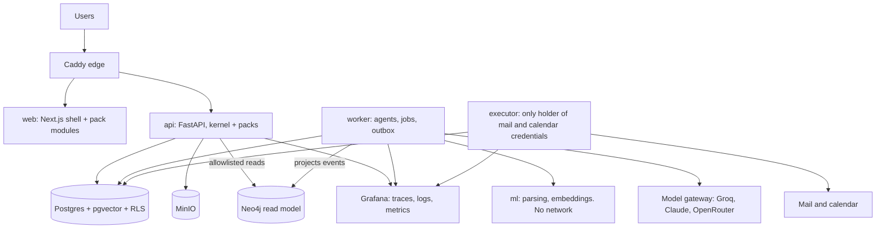

# AstraRH architecture

The short engineering reference. Full reasoning and scope: [PLAN.md](PLAN.md).

**AstraRH is one HR ecosystem, from hire to retain, on a shared trust layer.**
Golden rule from the brief: *the agent executes, the human decides about people.*

## Shape

A modular monolith, split into processes only at trust boundaries.

| Process | May | May never |
|---|---|---|
| `api` | Serve requests, record approvals | Hold mail or calendar credentials, call LLMs |
| `worker` | Run agents, create proposals | Send anything, approve anything |
| `executor` | Run approved proposals after re-checking them | Read CVs, call LLMs |
| `ml` | Parse and embed untrusted files | Reach any network |

## Data stores

| Store | Role | If it is down |
|---|---|---|
| PostgreSQL + RLS | **Only source of truth**, jobs, outbox | Platform stops, safely |
| pgvector (in Postgres) | Vector search under the same permissions | Same as Postgres |
| Neo4j | **Read model** rebuilt from events, for graph views only | Graph pages unavailable, everything else works |
| MinIO | Files | Uploads denied |

## Layers

- **Kernel** (`packages/kernel`): identity, authz, tenancy, people, trust, explain, events, jobs, ai, graph, knowledge, comms, calendar, files, notify, obs, registry.
- **Service packs** (`packages/packs/<pack>`): `talent`, `journey`, `finance`, `workforce`. Each has a manifest, its own database schema, routes, agents, evals and seed data.
- **Web** (`apps/web`): one shell, shared design system in `src/ui`, one module per pack in `src/modules/<pack>`.

## The ten invariants

Breaking one fails review. Most are enforced by code or CI.

1. **Agents propose, humans approve, the executor acts.** Only `executor` can send, book or perform an external action.
2. **Every action declares a risk class** in its pack manifest. An undeclared action cannot run.
3. **Approvals bind to a payload hash.** Editing the payload voids the approval.
4. **No explanation, no proposal.** Every R2/R3 proposal and every ranking has a `DecisionRecord`.
5. **LLMs never compute decisions or money.** Scores, payroll and forecasts are deterministic code. The LLM only narrates, and narration is validated against the numbers.
6. **Untrusted text only reaches a model with no tools.** Anything downstream gets validated structured data.
7. **Packs call models by tier through the gateway**, never a provider directly.
8. **Foreign keys point only into `core`.** Other packs are reached through `contracts.py` or events.
9. **Every table has `tenant_id` under RLS.** Neo4j is reached only through kernel query templates, and no LLM writes Cypher.
10. **Security steps fail closed.** If a check cannot run, the answer is deny.

## Risk classes

| Class | Meaning | Rule |
|---|---|---|
| R0 | Read or derive | Automatic, logged |
| R1 | Internal draft | Automatic, logged |
| R2 | Affects a person or leaves the system | Human approval bound to payload hash |
| R3 | Serious or irreversible | R2 + step-up authentication + no self-approval |

## What we will not build

Applies to every pack, for legal and ethical reasons (EU AI Act Art. 5(1)(f) and Annex III).

- Emotion or sentiment inference about workers.
- Reading private messages for HR signals.
- Webcam, keystroke or screen tracking.
- An individual "flight risk" or "conflict risk" score presented as fact.
- A map of person-to-person relationships.
- Automated decisions about people without a human approver.

## Technology

Python 3.12, FastAPI, SQLAlchemy 2, Alembic, Pydantic 2, Procrastinate, LangGraph, Docling, fastembed, Next.js, TypeScript, Cytoscape.js, PostgreSQL 17, pgvector, Neo4j Community, MinIO, OpenTelemetry, Grafana (`otel-lgtm`), Caddy, Docker Compose.
Tasks run through `python astra.py <command>`, which works the same on Windows, macOS and Linux. Exact versions are pinned in the lock files and compose file.
