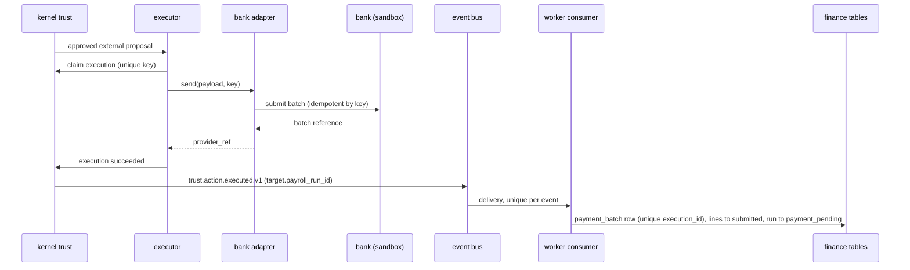

# Finance pack: payment execution and status design

Resolves the two open design points about how money leaves the system and how its result comes back. Part of the [finance documentation](FINANCE_INDEX.md). Background: [FINANCE_SYSTEM_DESIGN.md](FINANCE_SYSTEM_DESIGN.md) sections 2 and 7, and the platform rules in [ARCHITECTURE.md](ARCHITECTURE.md).

**Status: design only, nothing built.** Items tagged **[kernel]** need the kernel owner. Item 1 from the earlier list (the hire event) belongs to the kernel and `talent` owner, so it is only a request here (section 8).

## 1. What the kernel does today (verified in the code)

| Fact | Where | Consequence |
|---|---|---|
| The executor's database role can read and write only the `trust` schema (plus the event outbox it publishes through) | `ops/postgres/init/01-init.sql` | It can never update `finance.payment_line` |
| An approved external proposal is claimed, run through the adapter once, then finished as `succeeded`, `failed` or `unknown` | `kernel.trust.execute` | One adapter call per proposal, so the release must be one batch |
| The proposal's `idempotency_key` is also the execution's unique key | `trust.Execution` | A second execution of the same proposal is impossible |
| The adapter returns one `provider_ref` string, stored on the execution | `trust._finish` | Per-line outcomes cannot live there |
| `trust.action.executed.v1` is published **only on success**, carrying `proposal_id`, `action_type`, `execution_id` and the proposal's `target` | `trust._finish` | Failure and unknown outcomes produce no event |
| A timeout or any unexpected adapter error marks the execution `unknown` **immediately** | `trust.execute` | |
| `reconcile_stale` looks only at executions still `started` (a crash) and asks the adapter's lookup | `trust.reconcile_stale` | **A timed-out payment (`unknown`) is never looked up automatically.** This is a gap for payroll |
| Only `apps/executor/`, `packages/kernel/adapters/` and tests may import outbound modules | `tests/test_architecture.py` | The bank adapter must live in `kernel/adapters/`, not in the finance pack |
| Only the worker has outbound access to the LLM network, and neither worker nor api reaches the bank | compose networks | The worker cannot call the bank to read statuses |

## 2. Design principles

1. **One approved release is one batch.** A payment file for a run, with a line per payslip, goes to the bank in a single adapter call.
2. **The executor is the only process that talks to the bank**, for sending and for reading status.
3. **Outcomes travel through the event bus**, never through direct database writes from the executor into finance tables.
4. **A worker consumer owns every finance table update**, keyed by unique ids so duplicates change nothing.
5. **Never retry blindly.** Unknown means ask the bank by key, or hand to a person.
6. **Amounts are checked where the approved data is.** The executor already holds the approved payload, so it compares what the bank reports with what was approved.
7. **Events carry opaque line ids and statuses**, not names, account numbers or salary lines.

## 3. The release payload

The proposal `finance.payment.release` (R3, external, adapter `payment.release`) has:

- `target`: `{ "payroll_run_id": "<uuid>" }`. This travels in `trust.action.executed.v1`, so the worker can find the run.
- `payload`: `{ "run_id", "pay_date", "currency", "lines": [ { "line_id", "bank_ref_token", "amount", "idempotency_key" } ], "total", "line_count" }`. Lines carry opaque ids and a **vault token** for the account, never an account number.
- `idempotency_key`: `finance.payment.release:<run_id>:<release_number>`. A retry of only the failed lines is a new release with a new number and only those lines.
- The approver sees the total, the count, the pay date and the run, bound to the hash. Editing any line voids the approval.

The decision record attached to the proposal is the run's decision (inputs hash, rule versions, totals), so "why this payment" links back to the payslips.

## 4. Sending (point 2: how the result reaches finance tables)



**Worker consumer on `trust.action.executed.v1`** (filters `action_type == finance.payment.release`):
- Insert a `payment_batch` row with a **unique `execution_id`** and the `provider_ref`. A duplicate delivery hits the constraint and does nothing.
- Move the listed lines from `due` to `submitted`, and the run to `payment_pending`.
- Append an audit entry through the kernel and publish `finance.payment.submitted.v1` (run id and counts only).

This resolves point 2 without giving the executor any finance access.

## 5. Failure and unknown outcomes

Because `trust.action.executed.v1` fires only on success, the other two outcomes need their own path.

| Outcome | What happens | Who acts |
|---|---|---|
| **failed** (the bank definitely refused: `AdapterRejected`) | Proposal becomes `failed`. A worker **sweep job** finds finance release proposals in `failed`, creates a finance exception on the run, and leaves lines `due` | Worker sweep, then a finance user (E5) |
| **unknown** (timeout or unexpected error) | Proposal becomes `unknown`. **Kernel gap**: nothing looks it up. Needs the change in section 7, request K2 | Executor, once K2 exists |
| **started** (executor crashed mid-send) | `reconcile_stale` already asks the adapter lookup and settles it to `succeeded` or `unknown` | Executor, today |

**Worker sweep job** (queue `default`, every minute, per tenant): reads `trust.proposal` for finance release actions with status `failed` or `unknown`, and for each one without an open exception creates one (code `PAYMENT_RELEASE_FAILED` or `PAYMENT_RELEASE_UNKNOWN`, severity blocking, owner `finance`). It never resends and never changes line status. A person decides, and a retry is a new R3 release.

**Without K2** a timed-out release stays `unknown` until a person checks the bank manually and either confirms or creates a retry. That is safe (it cannot double pay) but manual. With K2 it resolves itself.

## 6. Status feed and reconciliation (point 3: where the status comes from)

The worker cannot reach the bank, and the executor cannot write finance tables. So status travels as events published by the executor.

```mermaid
sequenceDiagram
  participant Loop as executor loop
  participant B as bank adapter
  participant Bank as bank (sandbox)
  participant Bus as event bus
  participant W as worker consumer
  participant DB as finance tables
  Loop->>B: poll statuses for open batches
  B->>Bank: GET statuses (since cursor)
  Bank-->>B: per line status, reported amount
  B-->>Loop: statuses
  Loop->>Loop: compare with the approved payload (amounts)
  Loop->>Bus: finance.payment.status_reported.v1 per batch
  Bus->>W: delivery
  W->>DB: append payment_status_event (unique), update line status, run state, exceptions
```

**Event `finance.payment.status_reported.v1`** (published by the executor, so declared as a platform-visible contract **[kernel]**):

| Field | Meaning |
|---|---|
| `run_id`, `release_number` | Which release |
| `provider_ref` | The batch reference |
| `lines[]` | `line_id`, `status` (paid, part_paid, failed, reversed), `amount_matches` (boolean), `reason_code` for failures |
| `observed_at`, `status_seq` | Ordering and uniqueness |

No amounts and no account data in the event. The executor compares the bank's reported amount with the approved payload and sends only `amount_matches`.

**Worker consumer on `finance.payment.status_reported.v1`:**
- Inserts one `payment_status_event` per line, unique on `(provider_ref, line_id, status_seq)`, so redelivery changes nothing.
- Applies the status to `payment_line` using the allowed transitions (`submitted → paid | part_paid | failed`, `paid → reversed`, `failed → due` only by a new release). **Out-of-order events** are applied by `status_seq`, and an older one never overwrites a newer one.
- `amount_matches = false` creates a blocking exception and never marks the line paid.
- When every line of the run is `paid`, moves the run to `paid`. Any `failed`, `part_paid` or `reversed` line keeps it in `payment_pending` and raises an exception for finance.
- Unknown line ids or a batch with no matching run are parked and retried with backoff, then dead-lettered with a finance task.

**Where the executor poller lives.** A small hook in the executor loop: for every registered adapter that exposes `poll`, call it for open batches and publish what it returns. The adapter keeps a cursor in the bank (`since`) and the executor stores nothing finance-specific. This is request K3.

## 7. The sandbox bank

For the demo the "bank" is a small deterministic service, not a real provider.

| Aspect | Design |
|---|---|
| Form | A tiny HTTP container on its own internal network, reachable only from the executor (like Mailpit for mail) **[kernel: ops change, request K4]** |
| Endpoints | `POST /batches` (idempotent on the key, returns a batch reference), `GET /batches/{key}` (lookup for reconciliation), `GET /statuses?since=` (status feed) |
| Outcomes | Deterministic and configured by seed data: most lines `paid`, one `failed` with a reason, optionally one `part_paid` and one `reversed` later. Same input gives the same outcomes, so the demo and tests are repeatable |
| Destinations | An allowlist of sandbox account tokens. Anything else is `AdapterRejected` and audited |
| Idempotency | The same key returns the same batch reference and never creates a second batch |
| Honesty | The screen says "sandbox bank". A real provider is a production swap behind the same adapter interface |

Fallback if K4 is declined: a stateless simulator inside the adapter that derives outcomes from the key. It cannot answer "did this send happen?", so timeout reconciliation cannot be demonstrated honestly, and we would say so.

## 8. Contract requests (what to send to the kernel owner)

| # | Request | Why | Fallback |
|---|---|---|---|
| **K1** | Emit `talent.candidate.hired.v1` from `talent` (**not the finance owner's job**) | Starts the chain | Finance consumes `talent.application.stage_changed.v1` where `to_stage` is `hired` |
| **K2** | Make `reconcile_stale` (or a sibling) also look up executions left `unknown` after a timeout, using the adapter lookup, and settle them `succeeded` when found | Today a timed-out payment is never auto-checked | Manual review of `unknown` releases |
| **K3** | Add an adapter `poll` hook to the executor loop that publishes returned events | The worker cannot reach the bank | Manual status entry by finance (weaker, loses the live demo) |
| **K4** | Add the sandbox bank container, network and allowlist to `ops/compose*.yaml`, and register adapter `payment.release` in `kernel/adapters/__init__.py` | The bank adapter must live in the kernel adapters folder, outbound access is the executor's only | Stateless in-adapter simulator (see section 7) |
| **K5** | Add a `finance` queue to `kernel.jobs.WORKER_QUEUES` | Calculation and the sweep job run on a durable queue | Run on `default` |
| **K8** | **Fixed on `finance-v1` (2026-11-01), at the owner's request:** `01-init.sh` became `01-init.sql`, verified identical. Originally: make the Postgres init step work on Docker Desktop for Mac, where the mounted `01-init.sh` is treated as executable and fails with `bad interpreter: Permission denied` (see [FINANCE_RUNBOOK.md](FINANCE_RUNBOOK.md) section 3) | A fresh clone on macOS cannot start without a manual step | Feed the script through standard input as the runbook describes |
| **K9** | **The API database role cannot insert into `trust.proposal`; only the worker can.** A person-initiated proposal over HTTP fails with `permission denied for table proposal`. Verified on 2026-10-31 with `has_table_privilege` and by running the request path. The existing talent endpoint `POST /packs/talent/applications/{id}/reject` has the same defect, and its test hides it by proposing as the worker. Grant `INSERT` on `trust.proposal` to `astra_api` (the tenant policy already covers it), or give people another way to propose | Every finance action a person starts (activate a rule set, activate an engagement, submit or release payroll) is a proposal. Without this none works over HTTP | Finance creates proposals from the worker side in tests. The HTTP endpoint test is marked as an expected failure and flips when the kernel is fixed |
| **K7** | Let packs declare plain event consumers in the manifest, wired like agents | `kernel.events.subscribe` exists but the registry only wires agents and graph projections, so a pack's consumer is never registered in the worker | A non-LLM agent entry per consumer |
| **K10** | Confirm the shape of an employee-scoped role grant for self-service payslips | Employees see only their own payslip | The kernel already supports scoped grants; only the shape needs confirming |
| **K11** | Event envelope extras (`correlation_id`, `idempotency_key`) | The interface spec asks for them | Carry them in finance payload fields |
| **K12** | Optional kernel document-checklist helper | The spec has a document stage | Keep `document_ref` inside finance |
| **K6** | Publish `trust.action.executed.v1` equivalents for `failed` and `unknown` outcomes, or confirm the sweep job approach | Avoids polling the proposal table | Sweep job (section 5) |

### 8.1 Status of each request against `main` (checked 2026-11-01, after rebasing onto `63529ca`)

| Request | Status on `main` | Note |
|---|---|---|
| K1 hire event | Open | No `talent.candidate.hired.v1` anywhere in the code |
| K2 look up `unknown` executions | Open | `trust` and the executor are unchanged |
| K3 executor poll hook | Open | Unchanged |
| K4 sandbox bank and adapter | Open | Unchanged |
| K5 `finance` queue | Open | `WORKER_QUEUES` is still `["default", "agents"]` |
| K6 events for failed or unknown executions | Open | Unchanged. The sweep job is the default |
| K7 pack event consumers | **Open, with a known pattern** | Packs are wired by importing their module in `apps/worker/main.py` (`talent` does it, and the kernel does it through `install_kernel_consumers`). Finance can do the same with one import line there, which is a kernel-owner file. The manifest `consumers:` section is still the cleaner fix |
| K8 macOS init script | **Fixed on `finance-v2`** | `main` still has `01-init.sh`. Needs review and merge by the kernel owner |
| K9 API cannot insert proposals | Open | Verified again: `has_table_privilege('astra_api','trust.proposal','INSERT')` is false |
| K10 to K12 | Open | Small confirmations |

New on `main` that finance can reuse: periodic worker tasks (the daily digest and the talent sweep run as scheduled Procrastinate tasks in `apps/worker/main.py`), which is the pattern for finance's `ending_soon` and failed-payment sweep jobs, and the new kernel `comms`, `calendar` and `knowledge` modules.

**Message for the kernel owner (ready to send):**

> Finance needs a few kernel changes. Two are bugs that affect more than finance.
> **K9 (bug, also breaks talent):** the `astra_api` role has no INSERT on `trust.proposal`, so any proposal a person starts over HTTP fails with `permission denied for table proposal`. `POST /packs/talent/applications/{id}/reject` hits this too; its test proposes as the worker, which hides it. Granting INSERT to `astra_api` (the tenant policy already covers it) would fix both.
> **K8 (fixed on `finance-v1`, please review):** on Docker Desktop for Mac, `ops/postgres/init/01-init.sh` failed with `bad interpreter: Permission denied`, so a fresh clone never got its roles. It is now `ops/postgres/init/01-init.sql` (psql `\getenv` for the passwords, same SQL). Verified identical to the old result on a fresh database; details in `docs/FINANCE_RUNBOOK.md` section 3.
> **K7:** packs cannot register plain event consumers; please add a manifest `consumers:` section wired like agents.
> **K2:** let `reconcile_stale` also resolve executions left `unknown` by a timeout. **K3:** an adapter `poll` hook in the executor loop. **K4:** a sandbox bank container on an executor-only network plus adapter `payment.release` (we will write both). **K5:** a `finance` job queue. **K6:** confirm whether failed and unknown executions should publish events, or whether we sweep the proposal table.
> **K1** is yours: please emit `talent.candidate.hired.v1`. K10 to K12 are small confirmations. Details in `docs/FINANCE_PAYMENT_DESIGN.md` section 8.

## 9. Test plan for this design

| Test | Expectation |
|---|---|
| Approve then edit a release payload | Approval void |
| Release approved twice | One adapter call, one batch |
| Bank refuses a destination | Proposal `failed`, finance exception, lines stay `due` |
| Adapter times out | Execution `unknown`, exception raised, no automatic resend |
| Timeout then bank confirms (with K2) | Execution settles `succeeded`, consumer moves lines to `submitted` |
| Executor crash after the bank accepts | `reconcile_stale` finds the batch, no second batch |
| Duplicate `trust.action.executed.v1` | One `payment_batch` row |
| Duplicate and out-of-order status events | One row per status, newest wins |
| Bank reports a different amount | `amount_matches = false`, blocking exception, line not paid |
| One failed line, then a retry release | New release number, only that line, original failure kept |
| Status for an unknown line id | Parked, retried, dead-lettered with a task |
| Event payload inspection | No names, account tokens, salaries or amounts in any finance payment event |
| Role check | Executor role cannot read or write any `finance` table |

## 10. Open points

- Whether K6 should be an event or a sweep. The sweep works without a kernel change, so it is the default.
- Whether bank account tokens come from a real vault or a seed table for the demo.
- Whether per-line amounts stay in the proposal payload (they are in the trust ledger, which the executor already reads) or only totals plus line ids go there and amounts are fetched from finance by the approver's screen. Keeping amounts in the payload is simpler and is what the hash binds, so the design assumes it.
