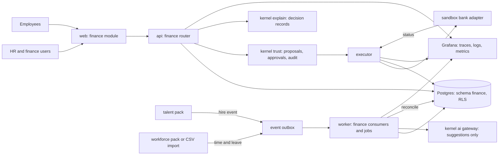
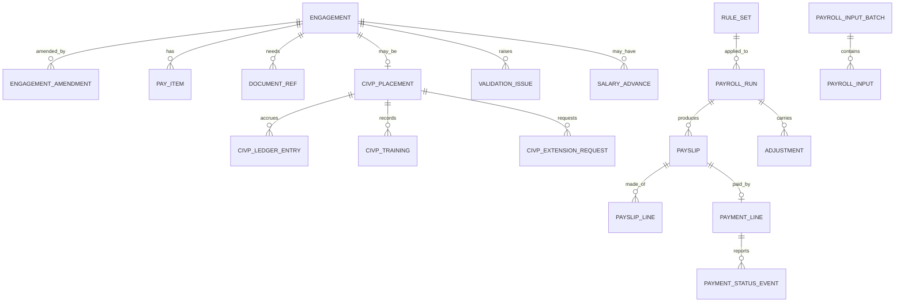
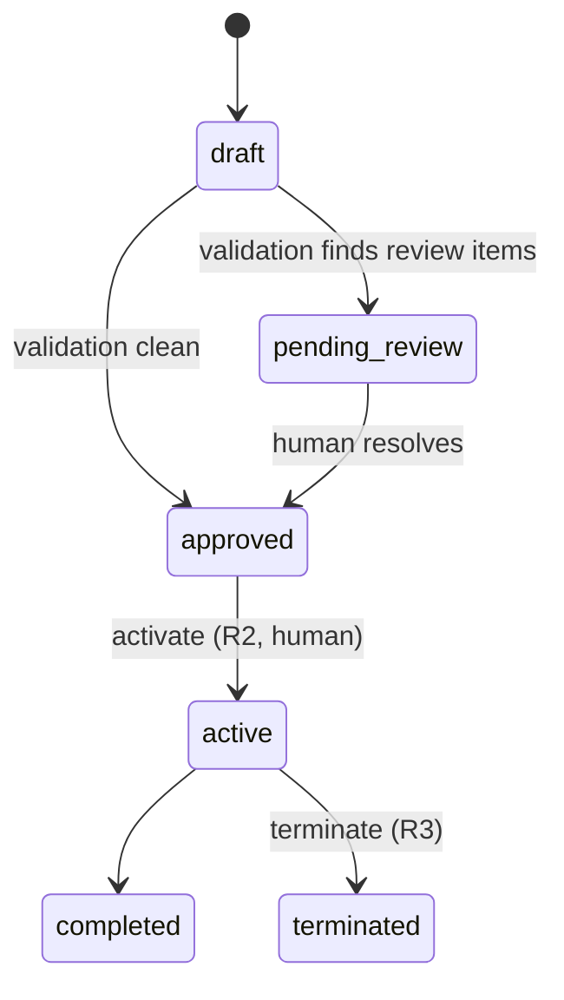
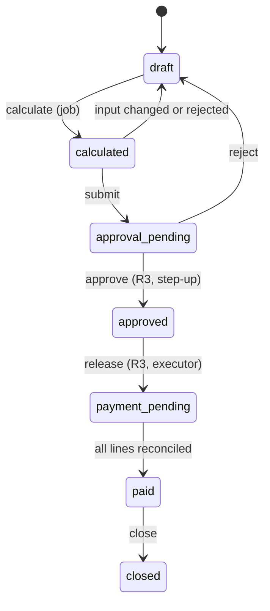
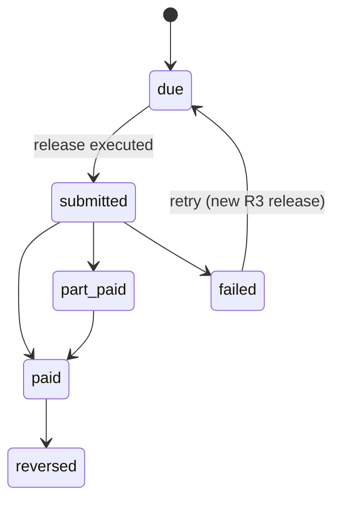
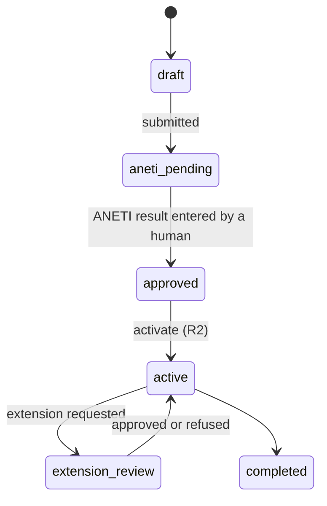
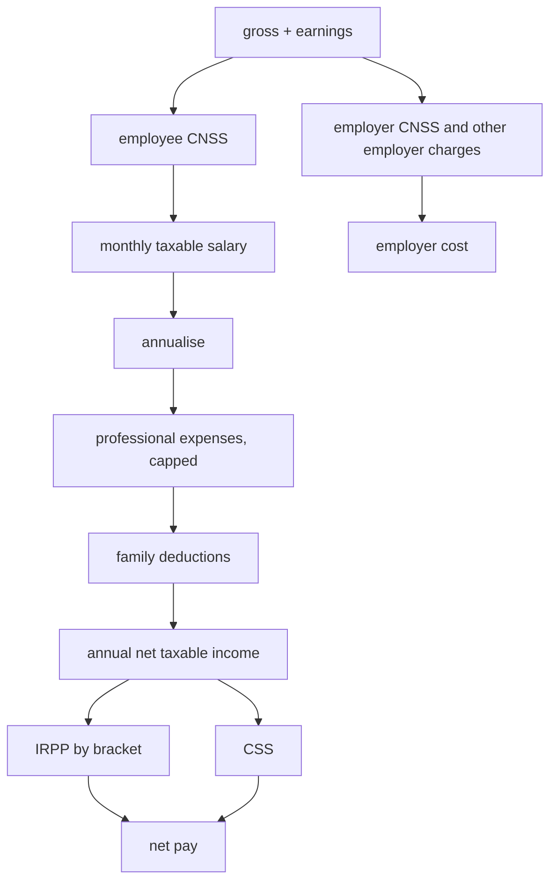
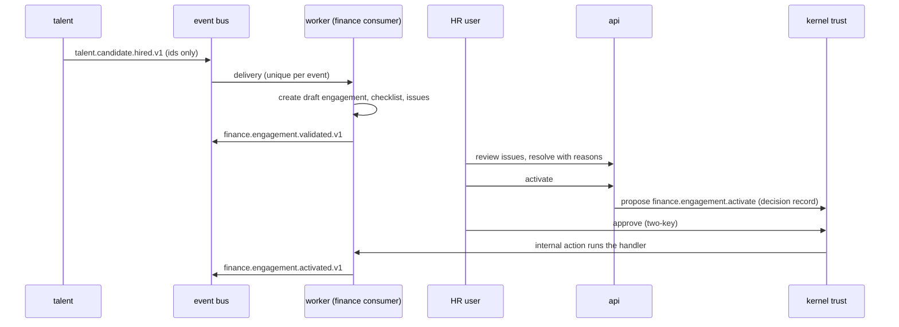
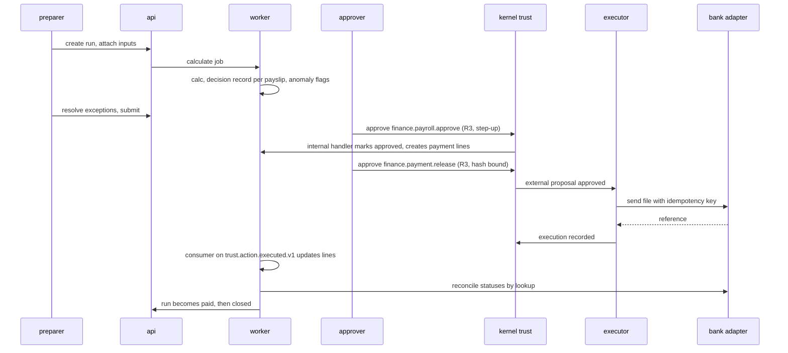

# Finance pack: system design

How the finance pack is built and how it fits AstraRH. What it does is in [FINANCE_FEATURES.md](FINANCE_FEATURES.md) and [FINANCE_USE_CASES.md](FINANCE_USE_CASES.md). Decisions and rules are in [FINANCE_PLAN.md](FINANCE_PLAN.md). Platform background is in [ARCHITECTURE.md](ARCHITECTURE.md).

Most of this is **design**; sections 4.1 and 8.1 list what is built. As of 2026-11-01 the kernel also has `comms`, `calendar` and `knowledge` modules (from `main`). Items marked **[kernel]** need a change or confirmation from the kernel owner. Items marked **[verify]** depend on a legal value that is not verified.

## 1. Context



The finance pack owns engagements, payroll, CIVP records, rule sets and payment lines. It does **not** own identity, files, tasks or the approval engine. It reads those through the kernel.

## 2. Process responsibilities

| Process | Finance work it does | It must never |
|---|---|---|
| `api` | Serve finance routes, record approvals through the kernel, run the calculator. It **cannot create proposals yet** (kernel request K9) | Hold bank credentials, call a model |
| `worker` | Consume events, calculate runs as jobs, apply approved **internal** actions, reconcile payments from execution results, run the reader and explainer through the gateway | Release payment, approve anything |
| `executor` | Run the approved **external** `finance.payment.release` through the bank adapter, reconcile by lookup | Read payroll tables, call a model |
| `ml` | Parse contract documents in a sandbox (A7) | Reach a network |

**Consequence of the database roles.** The executor can read only the `trust` schema, so it cannot update `finance.payment_line`. It returns a bank reference and the result lands on the execution record. A **worker consumer** of `trust.action.executed.v1` then updates the payment lines. Later bank status messages are read by a worker reconciliation job through the adapter lookup **[kernel: the lookup belongs with the executor, so a status feed needs a decision]**.

## 3. Module layout (planned)

```
packages/packs/finance/
  manifest.yaml            actions, agents, events, UI, status
  models.py                SQLAlchemy models, schema finance
  events.py                versioned event models
  contracts.py             what other packs may import
  api.py                   routes
  service/                 engagements, inputs, runs, payments, civp, rules
  payroll/
    calc.py                pure calculation, no database, no model
    rules.py               rule-set loading, validation, hashing
    anomalies.py           deterministic anomaly checks
    scorer.py              registers finance.payroll with kernel explain
  validation/              engagement and input validators
  handlers.py              effects of approved internal actions
  consumers.py             event consumers (hire, inputs, execution results)
  agents/                  contract reader, flag explainer (via gateway)
  adapters/                sandbox bank (see C2)
  seed.py  load_demo.py
  migrations/versions/     Alembic branch "finance", then an RLS revision
  evals/                   replay, narration, extraction checks
data/demo/finance/         fictional seed data
apps/web/src/modules/finance/  pages for the screens in the plan
tests/test_finance_*.py
```

Boundary tests carried over from the platform apply: the pack imports only `kernel.*` public APIs and other packs' `contracts.py`, `calc.py` imports no table or model client, and only the executor imports the bank adapter.

## 4. Data model

Every table has `id` (UUIDv7), `tenant_id` under RLS and `created_at`. Foreign keys point only into `core`. Money is `Numeric(18,3)` in TND. Rates are `Numeric(9,6)`.



Columns by table (types shortened):

| Table | Key columns and constraints |
|---|---|
| `engagement` | `employee_id` (core.employee), `type` CDI/CDD/CIVP, `status`, `starts_on`, `ends_on`, `job_title`, `work_location`, `weekly_hours`, `cdd_reason_code`, `external_request_id` **unique per tenant**, `source_event_id` unique, `linked_engagement_id` (CIVP to CDI) |
| `engagement_amendment` | `engagement_id`, `field`, `old_value`, `new_value`, `effective_from`, `actor_id`, `reason`, `proposal_id` |
| `pay_item` | `engagement_id`, `code`, `amount`, `currency`, `frequency`, `valid_from`, `valid_to`. Non-overlapping per code |
| `document_ref` | `employee_id`, `engagement_id`, `doc_type`, `file_key` (the MinIO key from `kernel.files`, no foreign key), `verification_status`, `verified_by`, `verified_at` |
| `validation_issue` | `entity_type`, `entity_id`, `code`, `severity`, `field`, `message`, `next_action`, `owner_role`, `resolved_by`, `resolved_at`, `resolution_reason` |
| `civp_placement` | `engagement_id`, `aneti_reference`, `approval_status`, `participant_category`, `starts_on`, `ends_on`, `training_hours_limit` (nullable), `status` |
| `civp_ledger_entry` | `placement_id`, `month`, `payer` aneti/employer, `due_amount`, `paid_amount`, `status`, `payment_ref`. Unique `(placement_id, month, payer)` |
| `civp_training` | `placement_id`, `date`, `hours`, `topic`, `recorded_by` |
| `civp_extension_request` | `placement_id`, `requested_end`, `reason`, `status`, `decided_by` |
| `incentive` | `engagement_id`, `kind`, `starts_on`, `ends_on`, `covered_contribution_rate`, `confirmed_by`, `evidence_ref` |
| `rule_set` | `kind`, `jurisdiction`, `version`, `status`, `valid_from`, `valid_to`, `source_ref`, `is_demo`, `definition` (JSONB), `definition_hash`, `approved_by`. No overlap among active sets of one kind |
| `employer_profile` | `legal_entity`, `sector`, `regime_id`, identifiers, sector rates reference |
| `payroll_input_batch` | `source`, `period`, `status`, `received_event_id`, `file_sha256` |
| `payroll_input` | `batch_id`, `employee_id`, `kind`, `quantity`, `amount`, `effective_date`, `source_event_id` **unique**, `status` |
| `payroll_run` | `external_request_id` unique, `period_start`, `period_end`, `pay_date`, `regime_id`, `status`, `rule_set_refs`, `input_batch_refs`, `inputs_hash`, `results_hash`, `calculated_at`, `prepared_by`, `last_edited_by` |
| `payslip` | `run_id`, `employee_id`, `engagement_id`, `gross`, `employee_deductions`, `income_tax`, `net_pay`, `employer_cost`, `status`, `decision_record_id` |
| `payslip_line` | `payslip_id`, `code`, `label`, `base`, `rate`, `amount`, `kind`, `rule_ref`, `position` |
| `adjustment` | `run_id`, `employee_id`, `origin_run_id`, `amendment_id`, `code`, `amount`, `reason` |
| `salary_advance` | `engagement_id`, `amount`, `monthly_recovery`, `balance`, `status`, `approved_by` |
| `payment_line` | `run_id`, `payslip_id`, `amount`, `status`, `bank_ref_token`, `idempotency_key` **unique**, `proposal_id`, `execution_id` |
| `payment_status_event` | `payment_line_id`, `status`, `provider_ref`, `amount`, `received_at`. Append-only |
| `ai_suggestion` | `task`, `document_ref_id`, `field`, `value`, `confidence`, `evidence`, `status`, `confirmed_by`, `confirmed_at` |

**Integrity rules enforced in the database:** see section 4.1 for what is actually built. Overlap checks are in the service layer, not exclusion constraints.

### 4.1 What is built (2026-10-31)

Migrations on the `finance` branch: `3e65e32a7d91` (20 tables) and `finance_0002` (security). Models are in `packages/packs/finance/models.py`. Tests are in `tests/test_finance_schema.py`.

| Built | Detail |
|---|---|
| 21 tables | `employer_profile`, `engagement`, `engagement_amendment`, `pay_item`, `document_ref`, `validation_issue`, `civp_placement`, `civp_ledger_entry`, `civp_training`, `civp_extension_request`, `rule_set`, `payroll_input_batch`, `payroll_input`, `payroll_run`, `payslip`, `payslip_line`, `adjustment`, `payment_batch`, `payment_line`, `payment_status_event`, and `hire_notice` (added 2026-11-01, migration `d99850d16682`) |
| Row-level security | On all 21, enforced by the shared `enable_rls` policy. A test compares the database's own list with the models |
| Role permissions | The executor has no access to the schema. The API can only read payslips, payment batches, lines and bank statuses. Only the worker writes bank statuses, insert and read only |
| Rule sets (`finance_0003`) | A new rule set must be a draft, except when inserted by the owner role (migrations and seed). Once active, its content never changes, for any role, owner included. Status moves only `draft → active → superseded`. Only drafts can be deleted. The service also refuses an active rule set whose content no longer matches its approved hash, so calculation stops instead of using tampered rules |
| Runs (`finance_0003`) | A new run must be a draft (owner excepted). Status follows `draft ⇄ calculated → approval_pending → approved → payment_pending → paid → closed`, with `approval_pending → draft` for a rejection. Moving to `approved`, `payment_pending`, `paid` or `closed` is reserved to the worker, which applies approved actions |
| Append-only | `payment_status_event` rejects update and delete, even from the owner role (trigger) |
| Frozen when submitted | Once a run is `approval_pending`, `approved`, `payment_pending`, `paid` or `closed`, its payslips and lines cannot be inserted, changed, deleted or moved to another run or payslip (`finance_0003`). Rejecting returns it to `draft` first |
| Closed runs | A `closed` run cannot be updated, and only a `draft` run can be deleted |
| Uniqueness | `external_request_id` and `source_event_id` per tenant on engagements, `source_event_id` on inputs, one ledger row per placement, month and payer, one payment line per payslip, unique idempotency key, unique execution per payment batch |

Differences from the design above, and why:
- **No exclusion constraints.** Overlap checks for pay items and rule sets need the `btree_gist` extension, which the database does not install. They are enforced in the service layer and tested there instead. `pay_item` has a unique key on engagement, code and start date.
- **`document_ref` stores a `file_key`**, the MinIO key, because the kernel has no file table to reference.
- **Not built yet:** `ai_suggestion` (AI is paused, decision D14), `salary_advance`, `incentive` and the cost-intelligence tables (slice S5 and S4).
- **Family data lives on the engagement** (`head_of_family`, `children`) until the kernel holds it on the employee, so payroll has what the formula needs.
- **Column-level limits** such as "only the worker may set an engagement's status to active" are enforced in the application and its tests, not by database grants.

## 5. State machines









Rule sets move `draft → active → superseded` (decision D15). Tests are run on demand and re-checked at activation, and the database refuses any other move. Status and outcome are separate everywhere: **calculated, approved and paid are three different facts.**

## 6. The calculation core

**Contract.** `calc.payslip(engagement_terms, inputs, rules, month) -> Payslip` is a pure function. No database, no clock, no randomness, no model.

**Sequence of a payslip** (full order and the current demo values are in the plan, section 8.1):



- **Rounding:** unrounded `Decimal` internally, half-up to the millime once per displayed line. The rule set names the method.
- **Explainability:** `finance.payroll@1` is registered with the kernel explain module. A payslip is a decision whose factors are signed lines (weight +1 for earnings, −1 for deductions), so the factors sum exactly to net pay and `verify` replays it. Employer cost is stored as a separate figure because it is not part of net.
- **Inputs hash:** a canonical hash of terms, inputs and rule hashes. The run stores it, so a replay detects any change.
- **Adjustments** enter as signed lines tied to their origin run, so a closed run never changes.
- **Failure behaviour:** a failure for one employee becomes an exception on that payslip and the run continues for the others. No rule set for the month refuses the whole run.

## 7. Key sequences

**Hire to active engagement**



**Payroll to payment**



**Provider timeout.** The executor marks the execution `unknown` and nothing resends. **Correction:** today the kernel only looks up executions left `started` by a crash, not ones marked `unknown` after a timeout, so resolving a timeout automatically needs kernel change K2. Until then a person confirms with the bank. Either way a lost reply never causes a second payment. Full design, including status events and the sandbox bank, is in [FINANCE_PAYMENT_DESIGN.md](FINANCE_PAYMENT_DESIGN.md).

## 8. API reference (planned)

Base path `/api/packs/finance`. Standard cookie session, CSRF header on writes, `{error, message}` errors, tenant from the session. Roles use the access matrix in section 10.

| Group | Routes |
|---|---|
| Calculator | `POST /calculator/net` (inputs, returns lines, totals, rule refs), `POST /calculator/compare`, `POST /calculator/gross-from-net` |
| Engagements | `POST /employees/{id}/engagements`, `GET /engagements`, `GET /engagements/{id}`, `PATCH /engagements/{id}` (amendment), `POST /engagements/{id}/validate`, `POST /engagements/{id}/activate`, `POST /engagements/{id}/terminate`, `GET /engagements/{id}/issues`, `POST /issues/{id}/resolve` |
| Documents | `GET /engagements/{id}/documents`, `POST .../documents` (reference), `POST /documents/{id}/verify`, `GET /suggestions`, `POST /suggestions/{id}/confirm`, `POST /suggestions/{id}/reject` |
| CIVP | `POST /engagements/{id}/civp`, `GET .../civp`, `POST .../civp/eligibility`, `POST .../civp/activate`, `POST .../civp/payments`, `POST .../civp/training`, `POST .../civp/extension-requests`, `POST .../civp/complete`, `POST .../civp/convert-to-cdi` |
| Inputs | `POST /input-batches` (CSV upload), `GET /input-batches/{id}`, `GET /input-batches/{id}/rejections` |
| Runs | `POST /payroll-runs`, `GET /payroll-runs`, `GET /payroll-runs/{id}`, `POST .../calculate`, `GET .../results`, `GET .../exceptions`, `POST .../submit`, `POST .../close`, `GET .../compare/{other}` |
| Payslips | `GET /payslips/{id}`, `POST /payslips/{id}/verify`, `GET /me/payslips`, `GET /me/payslips/{id}` |
| Payments | `GET /payroll-runs/{id}/payments`, `POST .../payments/release` (creates proposal), `POST /payments/{id}/resolve` |
| Rules | `GET /rule-sets`, `POST /rule-sets`, `POST /rule-sets/{id}/test`, `GET /rule-sets/{id}/impact`, `POST /rule-sets/{id}/activate` (proposal) |
| Cost | `GET /cost/dashboard`, `POST /cost/forecast`, `POST /cost/scenarios`, `GET /cost/attrition` |
| Employer | `GET /employer`, `PUT /employer` |

Approve and reject for any proposal use the kernel trust routes, not new ones. Validation responses use the field-level issue shape from the interface spec.

### 8.1 What is built (2026-10-31)

Router `packs.finance.api` is mounted under `/packs/finance` through the manifest. Code is in `service.py`, `handlers.py` and `api.py`. Tests are in `tests/test_finance_rules_api.py`.

| Route | Roles | Status |
|---|---|---|
| `POST /calculator/net` | admin, finance, hr, auditor | Built. Gross to net under the active rule set for a date. Amounts are returned as strings. Nothing is stored |
| `POST /calculator/compare` | same | Built. Up to 6 scenarios |
| `GET /rule-sets`, `GET /rule-sets/{id}` | same | Built. The list hides definitions |
| `POST /rule-sets` | admin, finance | Built. Saves a draft |
| `POST /rule-sets/{id}/test` | same as reading | Built. Runs the hand-checked examples |
| `POST /rule-sets/{id}/activate` | admin, finance | Built, but **blocked over HTTP by kernel request K9** (the API role cannot create the proposal). Works when the proposal is created by the worker, which the tests do |

Action `finance.rules.activate` (R3, internal) is declared in the manifest and registered in the action catalogue. Its handler re-checks everything when it runs.

**Engagement routes (2026-11-01)**, details in [FINANCE_ENGAGEMENTS.md](FINANCE_ENGAGEMENTS.md): `POST /employees/{id}/engagements`, `GET /engagements`, `GET /engagements/{id}`, `POST /engagements/{id}/pay-items`, `POST /engagements/{id}/validate`, `GET /engagements/{id}/issues`, `POST /issues/{id}/resolve`, `GET` and `POST /engagements/{id}/documents`, `POST /documents/{id}/review`, `POST /engagements/{id}/activate` and `/amendments` (both blocked over HTTP by K9), `GET /hire-notices` and `POST /hire-notices/{id}/engagement`. Actions `finance.engagement.activate` and `finance.engagement.amend` (both R2, internal) are registered. The engagement and pay guards are in migration `finance_0004`.

## 9. Event catalogue (planned)

Models live in `events.py`, named `<pack>.<entity>.<verb>.v1`. **Payloads carry IDs, status and the totals a consumer needs, never salary lines, bank details or identity.**

| Event | Key fields | Consumers |
|---|---|---|
| `finance.engagement.validated.v1` | engagement_id, status, issue_counts | HR task creation |
| `finance.engagement.activated.v1` | engagement_id, employee_id, type, starts_on | journey, workforce |
| `finance.engagement.amended.v1` | engagement_id, effective_from | payroll adjustments |
| `finance.engagement.ending_soon.v1` | engagement_id, ends_on | HR task |
| `finance.civp.activated.v1` | placement_id, engagement_id, starts_on | HR |
| `finance.civp.payment_due.v1` | placement_id, month, payer | finance task |
| `finance.civp.payment_reconciled.v1` | placement_id, month, payer, status | finance |
| `finance.civp.completed.v1` | placement_id, engagement_id | HR |
| `finance.payroll.calculated.v1` | run_id, employees, exceptions | approver |
| `finance.payroll.approved.v1` | run_id, totals only | payment preparation |
| `finance.payroll.rejected.v1` | run_id | preparer |
| `finance.payment.reconciled.v1` | run_id, paid, failed counts | finance |
| `finance.payroll.closed.v1` | run_id | reporting |
| `finance.forecast.published.v1` | org_unit_id, month, delta | dashboard |

**Consumed:** `talent.candidate.hired.v1` (built: it becomes a hire notice), `trust.action.executed.v1`, `workforce.leave.approved.v1`, `journey.skill_gap.confirmed.v1`, `journey.training.completed.v1`.

**Handling rules for every consumer:** write keyed by the event id under a unique constraint, so a duplicate changes nothing. A write that depends on a missing parent raises so the bus retries with backoff and finally dead-letters with a finance task. Payload hashes are compared on replay.

## 10. Security design

**Access matrix** (✓ full, T totals only, S own records only, · none).

| Data | admin | finance | hr | manager | employee | auditor |
|---|:-:|:-:|:-:|:-:|:-:|:-:|
| Payslip lines and salaries | ✓ | ✓ | T | · | S | read |
| Engagements and documents | ✓ | ✓ | ✓ | · | S | read |
| CIVP records | ✓ | ✓ | ✓ | · | S | read |
| Rule sets | ✓ | ✓ | read | · | · | read |
| Run approval and payment release | · | ✓ | · | · | · | · |
| Rule activation | ✓ | ✓ | · | · | · | · |
| Audit and decision records | ✓ | read | read | · | S | ✓ |

Admin cannot approve payroll on their own: the two-key check needs the finance role. Employee access uses a scoped grant on the employee id. Any request for another employee's record returns 404 and writes an audit entry.

**Threats and mitigations**

| Threat | Mitigation |
|---|---|
| Altered payload after approval | Payload hash bound to the approval, edit voids it |
| Self-approval | Kernel refuses on R3 for the requester and last editor |
| Double payment | Idempotency key per line, provider called once, lookup on timeout |
| Fake or tampered audit | Hash chain with verify, insert-only table |
| Prompt injection in a contract | Reader with no tools, quoted evidence checked against the file, suggestions unconfirmed |
| Wrong AI numbers in explanations | Narrative validator rejects numbers not in the record |
| Cross-tenant leakage | RLS on every table, tested |
| Salary or bank data in events, logs or the graph | Payload tests, spans carry hashes only, graph projections exclude finance |
| Rule tampering | Versioned rule sets with hash, R3 activation, history kept, past runs replay on their own version |
| Malicious CSV | Upload gate (type, size, parse timeout), row validation |
| Executor compromise | It reads `trust` only, destination allowlist, no model access |
| Silent fallback to defaults | Fail closed: missing rule, approval or hash means deny |

## 11. Observability

OpenTelemetry spans for calculation, import, release, reconciliation and consumers, with attributes for run id, counts and rule-set hash and **never amounts or identities**. Planned metrics: `finance_runs_total{status}`, `finance_calc_seconds`, `finance_payments_total{status}`, `finance_unreconciled_lines`, `finance_import_rejections_total`, `finance_events_parked_total`, `finance_stale_approvals`. A Grafana "Finance operations" dashboard shows run state, queue depth, reconciliation backlog and failed payments.

## 12. Configuration

| Setting | Purpose | Where |
|---|---|---|
| Active rule sets | Rates, brackets, deductions | `finance.rule_set`, not environment |
| Payment allowlist | Permitted sandbox destinations | environment, read by the executor |
| Sandbox bank outcomes | Which lines fail in the demo | seed data |
| Anomaly thresholds | Net change percentage and others | rule set `anomaly` section |
| Import limits | File size and row cap | environment |
| Step-up window and approval lifetime | Existing kernel settings | kernel |

## 13. Testing strategy

| Layer | What | How |
|---|---|---|
| Unit | Calculation lines, rounding, brackets, proration | Hand-checked examples, parametrised, no database |
| Property | Net never above gross, monotonic tax, deterministic output | Generated cases |
| Invariants | No `float` in the pack, `calc.py` imports nothing impure, events free of sensitive fields | Static and payload tests |
| Integration | Engagement flow, run lifecycle, payment release and reconciliation, CIVP ledger | Real Postgres with real roles, throwaway tenants |
| Trust path | Edited payload voids approval, self-approval denied, duplicate release, crash after send | Same patterns as the existing trust tests |
| Security | Role matrix, RLS, step-up expiry, cross-employee access | API tests with scoped users |
| AI | Extraction evidence exists, injected PDF ignored, wrong narration rejected | Evals in `evals/` |
| Replay | Every payslip recalculates to the same digits, including after a rule change | Verify endpoint plus tests |
| End to end | Hire to payment in a browser | The demo beat as a script |

Test data is fictional and uses the shared Carthage Demo Systems world. Worked examples (three payslips, one CIVP month, one forecast) are calculated by hand first and become the tests.

## 14. Risks and open design points

| Item | Note |
|---|---|
| Hire event | Built on `finance-v2` (talent action and event, finance hire notice), for the kernel owner to review |
| **[kernel]** Bank adapter and status feed live outside the pack | Sandbox adapter proposed with the pack, owner decides placement |
| **[kernel]** Executor cannot write finance tables | Worker consumer updates lines from execution results |
| **[kernel]** `WORKER_QUEUES` needs a finance queue | Run calculation inline for demo size otherwise |
| **[verify]** All rates, brackets, deductions, CIVP amounts and limits | Reviewed demo data until checked against official text |
| Scope breadth | Slices S1 to S5 let us stop at any point with a working product |
| macOS setup | Done, with one workaround for the database init script (see the runbook and K8) |
