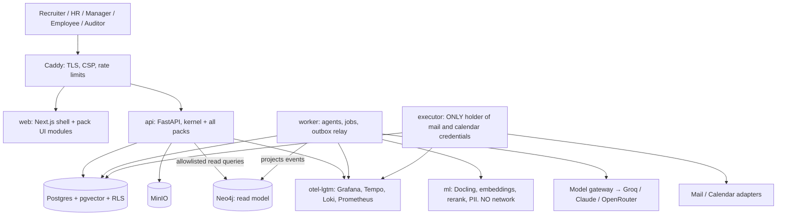

# Secure AI HR ecosystem: platform, service packs and team plan

Product name: **AstraRH**. Sources: `hackathon-bool.pdf`, `report/secure-ai-hr-solutions.md`, Horilla `2.0` branch code, Groq and Grafana docs.

## 1. Context

**What I understood you want.** The brief's six axes are one job: hiring plus inbox and policy answers. You will own all of them. Your team adds what happens after the hire, because losing a new hire costs more than recruiting one:
- **Wassim:** onboarding, follow-up, skill gaps, training tied to KPIs.
- **Finance owner:** payroll and financial forecasting.
- **Workforce owner:** workforce tracking, conflict management, and UI/design.

You want a real foundation built first, so each person branches from it, builds with a coding agent, and merges without breaking the others.

**My opinion: the idea is right, and it is also the winning pitch.** Most teams will demo a CV screener. "Hire to retain on one trust layer" is a product. Three adjustments:

1. **Two of the six axes aren't recruitment.** Employee Questions and the inbox digest serve every service. They become shared platform capabilities, still yours to build, which Wassim's and others' services reuse.
2. **The real risk is depth.** There are 15 hours left. The brief judges recruitment and security, so that must be deep and reliable. Each other service ships **one complete vertical slice**, not a wide module. Unfinished services must degrade cleanly, not break the demo.
3. **The new services carry legal and ethical risk**, and judges will probe it. Workplace monitoring, performance evaluation and task allocation are high-risk under EU AI Act Annex III. Inferring emotions at work is prohibited (Art. 5(1)(f)). So there is no sentiment reading of messages, no webcam or keystroke tracking, and no individual "flight-risk score" shown as fact. The golden rule extends to every service.

**The argument for the pitch:** cost per hire is about $4,700, and replacing an employee costs 33–200% of salary. Those numbers come from blogs quoting SHRM and similar sources, so open the originals before putting them on a slide.

## 2. Decisions

| Decision | Choice | Why |
|---|---|---|
| Horilla | **Not a base and not a connector. Feature inspiration only** | See §3 |
| Architecture | **Modular monolith + 4 processes split only at trust boundaries** | Microservices across 4 people in 15 h means integration failure. Boundaries are enforced by CI, so packs can be extracted later |
| Extension model | **Service packs** on a shared **trust kernel** | Each teammate gets isolated folders, schema, routes and UI |
| Backend | Python 3.12, FastAPI, SQLAlchemy 2, Alembic, Pydantic 2 | Team's choice |
| Frontend | Next.js + TypeScript, typed client generated from OpenAPI | Team's choice |
| Source of truth | PostgreSQL 17 + RLS, MinIO for files | One authoritative store for relational data, full-text and job queue |
| Vector database | **pgvector inside Postgres, not Qdrant** | Permissions and vector search run in one query under RLS, so nothing can drift out of sync or fall open. Our volume (tens of thousands of chunks) is well within range. `VectorStore` interface keeps a later move to Qdrant cheap |
| Graph database | **Neo4j Community, as a read model rebuilt from events** | Powers the Skills Graph, Decision Graph and Agent Mesh (§7.1). Never the source of truth: if it is down, decisions and scores still work |
| Explainability | **Kernel module; no explanation means no proposal** | See §6.6 |
| Jobs and timers | **Procrastinate** (Postgres-based) + transactional outbox | Durable follow-ups with no Redis or Temporal to run |
| Agents | **LangGraph 1.2** with Postgres checkpointer | Resume after crash, inspectable graphs |
| Models | **Groq first**, Claude/OpenRouter for hard cases, behind our own thin gateway | See §6.3 |
| Parsing and embeddings | Docling + fastembed (ONNX, local) in a no-network container | Groq's model list shows no embedding model; CVs are parsed in a sandbox |
| Observability | **OpenTelemetry + `grafana/otel-lgtm`** | One container with Collector, Tempo, Loki, Prometheus, Grafana. Its docs say dev/demo only, which suits us |

**Trimmed from your report's stack, on purpose:** Keycloak, OpenFGA, OPA, Temporal, LiteLLM, NeMo, Langfuse. Each costs hours and adds failure points. Interfaces leave room for them, and the README lists them as production upgrades. LiteLLM also had a PyPI compromise in March 2026 per your report, which is one more reason to keep a thin gateway.

## 3. Horilla verdict

This changes your report's Blueprint A, because the goal changed from "HR system plus AI" to "one coherent ecosystem". What I found in the code:

- **Tenant scoping is not isolation.** `HorillaCompanyManager` filters through thread locals, skips the filter when no company is selected, and treats `company IS NULL` as visible to all.
- **Global monkey-patches:** `QuerySet.update` and `Model.clean`.
- **Models render UI templates** (`render_template` inside models), so UI and data are coupled. `recruitment/models.py` is about 65 KB and `onboarding.models` imports `recruitment.models`.
- **`requirements.txt` documents fragility:** spaCy imported at module scope, and a preshed pin to stop the app failing at import.
- **Its API is good** (recruitment, onboarding, payroll, pms, leave, attendance and more) but is described as serving the mobile app.

Its LGPL-2.1 licence allows reuse, but we copy **no code**. We take product ideas only:

| Idea from Horilla | Where it lands |
|---|---|
| Configurable pipeline stages, per-stage notes and files, reject reasons | `talent` |
| Candidate surveys attached to a job | `talent` |
| Candidate-to-employee conversion, onboarding stages and tasks with owners | `talent` → `journey` |
| Objectives, key results, review periods, feedback | `journey` (KPI links) |
| Contracts, allowances/deductions, payslips | `finance` |
| Attendance, shifts, leave types and balances, approvals | `workforce` |
| Helpdesk with tickets | Escalation target for Employee Questions |
| Automations on record changes | Our event bus |
| Master-data spreadsheet import | Later, not in the 15 h |

Also borrowed from elsewhere: **Workday** two-key authorisation (can see *and* can execute), **Oracle** agent guardrail specs, **ServiceNow** AI control tower (our Trust Center), **Lattice / Culture Amp** onboarding pulse surveys, **Eightfold / Gloat** skills graph, **MintHCM** MCP tool registry (stretch goal).

## 4. System architecture



**The four process splits are security controls, not scaling choices:**

| Process | May do | May never do |
|---|---|---|
| `api` | Serve requests, create approvals | Hold mail or calendar credentials, call LLMs directly |
| `worker` | Run agents, create **proposals** | Send anything, or approve anything |
| `executor` | Run **approved** proposals after re-validating them | Read CVs, call LLMs |
| `ml` | Parse and embed untrusted files | Reach any network (Docker `internal` network) |

Each has its own Postgres role. `executor` sees only approved payloads, and `audit_event` is insert-only.

## 5. The trust kernel (the core of the product)

Every pack gets these. No pack may reimplement them.

| Kernel module | Provides |
|---|---|
| `identity`, `authz`, `tenancy` | Login (Argon2, httpOnly cookie, CSRF, step-up re-auth), roles, `can(actor, action, resource)` two-key check, RLS session setup |
| `people` | The shared record: `person`, `employee`, `org_unit`, `position`, **skills graph**, KPI registry |
| `trust` | **Proposal → Approval → Execution → Audit** |
| `explain` | Decision records, factors, evidence, counterfactuals, replay check, shared "Why?" API (§6.6) |
| `graph` | Neo4j projector from events, manifest-declared projections, allowlisted query templates (§7.1) |
| `events`, `jobs` | Transactional outbox, versioned event catalogue, durable timers |
| `ai` | Model gateway, prompt registry, sanitiser, quarantined reader, agent run log, evals |
| `knowledge` | Hybrid RAG (dense + full-text + rerank) filtered by ACL **before** search, citations, refusal |
| `comms` | Threads, messages, classification, digest, templates, mail adapter |
| `calendar` | Availability, slot holds, booking, ICS |
| `files`, `notify`, `obs`, `registry` | Safe upload gate, notifications, OTel setup, pack loader |

**Action risk classes.** Every action a pack can take must declare one in its manifest. An undeclared action cannot execute.

| Class | Meaning | Rule | Examples |
|---|---|---|---|
| R0 | Read or derive | Automatic, logged | Summarise, score, retrieve |
| R1 | Internal draft | Automatic, logged | Create draft, internal task |
| R2 | Affects a person or leaves the system | **Human approval, bound to payload hash** | Send email, book interview, assign training |
| R3 | Serious or irreversible | **R2 + step-up + no self-approval** | Reject candidate, offer, run payroll, close conflict case |

**Executor checks (all must pass, otherwise deny):** approval exists and hasn't expired, hash matches the current payload (editing voids it), approver passes the two-key check, not a self-approval on R3, policy version current, idempotency key unused, audit writable, destination allowlisted. Timeouts mark `unknown` and reconcile; they never retry blindly.

**Approval lives in the ledger, not in the agent.** Agent runs **end** by creating a proposal, and they don't pause inside a LangGraph `interrupt()`. An approval can outlive a graph version or a deploy, and it stays hash-bound. When the executor finishes it emits an event, and that can start the next run.

**Audit:** `hash = sha256(prev_hash || canonical_json(event))`, with `actor`, `model_version`, `prompt_hash`, `input_hash`, `output_hash`, `policy_version` and `trace_id`. The UI has a one-click "verify chain".

## 6. AI architecture

### 6.1 Orchestration
**Events start agents; no LLM "supervisor" decides what runs.** Routing is deterministic and auditable: `event → registered agent`. LLMs work inside graph steps. The only LLM-routed surface is the HR Copilot chat, and it has read tools plus "create proposal" tools only.

### 6.2 Injection defence (Dual-LLM pattern)
```
untrusted CV/email → sanitise (hidden text, zero-width, bidi, HTML) → guard classifier
  → READER model: no tools, strict JSON schema, returns spans
  → validators (schema, spans really exist in source, enums)
  → PLANNER/DRAFTER: only validated structured data, never the raw text
  → proposal → human → executor
```
**The limit, stated honestly:** a reply drafter still needs some facts from a candidate's message, and those pass through validated fields. Human approval and the egress allowlist are the backstop. The classifier is one layer and never the only one. Any failure of a security step **denies** (fail closed).

### 6.3 Model gateway (`kernel.ai.gateway`)
A thin wrapper of about 200 lines, using the `openai` SDK with `base_url` for Groq and OpenRouter, and the `anthropic` SDK for Claude. **Packs ask for a tier, never a model.**

| Tier | Default | Use |
|---|---|---|
| `fast` | `openai/gpt-oss-20b` (Groq) | Classify, extract, digest. Strict JSON schema supported |
| `standard` | `openai/gpt-oss-120b` (Groq) | Reader, justifications, drafts. Strict JSON schema supported |
| `strong` | Claude (`claude-sonnet-5-5`), or OpenRouter | Only on escalation or failed validation |
| `guard` | `meta-llama/llama-prompt-guard-2-86m` (Groq **preview**) | One injection layer, with a heuristic fallback |

The gateway enforces PII masking, per-run and per-tenant budgets, retries with backoff, tier fallback, an OTel span per call, and a **response cache keyed on (input hash, prompt version, model)**. That cache means a demo replay still works if Groq is down or rate-limited.

**Groq facts to act on:**
- Developer-plan limits are 250K TPM / 1K RPM for gpt-oss. **Check your key's real limits first**, as a lower plan changes batch sizing.
- Inference data may be retained up to 30 days in US buckets unless **Zero Data Retention** is enabled. Turn it on in Data Controls; it is a good pitch point, and our data is fictional anyway.
- The gateway checks `/models` at startup, because preview models can disappear.

### 6.4 Agents

| Agent | Pack | Trigger | Output | Class |
|---|---|---|---|---|
| CV Reader | talent | `cv.uploaded` | Profile with spans | R0 |
| Rubric Builder | talent | Job created | Draft rubric for recruiter to approve | R1 |
| Justifier | talent | Scores ready | Evidence-cited bullets (unsupported sentences dropped) | R0 |
| Inbox Triage + Digest | kernel | `message.received`, daily | Type, urgency, needs-human, digest | R0 |
| Reply Drafter | talent | Thread needs reply | Draft from **that candidate's file only** | R2 |
| Follow-up | talent | Durable timer | Reminder, stops on reply/reject/hire, respects cadence | R2 |
| Scheduler | talent | Stage = interview | 3 real slots, re-checked at booking | R2 |
| Policy QA | kernel | Employee question | Cited answer, or refusal + ticket. No write tools | R0 |
| Onboarding Planner | journey | `employee.created` | 30-60-90 plan from role + hiring gaps | R2 |
| Check-in Coach | journey | Timer | Check-in prompts, support flags for HR | R2 |
| Skill Gap Analyst | journey | Review, new requirement | Gaps with evidence, training options | R2 |
| Payroll Explainer + Anomaly | finance | Payroll draft | Explains variance, flags anomalies | R3 to run |
| Cost Forecaster | finance | Scenario, events | Math forecast; LLM writes narrative only | R0 |
| Case Intake | workforce | Case filed | Structured case, suggested next step | R2 |
| Capacity Analyst | workforce | Leave, time events | Overload and coverage alerts (aggregates) | R0 |

### 6.5 Screening (reproducible by design)
`hard filters → BM25 + embeddings → rerank → weighted rubric = score`. **All math; the LLM never ranks.**
- Identity is held in a separate table and removed before scoring.
- The LLM writes justifications only, citing resume spans.
- Recruiter overrides are stored with reason, actor, and old and new values.
- Tests: same input gives same score, name-swap doesn't move rank, injected CV doesn't move rank (ΔNDCG), and selection rates by group on **synthetic** labels only.

### 6.6 Explainability (a platform rule, not a feature)
**Rule: every R2/R3 proposal and every ranking must carry a `DecisionRecord`. The kernel refuses a proposal without one.** Teammates get this free by calling `explain.record(...)`.

**Principle: explain the real computation.** Post-hoc tools like SHAP approximate a black box. Our decisions don't need them, since a weighted rubric is interpretable by construction: the factors shown *are* the formula. The LLM may only narrate; a validator rejects any narrative whose numbers or claims don't match the record.

| A DecisionRecord holds | Example |
|---|---|
| Question and outcome | "Rank for Backend Engineer": #3, score 0.78 |
| **Factors**, summing exactly to the score | Python 0.25 × 4/4 = 0.25; SQL 0.15 × 2/4 = 0.075 |
| **Evidence**, per factor | Quoted CV span with document, page and offsets |
| **Counterfactuals**, computed by re-scoring | "With SQL at level 4, rank would be #1" |
| **Not considered** | Name, photo, gender, age, address: excluded before scoring |
| Limits and confidence | "No evidence found for Kubernetes", not "lacks Kubernetes" |
| Versions and hashes | Rubric, prompt, model, input and output hashes, `trace_id` |
| **Human decision** | Approver, decision, reason, overrides with old and new values |

**Four guarantees:**
1. **Replay:** "Verify" recomputes the score from stored inputs and confirms it matches.
2. **Faithfulness test:** eval that the narrative's numbers match the factors, and that each cited span exists.
3. **Three audiences:** recruiter (why this rank), affected person (plain-language notice), auditor (full chain).
4. **One UI:** a shared `<WhyPanel>` everywhere, linked to the Decision Graph.

**By pack:** payroll shows line-by-line rule results; forecasts show driver breakdown; skill gaps show requirement vs evidence; training shows expected KPI *as a hypothesis* and later the measured result; conflict cases show which policy text led to a suggested step.

## 7. Data architecture

One Postgres, **one schema per pack**. Every table has `id (uuid7)`, `tenant_id`, `created_at`, and RLS on from day one, even with one demo tenant. **Rule: foreign keys may only point into `core`.** Everything else crosses packs by ID through events or contracts.

| Schema | Owner | Tables |
|---|---|---|
| `core` | Oussema | tenant, user_account, role_assignment, person, employee, org_unit, position, skill, skill_relation, person_skill_evidence, kpi_definition, kpi_observation, file_object, notification |
| `trust` | Oussema | action_type, policy_version, proposal, approval, execution, audit_event, decision_record, decision_factor, decision_evidence, decision_counterfactual |
| `ai` | Oussema | agent_run, agent_step, prompt_version, llm_cache, eval_result, security_event, (LangGraph checkpoints) |
| `knowledge` | Oussema | collection, document, chunk (embedding, tsv, acl, page, section) |
| `comms` | Oussema | thread, message, classification, digest, digest_item, template |
| `calendar` | Oussema | availability_block, slot_hold, booking |
| `talent` | Oussema | job, rubric, stage, candidate, candidate_identity, application, stage_event, cv_document, cv_chunk, extracted_profile, score, score_criterion, evidence, override, followup_sequence, followup_step, interview, survey, offer |
| `journey` | Wassim | onboarding_template, template_task, onboarding_plan, onboarding_task, buddy_assignment, checkin, pulse_survey, pulse_response, support_flag, skill_requirement, skill_gap, course, training_recommendation, enrollment, impact_measure |
| `finance` | Finance owner | salary_structure, compensation, rule_set, payroll_run, payslip, payslip_line, budget, budget_line, cost_snapshot, scenario, forecast_run, forecast_point |
| `workforce` | Workforce owner | shift, time_entry, leave_type, leave_balance, leave_request, capacity_snapshot, case, case_party, case_event, resolution_plan |

**Three shared records make this one ecosystem instead of four apps:**
1. **`person`:** the same human from candidate to employee to alumni. Rejected candidates are purged by retention policy.
2. **Skills graph:** a skill is a skill in the rubric, the onboarding plan and the training catalogue. Each claim has a source and evidence.
3. **KPI registry:** training impact, cost, time saved and approval rates all use one definition table.

**Coherence killer feature:** the gaps found when screening a hired person's CV seed their onboarding plan and training. Purpose limits apply: their own file only, approved by a human, and identity stays separate until hire.

### Event catalogue v1 (versioned JSON Schemas in `contracts/events/`)
```
talent.candidate.hired.v1 → journey: propose plan | finance: update cost | workforce: capacity
journey.onboarding.completed.v1, journey.skill_gap.confirmed.v1 → finance: training budget
journey.training.completed.v1 → kpi observation
finance.forecast.published.v1 → dashboard
workforce.leave.approved.v1 → capacity, finance | workforce.case.opened.v1 → HR queue
trust.action.executed.v1 → any pack | knowledge.question.escalated.v1 → ticket
```

### 7.1 AstraGraph: Neo4j for the wow effect, with real uses
**Architecture:** the outbox feeds an idempotent projector that writes to Neo4j. Packs declare what they project in `manifest.yaml`. `make graph-rebuild` regenerates everything from Postgres. Frontend: **Cytoscape.js**, with a table fallback.

**Three connected views in one page, `/graph`:**

| View | Graph | Questions it answers | Why a graph is right |
|---|---|---|---|
| **Skills Graph** | `Person-HAS_SKILL{evidence}→Skill←REQUIRES-Position`, `Course-TEACHES→Skill-INFLUENCES→KPI`, `Skill-RELATED_TO→Skill` | Team gaps; **bus factor** (skills only one person holds); shortest learning path to a role; internal candidates before hiring | Multi-hop paths and coverage are one short query |
| **Decision Graph** | `Decision←FACTOR-Criterion←EVIDENCE-Span←Document`, plus `Model`, `Prompt`, `Approver`, `Execution` | "Why this outcome?" as one clickable chain; everything a given prompt version touched | Explainability becomes visible (§6.6) |
| **Agent Mesh** | `Event-TRIGGERED→AgentRun-PROPOSED→Proposal-APPROVED_BY→Human-EXECUTED→Event` | What actually happened, across services, live | Shows orchestration as it runs |

**The wow moment:** click "Hire" and the Agent Mesh animates live as the event cascades through `talent → journey → finance → workforce`, stopping at a human approval. Click the new proposal, and the Decision Graph opens to show why. Click a gap, and the Skills Graph shows the path through a course to the KPI it should move.

**Coherence and security rules:**
- **Scoring never depends on Neo4j.** Skill adjacency used in scoring comes from `core.skill_relation` in Postgres, so rankings stay reproducible. Neo4j down means graph pages show "temporarily unavailable" and nothing else breaks.
- **No LLM-written Cypher.** An injected CV must not be able to shape a query. Only allowlisted, parameterised templates, always filtered by `tenant_id`, which the kernel injects. Community Edition has no per-database permissions, so this kernel path is the only access. It is the weaker of our isolation layers, and we will say so.
- **Authorisation is checked in Postgres first.** Neo4j holds IDs, labels and non-sensitive metadata; details are fetched through the normal API.
- **Never in the graph:** salaries, conflict cases, candidate identity before hire, or any person-to-person "relationship" map. People analytics of that kind is exactly what we said we won't build.

**Team contract:** Wassim's pack owns `Course`, `TEACHES`, `INFLUENCES`. Finance adds no graph data about individuals. Workforce owns the graph page's visual design with the shared UI.

## 8. The services: send these to the team

Every pack is a vertical slice with its own manifest, schema, API routes, UI module, agents, evals and seed data.

### `talent`: Oussema (the hackathon scope; depth comes first)
Six brief axes, end to end: **ranked shortlist with evidence, daily digest and needs-human flags, candidate-file-only replies with approval, follow-ups, interview slots from the recruiter's calendar, cited policy answers.** Also the approval inbox, audit timeline and Trust Center.

### `journey`: Wassim (onboarding → follow-up → skills → training)
**Must know:** agents only draft. They never score a person's "attitude", and never read private messages.
- **Slice:** `candidate.hired` → proposed 30-60-90 plan → HR approves → tasks and buddy → day 7/30/60/90 check-ins and pulse → support flags → confirmed skill gap → training recommendation stating **cost, capability gained, and the KPI it should move**.
- **Impact:** report before/after measures with comparison groups where possible. Never claim that training caused a change without evidence.

### `finance`: Finance owner (people cost intelligence)
What this domain can contain, in priority order:
1. **Payroll run:** rule-set driven (gross → deductions → net), draft → explain anomalies → R3 approval. The rates are **configurable demo values, not legally certified**. Say so openly.
2. **People-cost dashboard:** by org unit, against budget.
3. **Forecast and scenarios:** 12-month projection from headcount, salaries and planned hires, computed with deterministic math. "What if we hire 5 / lose 3?"
4. **Cost of attrition:** turns the pitch into a live number by estimating a departure's replacement cost.
5. **Training ROI:** using Wassim's events.

**Must know:** the LLM never computes money. It only explains numbers already calculated. Use `Decimal` and tests with known answers.

### `workforce`: Workforce owner (tracking + conflict + UI system)
- **Tracking:** shifts, time entries, leave requests and balances, coverage and overload alerts on **team aggregates**.
- **Conflict:** a confidential case flow: intake → structured summary → suggested process from policy → human mediator → recorded resolution. Case access is restricted to named parties and mediators, and closing a case is R3.
- **Also covers operational conflicts:** overlapping leave, shift clashes, double bookings.
- **Hard limits:** no message sentiment, no webcam or keystroke tracking, no individual "conflict risk" prediction.
- **UI role:** owns `web/src/ui` (design tokens, components, shell, states) from hour 0. This is the highest-leverage job after the kernel, since it makes four modules look like one product.

## 9. Repository layout

```
apps/      api/  worker/  executor/  ml/  web/
packages/
  kernel/          # identity, authz, people, trust, events, jobs, ai, knowledge, comms, calendar, obs, registry
  packs/_example/  # copy-me reference pack with a full working action
  packs/talent/  packs/journey/  packs/finance/  packs/workforce/
    manifest.yaml  models.py  api.py  agents/  prompts/  events.py  contracts.py  migrations/  seed.py  tests/  evals/
apps/web/src/ui/          # shared design system
apps/web/src/modules/<pack>/   # pack routes, nav, widgets
contracts/events/   contracts/openapi.json
docs/  ARCHITECTURE.md  THREAT_MODEL.md  PACK_GUIDE.md  DEMO.md  decisions/  handoff/  research/
ops/   compose.yaml  caddy/  grafana/dashboards/  postgres/
AGENTS.md  CLAUDE.md  README.md  Makefile
```

`manifest.yaml` drives the system: the dashboard shows features from it, actions register with risk classes, and each pack has `status: live | preview | off`. This directly delivers the brief's "dashboard presents the features", and a `preview` pack degrades cleanly.

**Boundary rules enforced by CI:**
- `import-linter`: a pack imports only `kernel.*` public APIs and other packs' `contracts.py`.
- Separate Alembic branches per pack (`version_locations`), so teammates never hit conflicting migration heads.
- Contract test: all manifest actions, events and prompts must be valid.
- OpenAPI and event-schema diffs flag breaking changes.
- `tests/test_no_direct_send.py`: only `executor` may import mail and calendar adapters.

## 10. Observability and the capability showcase

- **OpenTelemetry everywhere:** FastAPI, SQLAlchemy, httpx, jobs, and GenAI spans (model, tier, tokens, cost, latency, prompt hash). **Content never goes in spans, only hashes.** The same `trace_id` is stored in `agent_run` and `audit_event`.
- **Grafana dashboards, pre-provisioned:** AI operations (tokens, cost, latency, fallbacks, cache hits), Trust (proposals, approvals, denials, blocked attacks), Platform (RED metrics, queue depth).
- **In-app, for judges:**
  - **Agent Run Explorer:** steps, evidence and a "View trace" link to Tempo.
  - **Trust Center:** live audit-chain verify, red-team results, security drill status.
- **Evals in CI:** `promptfoo` injection suite, golden sets for ranking (NDCG@10), digest grouping, citation validity and refusal, cross-candidate leak tests.
- **Stretch if time remains:** an MCP server exposing read-only platform tools, using the same authz and audit path.

## 11. Security: by design, then a cover layer

**By design (§4–6):** process separation, per-role database access, RLS, dual-LLM, proposals and hash-bound approvals, ACL-first retrieval, fail-closed defaults, append-only audit, candidate-file-only scoping, identity-blind scoring.

**Cover layer:**
- **Edge:** Caddy with security headers, strict CSP, rate limits.
- **App:** CSRF, schema validation, output sanitising (no raw model HTML), upload gate (type, size, parse timeout, quarantine).
- **Egress:** per-process network allowlists.
- **Supply chain:** pinned versions and image digests, gitleaks, semgrep, pip-audit, Trivy pinned by SHA (your report shows why).
- **Secrets:** `.env` is git-ignored and `.env.example` holds no values.

`make drills` runs the failure drills from report §11.7: guard down, mask failure, hash mismatch, duplicate execute, vector store down, injected CV, unauthorised approver.

**Known limits we will state, not hide:** no antivirus scan, no SSO, single demo tenant, French and Arabic PII detection weaker than English, no legal certification of any kind. Keep the report's wording: "designed for Annex III controls", never "AI Act compliant". Tunisian Law 2004-63 (INPDP) is the local reference; confirm its current status before citing it, since a replacement bill was reported in progress.

## 12. Team workflow

**Git:** protected `main`, tag `platform-v0` as the common start, branches `feat/<pack>/<topic>`, small PRs, squash merge. CODEOWNERS: `kernel`, `contracts`, `ops` → Oussema; each pack → its owner; `web/src/ui` → Workforce owner.

**Teammates may edit only:** `packages/packs/<pack>/**`, `apps/web/src/modules/<pack>/**`. Kernel or contract changes go through a **contract-change issue**, which Oussema handles quickly, so nobody blocks or forks the core.

**Definition of done for a PR (a template and CI enforce it):**
- CI is green and the manifest is valid.
- Every outbound or person-affecting action goes through a proposal with a `DecisionRecord`.
- Seed data is fictional, tests and an eval are included, and the UI handles empty, loading and error states.
- The description states what was tested and the risk class of any new action.

**Coding-agent setup.** Root `AGENTS.md` and `CLAUDE.md` carry the non-negotiable rules. Each `docs/handoff/<pack>.md` gives that member's scope, tables, events, slice, acceptance tests, hard limits, and a **ready-to-paste agent prompt**. Each prompt says, in short: read these docs, work only in these folders, copy `_example`, never call an LLM or send email directly, stop and open a contract issue if the kernel lacks something, run `make check` before every PR. This makes review fast: I check boundaries and rules in CI, and you review behaviour.

## 13. Timeline (15 h left; H0 = plan approved)

| Hours | Oussema + me | Wassim, Finance, Workforce |
|---|---|---|
| **H0–H2** | Build **`platform-v0`**: compose, kernel, `_example` pack, CI, docs, handoffs | Don't wait: get the brief now. Prepare fictional seed data and acceptance scenarios. Workforce starts design tokens and shell |
| **H2** | **Tag and push `platform-v0`** | Everyone branches, runs `make up` |
| H2–H6 | `talent`: upload → parse → score → shortlist → approval → audit | First slice working on seed data |
| H6–H9 | Digest, replies, follow-ups, scheduling, policy QA | Complete the slice, first PR |
| **H9–H10** | **First integration:** `candidate.hired` runs across all packs | Same |
| H10–H12 | Evals, red team, Grafana, Trust Center | Polish slices, fix integration |
| **H12** | **Feature freeze.** Incomplete packs set to `preview` | Same |
| H12–H14 | Drills, 500-CV and 1,000-email load test, seed reset, backup video, README, slides | Rehearse their demo beat |
| H14–H15 | Buffer: demo-blocking bugs only | Same |

**If behind, cut in this order:** MCP → Copilot chat → scenario UI → conflict's operational part → training ROI. **Never cut:** approval ledger, audit, injection test, the recruitment path.

**5-minute demo:**
- **3:00, recruitment:** ranked shortlist with evidence, injected CV caught with rank unchanged, digest, reply edited (which voids the approval), approve, audit row.
- **1:15, ecosystem:** click "hire" and watch the Agent Mesh animate: onboarding plan seeded from hiring gaps, a training recommendation with its KPI in the Skills Graph, the cost forecast updating, capacity updating.
- **0:45, proof:** click "Why?" into the Decision Graph, press Verify on the score and the audit chain, red-team score, live Grafana trace.

## 14. Implementation phases (we go one at a time)

**How we work:** I implement one phase, verify it, report back with exactly what to send the team, then you say go. Teammates' work doesn't wait on these gates after Phase 3.

| Phase | Build | Done when | Send to the team |
|---|---|---|---|
| **P0 Foundation docs** | `git init`, `.gitignore`, root doc `PROGRESS.md`, report moved to `docs/research/`, `docs/ARCHITECTURE.md`, `docs/handoff/*` first version | Docs exist, first commit | **Immediately:** each member's scope brief and seed-data task (§8), so nobody waits |
| **P1 Infra** | `ops/compose.yaml`: web, api, worker, executor, ml, postgres, neo4j, minio, mailpit, otel-lgtm, caddy; networks, DB roles, Makefile, `.env.example` | `make up` healthy, traces reach Grafana | Tool install list (Docker, keys they need) |
| **P2 Kernel** | `identity/authz/tenancy` → `people` → `trust` → `explain` → `events/jobs` → `ai` → `graph` → `obs` → `registry` | Trust path tests pass | Nothing; contracts still moving |
| **P3 `platform-v0`** | `_example` pack (manifest → agent → DecisionRecord → proposal → approve → executor → audit → event → graph), web shell with dashboard, approval inbox, audit timeline, `<WhyPanel>`, stub packs, CI, PACK_GUIDE, THREAT_MODEL, agent prompts. **Tag `platform-v0`** | Foundation gate in §15 passes | **Repo link, branch instructions, `docs/handoff/<pack>.md` with ready-to-paste agent prompt** |
| **P4 Screening** | `talent`: upload → parse → score → explain → shortlist → recruiter decision | Ranked list with evidence, injected CV caught | First integration date |
| **P5 Communication** | `comms`, `calendar`: digest, replies, follow-ups, scheduling | All R2 flows approved and audited | Event names now live |
| **P6 Knowledge** | `knowledge`: policy QA with citations, refusal, escalation | Leak and refusal tests pass | How packs add documents |
| **P7 AstraGraph** | Skills Graph, Decision Graph, Agent Mesh, `/graph` page | "Hire" cascade animates live | How to project pack data |
| **P8 Integration and proof** | Merge packs, evals, Trust Center, Grafana dashboards, drills, load test, README, demo | §15 passes | Freeze notice, demo beats |

P2's `explain` and `graph` interfaces land **before** teammates branch, so contracts don't shift under them. Pushing to GitHub happens when you give me the remote.

**Keeping on track:** `PROGRESS.md` at the repo root is the single running log. After **every completed step** I record what was done, decisions and why, files touched, commands, verification results, open problems, and a **"Resume here"** section stating the exact next action. I can't reliably detect when compaction is about to happen, so the doc stays current at all times instead of being written at the last moment. A memory entry points future sessions to it.

## 15. Verification

- **Foundation gate before tagging `platform-v0`:**
  - A fresh clone reaches a running stack with `make up && make seed`.
  - `_example` passes end to end in a browser.
  - `make new-pack` produces a pack that passes CI.
  - A deliberate boundary violation fails CI.
- **Trust path tests:**
  - Edited payload voids approval.
  - Duplicate execute calls the provider once.
  - Killing the executor after send produces no duplicate.
  - Unauthorised approver gets 403 and an audit `denied` entry.
  - Tampering with an audit row fails verification.
  - RLS blocks cross-tenant reads.
- **Explainability:**
  - A proposal without a DecisionRecord is refused.
  - Factors sum exactly to the score, and replay reproduces it.
  - A narrative with a wrong number is rejected.
  - Counterfactual ranks match a real re-score.
- **Graph:**
  - Stopping Neo4j leaves scoring and approvals working.
  - `make graph-rebuild` restores the same graph, and replaying an event creates no duplicates.
  - Graph queries can't cross `tenant_id`, and a malicious skill name in a CV is stored as inert text.
- **Vector search:** a search for another tenant's or department's document returns nothing.
- **Security drills:** `make drills` passes all report §11.7 cases.
- **AI quality:** `make evals` reports NDCG@10, citation validity, refusal correctness, leak tests, name-swap stability and promptfoo results. **Numbers shown to judges must come from these runs.**
- **Volume:** 500 CVs and 1,000 emails complete with no loss, with p95 and cost captured in Grafana.
- **Lifecycle:** one browser run from CV upload to hire to onboarding to forecast update, using the Claude Browser pane, before freeze and again before the demo.
