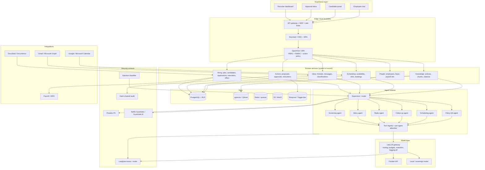
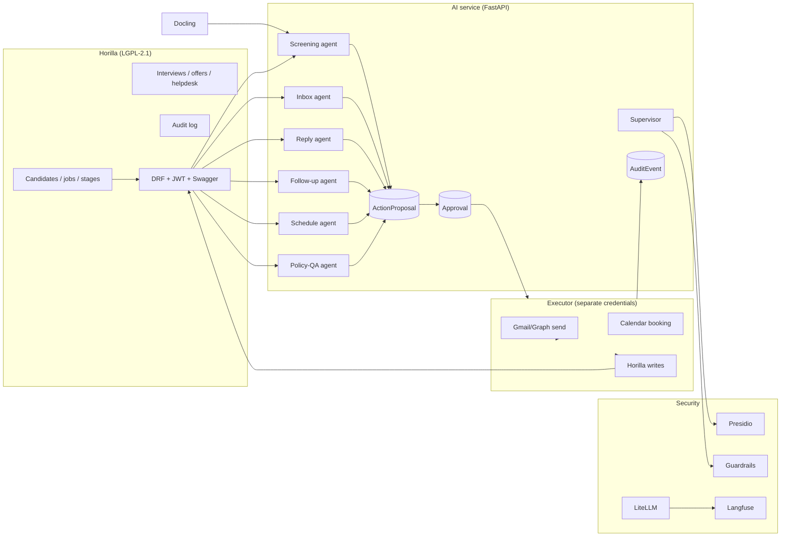
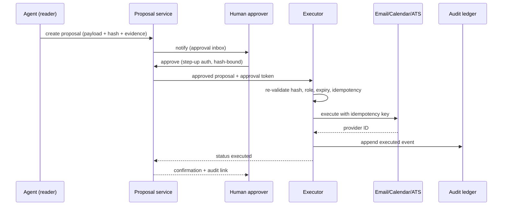

# Secure AI HR System — Open-Source & Commercial Solution Landscape

**Research date:** 2026-10-31 · **Context:** Astropreneur SupCom "Secure AI HR System" hackathon (17 h) · **Companion:** `report/solutions-matrix.csv` (machine-readable scores and coverage) · **Visual summary:** chat digest.

> **How to read this.** Decision-maker: §0, §8, §11. Architect: §9, §10. Buyer: §6, §12. Builder: §4–5, §7, §13. Every non-obvious claim has a source in §13. Vendor marketing claims are labelled as such; unverified items are marked `[unverified]`.

---

## 0. Executive verdict

### 0.1 The uncomfortable truth

**No single open-source project satisfies all six hackathon axes plus AI agents, human approval, and security.** Not one. The projects that look like "AI ATS" on GitHub are either candidate-side tools (Resume Matcher, career-ops), demo notebooks, or unlicensed prototypes. The mature HR systems have the data model and workflows but no AI. The AI frameworks have the agents but no HR data model. The honest answer is a **composition**, and the quality of your architecture is the quality of the seams between the parts.

Three open-source projects come closest to "complete":

| Project | What it really is | Why it is close | Why it is not enough |
|---|---|---|---|
| **Frappe HR** | Mature HR/payroll suite on Frappe | Recruitment, interviews, offers, onboarding, leave, payroll, performance; REST, webhooks, workflows, site-per-tenant | No AI, no inbox agent, no policy RAG |
| **Horilla** | Django HRMS with recruitment + helpdesk | Candidate pipeline, CV parser, DRF/JWT API, audit, onboarding/offboarding/payroll, helpdesk | No LLM, no email digest, no approval-bound sends |
| **Odoo 20 Community** | ERP with HR/Recruitment | Deepest domain model; calendar/mail/activities; JSON-2 API; LGPL | Heavy, no AI, community webhooks are awkward |

The closest **closed** end-to-end suites are **Workday** (HCM + HiredScore + Paradox), **Oracle Fusion HCM** (60+ documented HCM agents), **ServiceNow Otto/HRSD** (employee service + AI Control Tower), and **SAP SuccessFactors** (Joule + SmartRecruiters/Winston). They are benchmarks, not build bases.

### 0.2 The recommended build

**Primary recommendation — "Horilla + agent service + approval ledger":**

```
Horilla (system of record, LGPL-2.1, Django/DRF)
  + external AI service (FastAPI + LangGraph, or PydanticAI for a smaller build)
  + Postgres/pgvector (or Horilla's DB + a vector schema)
  + Docling for parsing
  + Easy!Appointments or direct Google/Microsoft Calendar API for slots
  + RAGFlow or a small in-house RAG for policy Q&A
  + Presidio + NeMo Guardrails/Guardrails AI + LiteLLM
  + one `ActionProposal` / `Approval` / `AuditEvent` ledger
```

Why Horilla: LGPL-2.1 (commercial-friendly), Django 5.2 + DRF + JWT + Swagger (your agent is a normal API client), already has a candidate pipeline, CV parser, audit, helpdesk, onboarding/offboarding/payroll, Docker, tests, and 2.2.0 released 2026-10-21. It is the best **speed-to-real-system** tradeoff.

**If you want the strongest long-term HR platform** and accept GPL-3.0 + the Frappe learning curve, use **Frappe HR**. It gives you metadata-driven DocTypes, site-per-tenant, HMAC webhooks, background jobs, workflows and 13+ HR modules — the best foundation for adding many HR services later.

**If the pitch is "AI-native HCM"** and AGPL is acceptable, **MintHCM** is the most interesting architecture: MCP/WebMCP/A2A, a built-in agent, a tool registry with CRUD/search/report tools, and an explicit OAuth2+PKCE+CSRF consent flow. It is also the riskiest: small community, legacy SuiteCRM/PHP core, and write-capable tools that need a per-action approval layer.

### 0.3 The five things that will make you win

1. **Agent proposes, human approves, executor acts.** Make approval a first-class, hash-bound object — not a prompt instruction and not a chat message. This is the hackathon's golden rule and the strongest live demo.
2. **Deterministic screening core, LLM at the edge.** Ranking math (hard filters + BM25 + embeddings + reranker + rubric weights) is reproducible and auditable; the LLM writes only evidence-cited justifications. This defeats both "the LLM is biased" and "the resume injected instructions".
3. **Dual-model isolation.** The model that reads untrusted resumes/emails has **no tools**; the model that has tools never sees untrusted text. This is the only control that survives a prompt-injection classifier's false negatives.
4. **Evidence chain.** Every claim (ranking reason, digest item, policy answer, reply) points to a source chunk, message ID, or calendar fact. Unsupported claims are dropped, not softened.
5. **HR service factory.** Show that adding onboarding, leave, payroll Q&A or performance is a **service pack** (entities + workflows + agent tools + policies + evals + UI), not a rewrite. That is your answer to "can you build more HR services?".

### 0.4 What "secure" means here

Security is not a slide. It is a set of fail-closed controls around untrusted content and irreversible actions:

- **Untrusted input**: resumes/emails are attacker-controlled. Strip hidden text/zero-width/HTML comments, scan files, never put document text in an instruction channel.
- **Least privilege**: the reader model has no tools; the executor has the only send/calendar credentials; tools are allowlisted per agent.
- **Human approval**: every send, booking, stage change, rejection or record write requires an approval bound to `payload_hash`, approver identity, role, expiry and policy version.
- **Idempotency**: exactly-once side effects via an outbox + idempotency key; approval alone does not prevent duplicate sends after a crash.
- **Audit**: append-only, hash-chained events with `actor`, `model_version`, `prompt_hash`, `policy_version`, `input_hash`, `output_hash`, `approver`.
- **Fail closed**: guardrail timeout, PII-mask failure, vector-store/ACL failure, budget-counter failure, audit-sink failure → deny.
- **Supply chain**: pin SHAs/digests, 3-day cooldown, SBOM, signed images. LiteLLM's PyPI packages 1.82.7/1.82.8 were compromised in March 2026; Trivy's `trivy-action` tags were force-pushed in the same incident window. This is not theoretical.

### 0.5 Legal context you can mention, correctly

- Hiring/screening AI is **high-risk under EU AI Act Annex III.4(a)**. The Digital Omnibus (Regulation (EU) 2026/1744) moved the bulk of stand-alone Annex III obligations to **2 December 2027** (not August 2026). Transparency obligations still apply earlier. Do not claim "AI Act compliant"; claim "designed for the Annex III controls".
- **NYC Local Law 144** requires an annual independent bias audit and candidate notice for automated employment decision tools; enforcement audits were active in 2025. If you demo a US/NYC scenario, mention it.
- **GDPR**: purpose limitation, minimisation, retention, DSAR, human intervention (Art. 22), DPIA. Candidate data is sensitive; do not send full resumes to a provider that trains on them.

---

## 1. What the hackathon actually requires

### 1.1 Requirement → capability → acceptance test

| Brief requirement | Real capability | Acceptance test that proves it | Typical failure |
|---|---|---|---|
| Ranked shortlist vs job offer | Parsing + rubric + retrieval + scoring | NDCG@10 / recall@50 on a labelled set; every rank has evidence | LLM gives a single opaque "78% match" |
| Short job-related justification | Evidence-linked generation | Every claim cites a resume span + JD criterion; unsupported claims removed | Model invents skills or cites protected traits |
| Daily inbox digest, grouped by type/urgency | Ingest + thread + classify + summarise + rank | 100 seeded emails → correct groups; needs-human flags with reasons | Summaries drop deadlines or mis-group |
| Flag emails needing a human | Policy/eligibility classifier | Legal/comp/salary/visa/discrimination/offer cases flagged; recall measured | Everything is "urgent" or nothing is |
| Draft replies from candidate's file only | Scoped context + templates + policy checks | No cross-candidate leakage; no commitments; human approval recorded | RAG retrieves another candidate's CV |
| Every reply approved before send | Approval object + executor | Approval bound to content hash; edited draft invalidates approval | "Approve" button then the model changes text |
| Follow-ups for non-responders | State machine + durable timers | Stops on reply/reject/hire; max cadence; quiet hours | Infinite reminders; duplicate sends |
| Interview slots from recruiter calendar | Calendar OAuth + free/busy + booking | Slot exists, no conflict, timezone correct, re-validated at booking | Model invents times; double booking |
| Answers from company documents | ACL-aware RAG + citations + refusal | Citation validity; refusal when no evidence; escalation | Hallucinated policy; cross-department leak |
| Human decides about people | Approval + audit + override | Every people-affecting action has a human actor and a reason | Agent auto-rejects/hires |
| Secure | Threat model + controls + tests | Injection tests, PII tests, authz tests, audit replay | Prompt-only "please be safe" |

### 1.2 Hidden requirements judges will probe

- **Reproducibility**: same input + same model/version + same rubric → same ranking. LLM-only ranking fails this.
- **Idempotency**: a crash after send must not send twice.
- **Freshness**: approval for draft A must not execute draft B.
- **Tenant/role isolation**: a recruiter for req A must not read req B; a manager must not see another team's candidate.
- **Data lifecycle**: rejected candidate retention, deletion, DSAR.
- **Observability**: per-run trace, token/cost, latency, tool calls, approvals.
- **Graceful degradation**: provider down → queue, not lose the task; guardrail down → deny, not bypass.
- **Explainability**: "why this candidate?" and "why did the AI answer that?" answerable from stored artifacts.

### 1.3 The golden rule, operationalised

> "The agent executes, the human decides about people."

Translate it into a state machine:

```
PROPOSED → (policy: auto-allow for read-only) → DISPLAYED
PROPOSED → (policy: require_approval) → PENDING_APPROVAL
PENDING_APPROVAL → APPROVED (hash-bound) → EXECUTING → EXECUTED → AUDITED
PENDING_APPROVAL → REJECTED → AUDITED
PENDING_APPROVAL → EXPIRED → AUDITED
EXECUTING → FAILED → RETRY (same idempotency key) → EXECUTED
```

Read-only actions (classify, summarise, retrieve, score) can be automatic. People-affecting writes (send, reject, advance, book, record) always require approval by default. Low-risk internal writes (create a draft, create a task) may be auto-approved per policy, but the policy decision and actor are still logged.

---

## 2. Scoring method

Scores are **judgment calls**, not benchmarks. They are useful for relative ordering and for explaining tradeoffs, not for precision. Two rubrics are used because comparing an HR suite to an auth server is meaningless.

### 2.1 Systems-of-record rubric (0–100)

| Dimension | Weight | 5 means | 1 means |
|---|---:|---|---|
| Domain coverage | 15 | Recruitment + employee lifecycle + leave/payroll/performance; real data model | ATS only or demo schema |
| Extensibility / API | 20 | REST/GraphQL + webhooks/events + plugins + background jobs | No HTTP API; fork-only |
| Agent / HITL | 20 | Native agent primitives + approval state + audit | No AI, no approval object |
| Security / compliance | 15 | SSO/RBAC/audit/tenancy + security program | Session auth, no audit |
| Reliability / ops | 10 | Mature releases, queues, tests, migrations | Abandoned/legacy |
| Ecosystem / maturity | 10 | Large community, docs, integrations | Small/unknown |
| 17 h buildability | 10 | Docker + docs + familiar stack + API | Multi-day setup or niche stack |

### 2.2 Component rubric (0–100)

| Dimension | Weight | Meaning |
|---|---:|---|
| Capability depth | 25 | Does the one job better than reasonable alternatives? |
| Integration / API | 20 | Can it be composed in hours, not days? |
| HITL / security | 20 | Approval, policy, isolation, audit where relevant |
| Reliability / ops | 15 | Durability, retries, observability, deployment weight |
| Ecosystem / maturity | 10 | Releases, docs, community, maintenance |
| 17 h buildability | 10 | Setup + config + debugging cost |

### 2.3 Closed-vendor rubric

Suites: breadth 20, innovation 20, HITL/oversight 20, security/compliance 15, reliability 10, ecosystem 10, integrability 5. Specialists are scored separately on depth, innovation, HITL/security, reliability and API; breadth is not held against a parser.

**Caveat:** a low score for a specialist (e.g. Affinda) does not mean "bad"; it means "not a platform". Read the category and the `best_for` column in `solutions-matrix.csv`.

---

## 3. Landscape in one picture



**Trust boundaries.** Everything above `EDGE` is user-facing; the agent runtime is a separate service; the executor is a separate service holding the only outbound credentials; the model gateway is the only path to providers. Never collapse these into one process for a "faster demo" — the separation is the security story and the demo.

---

## 4. Open-source systems of record (ranked)

### 4.1 Leaderboard

| Rank | Solution | Score | License | Stack | 1 | 2 | 3 | 4 | 5 | 6 | Best for |
|---:|---|---:|---|---|:-:|:-:|:-:|:-:|:-:|:-:|---|
| 1 | **Frappe HR** | 83.0 | GPL-3.0 | Python/Frappe/MariaDB/Vue | P | P | P | P | P | N | Long-term HR platform |
| 2 | **Horilla** | 80.5 | LGPL-2.1 | Django/PostgreSQL/DRF | P | P | P | P | P | P | Fastest real HR base |
| 3 | **Odoo 20 Community** | 80.0 | LGPL-3.0 | Python/PostgreSQL/OWL | P | P | N | P | P | N | ERP-grade HR |
| 4 | **Zammad** | 72.5 | AGPL-3.0 | Ruby/Rails/PostgreSQL | N | F | F | P | N | P | Inbox triage/reply UI |
| 5 | **MintHCM** | 71.5 | AGPL-3.0 | PHP/MySQL/SuiteCRM/Vue | P | P | P | P | P | P | AI-native HCM experiment |
| 6 | **Chatwoot** | 71.0 | MIT core + EE | Rails/Vue/PostgreSQL | N | P | F | P | N | P | Polished shared inbox |
| 7 | **Frappe Helpdesk** | 66.0 | AGPL-3.0 | Frappe/Python/MariaDB | N | P | P | P | N | P | Ticket store for Q&A |
| 8 | **AureusERP** | 63.5 | MIT | Laravel/Filament/Livewire | P | N | N | P | P | N | License-friendly admin |
| 9 | **OrangeHRM Starter** | 60.5 | GPL-3.0 | PHP/Symfony/MySQL | P | N | P | N | P | N | Legacy enterprise HR |
| 10 | **OpenCATS** | 40.5 | MPL-2.0 | PHP/MySQL | P | N | N | P | N | N | ATS domain depth |

`F` = full, `P` = partial, `N` = none for the six axes (1 screening, 2 digest, 3 replies, 4 follow-ups, 5 scheduling, 6 policy Q&A). Coverage is *native*; every row can reach F with the agent layer described in §8.

### 4.2 Frappe HR — the platform play

**Facts.** GPL-3.0; 8,995 stars; v16.53.0 (2026-10-30); Python + Frappe Framework (MariaDB, Postgres support), Vue/frappe-ui, PWA. 13+ modules: employee lifecycle, onboarding/offboarding, leave, attendance, expenses, performance, payroll, recruitment, training, assets, grievances. Recruitment doctypes: `Job Requisition`, `Job Opening`, `Job Applicant`, `Interview`, `Interview Feedback`, `Job Offer`, `Appointment Letter`, `Staffing Plan`, plus `Employee Referral` and skill tables.

**Architecture.** Metadata-driven: every business object is a DocType; permissions, list views, REST, versions/audit, workflows, and webhooks are framework features. `/api/resource/:doctype` CRUD and `/api/method/<dotted.path>` for whitelisted functions; API key/secret, session, or OAuth2 bearer. First-class `Webhook` doctype with `doc_event`, Jinja condition, JSON/form payload and `X-Frappe-Webhook-Signature` (base64 HMAC-SHA256). Background jobs via `frappe.enqueue` + `scheduler_events` (hourly/daily/cron, short/default/long queues). **Site = tenant, own database** — the cleanest multi-tenancy story in this survey. Extension unit is a new app with `hooks.py` (`doc_events`, `scheduler_events`, `override_whitelisted_methods`).

**Hackathon coverage.** Recruitment pipeline (P), email templates/auto-reply (P), interview scheduling (P, no availability lookup), follow-ups (P, no cadence object), policy Q&A (N). No LLM. The cheapest AI hook is a **separate app** that reads/writes these doctypes over HTTP and posts back fields such as `custom_ai_score` and `custom_ai_evidence` — zero forks. HITL: `docstatus` draft/submitted/cancelled + Workflow transitions give you "proposed → approved → sent" if you model it.

**Build upon.** Add a Frappe app `hr_agents` with DocTypes `Agent Run`, `Action Proposal`, `Approval`, `Audit Event`; an external LangGraph service; use Frappe Helpdesk for employee Q&A escalation. For a 17 h demo, pre-build the app as a Frappe fixture; for a product, this is the most extensible path.

**Risks.** GPL-3.0 (distribution triggers source disclosure; SaaS usually not distribution, but legal review). Frappe learning curve and bench deployment. MariaDB default. UI customization is Vue/frappe-ui, not React.

### 4.3 Horilla — the practical play

**Facts.** LGPL-2.1; 1,480 stars; v2.2.0 (2026-10-21); Django 5.2, Python 3.12–3.14, HTMX/jQuery, DRF + SimpleJWT + Swagger/ReDoc, APScheduler, Redis, spaCy. Docker image `horilla/horilla-hr`. Modules: recruitment, onboarding, employee management, attendance, leave, assets, payroll, performance, offboarding, helpdesk, automations, audit, API.

**Recruitment model.** `Recruitment` → `Stage` (sequence, `stage_type`: initial/applied/test/interview/cancelled/hired) → `Candidate` (resume PDF, `schedule_date`, `hired`, `canceled`, `converted`, `joining_date`, `offer_letter_status`, source/referral), plus `RejectReason`, `RejectedCandidate`, `StageNote`, `StageFiles`, interview and candidate email log. It already parses CVs: font-size-weighted name extraction, spaCy `PERSON`/`GPE`, and `rapidfuzz.partial_ratio` skill counting — deterministic, explainable, and a good base for an LLM re-ranker. `horilla_meet` creates Google Meet links; `horilla_automations` sends email/in-app on CRUD; `horilla_audit` logs history.

**Architecture.** Django apps as siblings; DRF namespaced `/api/<app>/`, Swagger at `/api/swagger/`; JWT; `HorillaCompanyManager` row scoping on a single DB (not true multi-tenant); `django-apscheduler` with `/ready/` and `/metrics/`; `django-auditlog`/`simple-history`; `django-axes`; gitleaks/trivy/SECURITY.md. No outbound HTTP webhooks — add an outbox or poll `last_updated`.

**Hackathon coverage.** P+ screening, P digest, P replies, P follow-ups, P scheduling, P policy Q&A (helpdesk). No LLM. Perfect seam for an external agent.

**Build upon.** Add a Django app `ai_hr` for `ActionProposal`/`Approval`/`AuditEvent` and a FastAPI/LangGraph service for agents. Use DRF for all reads/writes; add an outbox table for events; use helpdesk for Q&A escalation. For a product, LGPL-2.1 is the most permissive of the mature HR suites.

**Risks.** Smaller ecosystem than Frappe/Odoo; single-DB row scoping; no webhooks; recruitment UI is Django templates (customization is less clean than a React SPA). The CV parser is English-centric; replace with Docling + multilingual embeddings for non-English resumes.

### 4.4 Odoo 20 Community — the enterprise play

**Facts.** LGPL-3.0 (`hr_recruitment/__manifest__.py`), 55,445 stars, series 20.0 (`version_info=(20,0,0,FINAL)`), Python 3.12–3.14, PostgreSQL 16+, ORM + OWL JS. `hr_recruitment` depends on `hr, calendar, utm, attachment_indexation, mail, digest`; interviews are `calendar.event` records (`meeting_ids`), follow-ups are `mail.activity`/`mail.activity.plan`, and the applicant pipeline has stages, talent pool, refuse reasons and email templates. Resume OCR digitisation is an in-app purchase (credits), not a local model.

**Architecture.** Best-in-class ORM and module system; **JSON-2** `POST /json/2/<model>/<method>` (new in 19.0) plus XML-RPC/JSON-RPC; bearer API key with expiry and `X-Odoo-Database`; `ir.cron`; multi-company record rules; DB-per-deployment. Community webhooks are documented under Studio (paid); the community path is an automation rule + `ir.actions.server` or polling `write_date`.

**Hackathon coverage.** P screening, P digest (KPI digest, not mail digest), N replies, P follow-ups (activities as cadence), P scheduling (calendar events), N policy Q&A. No AI.

**Build upon.** A custom addon `hr_ai_agents` + external service; use `calendar.event` for interviews and `mail.activity.plan` for follow-up cadence as data. The uniform JSON-2 RPC makes an external agent trivial. Do not attempt this in 17 h unless the team already knows Odoo.

**Risks.** Setup weight, Odoo-specific skills, Studio/enterprise gravity, and an ORM that rewards deep knowledge. LGPL is commercially friendly, but the ecosystem is large and opinionated.

### 4.5 MintHCM — the AI-native experiment

**Facts.** AGPL-3.0; 437 stars; v4.3.5 (2026-10-23); PHP 8.2, MySQL/MariaDB, Elasticsearch 7.10+, SuiteCRM/SugarCRM heritage, Vue frontend, `api/`, `mcp/`, `legacy/`. Modules: recruitment and candidate management, onboarding/offboarding, employee profiles, competencies/skills/evaluations, time and attendance, leave, performance, org structure, job descriptions, resources, reporting, mobile apps.

**AI architecture (verified in repo).** An `AI/Tools` layer with `AbstractTool`, `ToolRegistry`, `ToolSchema`, `ToolResult`, and implementations for `SearchRecords`, `CreateRecord`, `UpdateRecord`, `DeleteRecord`, `CreateRelationship`, `DeleteRelationship`, `CountRecords`, `SumRecords`, `GetModuleFields`, `ListRelationships`, `ListKReports`, `ExecuteKReport`, `BrowseDocumentation`, `GetDocumentationEntry`. MCP controller with OAuth2 consent: PKCE S256, per-flow random ID, 64-hex CSRF `consent_token` compared with `hash_equals`, 15-minute TTL, explicit Authorize/Cancel even for authenticated sessions, redirect URI re-validation. This is the most serious **open-source agent governance** code in the HR space.

**Hackathon coverage.** P across the board; AI-native MCP/A2A; no evidence that recruitment screening/ranking or email digest is production-grade. The write tools (`create/update/delete`) are exactly what you must wrap in per-action approval.

**Build upon.** If you want to demo "any MCP agent can operate an HCM", this is the base. Add a `Proposal` layer in front of write tools; use the consent flow as the identity story; keep AGPL obligations in mind (network use triggers source availability).

**Risks.** AGPL-3.0; legacy PHP monolith; small community; Elasticsearch + MySQL ops; write-capable tools are dangerous without an approval layer. For a 17 h build, only if a team member knows SuiteCRM/PHP.

### 4.6 The rest, briefly

**AureusERP** (MIT, 12,144 stars, v1.7.0, Laravel 13/FilamentPHP 5/Livewire 4). Plugin-per-module (`php artisan <plugin>:install`), recruitment models (`Applicant`, `Candidate`, `Stage`, `StageJob`, `JobPosition`, `ApplicantInterviewer`, `RefuseReason`, `ActivityPlan`), Filament Shield RBAC. **No HTTP API** (`routes/api.php` is empty), so an external agent must live inside the monolith or talk to the DB. Best if your team is Laravel-first and you want MIT licensing; not AI-composable out of the box.

**OrangeHRM Starter** (GPL-3.0, 1,160 stars, v5.9, PHP/Symfony/MySQL). Recruitment plugin, OAuth2 client-credentials API, status-change notification emails, interview date/interviewers. Slow cadence (last push 2026-06-28), no digest, no AI, no activity/cadence object. Legacy enterprise; not recommended for this build.

**OpenCATS** (MPL-2.0, 772 stars, v0.12.0, 2026-10-22). Revived in 2026 (0.10→0.12 in four months). Candidates, job orders, pipelines, resume store, careers portal, cron task queue (`QueueCLI.php`), hooks (`lib/Hooks.php`). **No REST API**; you would scrape `ajax.php` or write PHP. Good staffing-agency domain fidelity, bad integration economics.

**Zammad** (AGPL-3.0, 6.1k stars, 7.2.2). Email/chat helpdesk with AI agents that set/route/prioritise fields, sentiment, summaries and an AI Writing Assistant; BYO OpenAI/Azure/Ollama/Anthropic; **human sends** ("human-in-the-loop", EU AI Act page). REST API, triggers→webhooks, macros; single-tenant instance, multi-group. No machine-enforced approval record. Best OSS inbox/triage UI if AGPL is acceptable.

**Chatwoot** (MIT core + `enterprise/`, 38.7k stars, v4.19.1). Polished omnichannel shared inbox; Captain AI (assistant, guardrails/scenarios, tools, memories) and Copilot drafts; multi-tenant accounts; audit logs are paid. No candidate data model. Good UI reference; check which AI features are enterprise.

**Frappe Helpdesk** (AGPL-3.0, 3.5k stars, v1.31.1). Tickets, SLAs, knowledge base, email; no AI; REST/webhooks; site-per-tenant; field-level permissions added in 1.31.1. Cheap ticket store for employee Q&A escalation; pair with RAG.

### 4.7 Excluded, with reasons

| Project | Why not |
|---|---|
| **IceHrm** | Elastic License 2.0 ("may not circumvent license key functionality") — not open source; 738 stars; not a safe base. |
| **Sentrifugo** | Zend Framework 1, PHP 5.3-era, last code change 2017; abandoned. |
| **YAWIK** | Last commit 2021; ATS/job board; dead. |
| **nueno** | Last commit 2022; AGPL ATS; dead. |
| **Resume Matcher** (29k★) | Candidate-side resume builder/tailoring, not recruiter ranking; single-user; no login/loopback by default. Steal the deterministic ATS score + parse-check, not the app. |
| **career-ops** (79k★) | Job-seeker agent; not an HR system. |
| **"AI ATS" repos >500★** | None found. Searches over `topic:ats` (>100★) and `topic:recruitment` (>300★) surfaced no HR-side AI screening system beyond Horilla's spaCy/rapidfuzz pipeline. Treat claims as marketing. |

---

## 5. Open-source AI, agent and security components (ranked)

### 5.1 Leaderboard (role-relative leverage)

This ranks **how much capability each component adds to the stack**, not "best project overall". A parser and an auth server are not substitutes.

| Rank | Component | Score | License | Role | Verdict |
|---:|---|---:|---|---|---|
| 1 | **LangGraph** | 96.5 | MIT | Agent graph + HITL + checkpoints | Best HITL + durability pair |
| 2 | **Keycloak** | 93.0 | Apache-2.0 | Identity/OIDC/token exchange | Production SSO |
| 3 | **OPA** | 90.5 | Apache-2.0 | Action/retrieval policy | Policy-as-code, pin ≥1.21.3 |
| 4 | **Trigger.dev** | 90.0 | Apache-2.0 | Durable tasks + waitpoints | Best 17 h approval pause |
| 5 | **LiteLLM** | 89.5 | MIT + EE | Model gateway | Strong; pin ≥1.83.0, verify supply chain |
| 6 | **Camunda 8** | 89.0 | Camunda License v1 | BPMN + user tasks | Gold standard, license trap |
| 7 | **PydanticAI** | 88.0 | MIT | Typed agents + deferred tools | Clean small build |
| 8 | **OpenFGA** | 88.0 | Apache-2.0 | ReBAC | Candidate/recruiter/tenant graph |
| 9 | **Presidio** | 87.5 | MIT | PII redaction | Must-have pre-model |
| 10 | **OpenAI Agents SDK** | 86.0 | MIT | Agents + approvals | Cleanest approval API |
| 11 | **NeMo Guardrails** | 83.5 | Apache-2.0 | Input/retrieval/execution/output rails | Best OSS rail coverage |
| 12 | **n8n** | 83.0 | SUL | Workflow glue | Best integrations, license caveat |
| 13 | **Guardrails AI** | 83.0 | Apache-2.0 | Output validators | Fail-closed validators |
| 14 | **Docling** | 82.5 | MIT | Document parsing | Default parser |
| 15 | **Langfuse** | 81.5 | MIT + EE | Tracing/evals/annotation | Self-host for PII |
| 16 | **RAGFlow** | 81.0 | Apache-2.0 | RAG + citations | Best citation UX, heavy |
| 17 | **promptfoo** | 81.0 | MIT | Red team/evals | CI injection tests |
| 18 | **Dify** | 80.5 | Modified Apache | Visual agent workflows | Fast demo, no multi-tenant resale |
| 19 | **Mastra** | 80.0 | Apache-2.0 + EE | TS agents + suspend/resume | Best JS/TS option |
| 20 | **Flowable** | 80.0 | Apache-2.0 | BPMN user tasks | Clean OSS Camunda alternative |
| 21 | **Onyx** | 80.0 | MIT core + EE | Enterprise RAG | Permission sync paid |
| 22 | **Langflow** | 77.5 | MIT | Visual flows + HITL | Good, less durable |
| 23 | **Temporal** | 77.0 | MIT | Durable execution | Best reliability, heaviest ops |
| 24 | **LibreChat** | 76.5 | MIT | Chat UI + tool approval | Reuse approval UX |
| 25 | **Open WebUI** | 73.5 | Custom BSD | Chat UI/RAG | Branding clause |
| 26 | **DocuSeal** | 72.5 | AGPL-3.0 | E-sign | Offer letters |
| 27 | **Unstructured** | 71.0 | Apache-2.0 | Document elements | Weak tables |
| 28 | **Novu** | 69.5 | MIT + EE | Digest/notifications | Heavy for 17 h |
| 29 | **Marker** | 69.0 | Apache-2.0 | PDF→Markdown | Fast, GPU preferred |
| 30 | **AIBF** | 69.0 | Apache-2.0 | Bias firewall | Compliance sidecar |
| 31 | **Paperless-ngx** | 67.0 | GPL-3.0 | Document archive | OCR/archive, not workflow |
| 32 | **Easy!Appointments** | 63.0 | GPL-3.0 | Scheduling | Fast slot engine |
| 33 | **Cal.diy** | 61.5 | MIT | Scheduling | Demo only; EE features removed |

### 5.2 Orchestration and HITL

**LangGraph (MIT, 44,220★, 1.2.19).** `interrupt(payload, response_schema=...)` pauses a graph; state is checkpointed per super-step by `thread_id`; resume with `Command(resume=...)`. Postgres checkpointer; `get_state_history` gives you **audit replay** — a killer demo moment. Caveat: a node re-runs from the start on resume, so side effects must be outside the node or idempotent. Best choice for the "robust" blueprint.

**PydanticAI (MIT, ~21k★, 2.64).** `requires_approval=True`, `ApprovalRequired`, `DeferredToolRequests`/`Results`, `HandleDeferredToolCalls`. Typed tools, model-agnostic, Logfire/OTel. Durability is conversation-level; pair with DBOS/Temporal if you need crash resume. Best choice for a small, legible 17 h build.

**OpenAI Agents SDK (MIT, ~30k★, 0.24).** `needs_approval` (bool or callable, **fails closed**), `result.interruptions`, `state.approve/reject`, `RunState.to_json()`. Cleanest approval API; run-level serialize/resume, no per-step journal. Its docs are unusually honest about replay, idempotency and snapshot auth — read them even if you do not use the SDK.

**Mastra (Apache-2.0 + `ee/`, ~29k★, core 1.80).** `suspend()`/`resume()`, `resumeSchema`/`suspendSchema`, `createWorkflowStateReader`; snapshots survive restarts; OTel/Langfuse exporters. Best TypeScript option.

**Temporal (MIT, ~24k★, 1.32.1).** Event-sourced history, replay, per-activity retry/timeout, durable timers, Signals/Updates. No approval UX or role model — you build those. Best reliability substrate; heaviest ops.

**Trigger.dev (Apache-2.0, ~16.7k★).** Durable tasks, retries, queues, idempotency, cron, **waitpoints** that pause for human approve/reject with approval links. Best 17 h "pause until approved" primitive if your stack is TypeScript.

**DBOS (MIT, ~1.7k★, 3.4).** Postgres-backed durable workflows; `DBOS.recv()`/`send()`, durable sleep. No new infrastructure; best "add durability to FastAPI" fit.

**Flowable (Apache-2.0, ~9.6k★, 8.0).** BPMN user tasks, task listeners, gateways, async job executor. Clean-license alternative to Camunda 8. **Camunda 8** (Camunda License v1; production self-managed binaries proprietary) is the gold standard for audit/user tasks, but a startup pitch should not call it open source. Camunda 7 CE is EOL (archived 2025-11).

**Visual platforms.** Dify (modified Apache-2.0: no multi-tenant resale without a commercial license; logo retention; Human Input node; 1.18), Langflow (MIT; HITL checkpoint + Human Input + per-tool approval; 1.13), n8n (Sustainable Use License, not OSI; HITL tool nodes + Wait; 2.45), Windmill (AGPL/Apache mix; suspend/approval; 1.855). Activepieces/Kestra have no verified approval primitive; skip for this system. Flowise is **archived** (README says so; last push 2026-08-13) — do not adopt.

**Verdict.** Use LangGraph if you want the best HITL + durability and can afford the checkpointer schema work. Use PydanticAI if you want the smallest legible service. Use Trigger.dev if TypeScript and you want waitpoints in hours. Use Temporal only if you already operate it; do not learn it during the hackathon. Use Flowable if the pitch is BPMN/enterprise and licensing matters.

### 5.3 Documents, parsing and ranking

**Docling (MIT, 69,919★, 2.145.0, 2026-10-29).** Layout (DocLayNet), table structure (TableFormer), reading order, OCR, formulas/code → `DoclingDocument` + Markdown/HTML/DocTags/JSON. PDF, DOCX, PPTX, XLSX, HTML, EPUB, images, EML/MSG, Pages/Numbers/Keynote, audio/video; scanned PDFs via OCR; VLM preset. `docling-serve` REST + MCP server; CPU OK; air-gapped. **Default parser.**

**Unstructured (Apache-2.0, 15,652★, 0.27.36).** `partition()` → typed elements with coordinates; 25+ formats. Prose is good; OSS table extraction is weak (vendor's own numbers: table cell content 0.426 vs 0.866 paid Transform). Use for prose, not tabular CVs.

**Marker (Apache-2.0, 40,735★).** Fast PDF→Markdown/JSON, good tables/equations; GPU preferred. **MinerU** (Apache-2.0 + a commercial threshold at 100M MAU) is heavier and GPU-oriented. **PyMuPDF is AGPL-3.0** — fastest text extraction, viral license; use as a separate process or not at all. **pyresparser is GPL-3.0 and dead since Sept 2023** — exclude.

**Embeddings/rerankers.** `sentence-transformers` (Apache-2.0, 19k★, 6.2) is the universal adapter. **BGE-M3** (MIT) returns dense + sparse (BM25-like) + ColBERT multi-vector in one pass, 8192 tokens, 100+ languages — ideal for hybrid job↔resume scoring without a second model. **Qwen3-Embedding** (Apache-2.0; 0.6B/4B/8B; 32k context; MTEB multilingual 64.33/69.45/70.58) is the stronger multilingual option. **bge-reranker-v2-m3** (Apache-2.0) is a small drop-in cross-encoder reranker.

**Vector stores.** **pgvector** (PostgreSQL License, 23,544★, 0.8.7) if you want one Postgres for queues + audit + vectors; HNSW/IVFFlat, `halfvec`/`bit`/`sparsevec`, exact search by default, RLS for tenancy. **Qdrant** (Apache-2.0, 35k★, 1.20) if you want dense + sparse + BM25 in one query, `is_tenant` payload index, per-tenant IDF corpus, formula queries, audit log. **Milvus** (Apache-2.0, 47k★, 3.0.5) for distributed/GPU. **Weaviate** (BSD-3 outside `wl/`, enterprise license inside `wl/` — read the license) and **FAISS** (MIT, library, no filtering/tenancy/persistence) are not system choices here.

**The ranking rule.** Do **not** ask an LLM to rank the whole pool. Use deterministic filters + hybrid retrieval + reranker + rubric weights. The LLM writes only the justification, from retrieved evidence spans. The reason is not ideology: ~1% of ~200K real resumes carry hidden injections, >90% without explicit instructions (USENIX Sec '26 / arXiv 2605.28999), and injection "reliably improves rankings when résumé quality is homogeneous and few candidates inject" (ACL Findings 2026) — exactly the demo regime. A deterministic score of record is your defence.

**Reference pipeline:**

```
upload → type/size/AV gate → Docling → sections + page/char offsets
      → deterministic field extraction + NER (skills → ESCO/O*NET)
      → hard filters (right-to-work, must-have certs, seniority, location)
      → BM25 + dense (Qwen3/BGE-M3) + sparse → RRF → top 50
      → cross-encoder rerank (bge-reranker-v2-m3) → top 20
      → rubric score (weights from JD, versioned) → ranked shortlist
      → LLM (quarantined): justification only, every claim cites chunk_id
      → HITL: recruiter accepts/overrides → audit
```

**Evaluation.** NDCG@10, MRR@10, recall@50, precision@5 on graded qrels (3 strong fit, 1 adjacent, 0 no-fit); field-level F1 for parsing; citation validity; name-swap counterfactual; ΔNDCG under white-text/zero-width/HTML-comment injections; p95 latency and cost/1000. Use your own 30–100 synthetic resumes; public datasets are eval-only if unlicensed.

### 5.4 Retrieval and policy Q&A

**RAGFlow (Apache-2.0, 93.3k★, v1.0.0-rc3, 2026-10-30).** Deep document understanding (DeepDoc), chunk-level citations, grounded answers, agent workflows, decision model for evidence sufficiency, Categorize node. REST + OpenAI-compatible chat API; teams with shared datasets; **dataset-per-candidate is the only real isolation primitive**. Heavy: Python/Go, Elasticsearch/Infinity, MySQL, Redis, MinIO. RC build; no email/approval. Best citation quality for policy PDFs; deploy only if you have the ops budget.

**Onyx (MIT core + `ee/`, 33.1k★, 5.0.3).** 50+ connectors with permission/metadata sync, agentic RAG, custom agents, MCP, Slack bot; `Document Access: public / groups / sync with source`; **permission sync is Business/Enterprise/EE**. Single deployment, multi-user, not multi-tenant. Best if policies live in M365/Google/Confluence and you need source-ACL fidelity; heavy.

**Open WebUI** (custom BSD-3 + branding clause: ≤50 users may rebrand; 157k★, 0.12.5). Knowledge bases, inline citations, rerankers, OCR, tools/functions/pipelines, MCP, sub-agents. Fastest internal chat demo; weaker retrieval than RAGFlow/Onyx; **not a product base** without a license review.

**LibreChat** (MIT, 46.6k★, 0.8.x). Agents, MCP, **per-tool approval prompts**, scheduled chats, background tasks; Mongo + Meilisearch + RAG service. Best approval UX to copy; heavier ops than Open WebUI.

**AnythingLLM** (MIT, 67.8k★, 1.19). Workspace = clean document boundary — the closest thing to "candidate's file only"; agent skills/MCP; desktop-first, API less complete. Use workspace-per-candidate if you need hard isolation, but delete on close.

**LlamaIndex/Haystack** (MIT/Apache-2.0) are libraries, not products; use if you want to own the RAG pipeline. For a 17 h build, a small in-house RAG over `policy_chunks` with pgvector + a reranker is often faster and safer than deploying RAGFlow.

**The missing feature.** No helpdesk scopes retrieval per **candidate**: Zammad/Chatwoot attach files to a conversation, not a person; Onyx permissions are connector-level. For "draft from this candidate's file only", **do not retrieve** — extract the CV text at intake, store it in `candidates.cv_text`, and pass it inline in one prompt with a strict system message. Cheapest, most private, no leakage path.

### 5.5 Model gateway, guardrails, identity and audit

**LiteLLM (MIT + `enterprise/`, 62.4k★, 1.106.6).** 100+ providers, guardrail hooks (`pre_call`/`during_call`/`post_call`/`logging_only`), budgets, key/team scoping, cache namespaces, redaction flags. **Incident:** PyPI `litellm==1.82.7` and `1.82.8` were live for ~40 minutes on 2026-03-24 with a credential stealer, linked to the Trivy compromise; official Docker images were not affected; safe v1.83.0 released 2026-03-30. Use the official Docker image or ≥1.83.0, pin SHA-256, verify checksums, and set `turn_off_message_logging` + `redact_messages_in_exceptions`. No server-side per-tool approval — HITL lives in your agent. MCP/A2A permissions fall open when the DB is unreachable; exact-match cache is shared across keys/teams unless `cache.namespace` is set.

**Portkey Gateway (MIT, 13.3k★, 1.15.2).** 1,600+ models, 50+ guardrails, hooks, conditional routing; OSS cadence slowing (last commit 2026-05-25), advanced guardrails in cloud. **Kong AI Gateway** (Apache-2.0 gateway; some plugins enterprise) scans only `role:user` messages, so resume text injected as document/tool content is unscanned; semantic guard is enterprise. **Helicone** (Apache-2.0) is observability-first, weak enforcement.

**Presidio (MIT, 12k★, 2.2.366).** PII identify/anonymize for text/images/structured data; custom recognizers; multi-language; lib or container. Now community-owned (Data Privacy Stack); docs warn detection is not exhaustive. Use as a pre-call masker, fail closed on error.

**NeMo Guardrails (Apache-2.0, 7.4k★, 0.24.1).** Rails at **input / retrieval / dialog / execution / output** — the only OSS tool with first-class retrieval and execution rails. Colang learning curve; LLM self-check rails are probabilistic.

**Guardrails AI (Apache-2.0, 7.6k★, 0.11.0).** Validators + `OnFailAction.EXCEPTION/FIX/REASK/REFRAIN` — native fail-closed. Hosted inference discontinued (2026-08-25); validators are PyPI packages you must vet.

**LLM Guard is archived (2026-07-09)**; Rebuff/Vigil-LLM are abandoned (Jan 2024). Do not adopt. **Llama Prompt Guard 2 86M** is a classifier only (Llama 4 Community License, gated, 8 languages) — one layer, never the control.

**promptfoo (MIT, 27k★, 0.125.1).** `indirect-prompt-injection` (`indirectInjectionVar`), `rag-poisoning`, `rag-document-exfiltration`, assertions in CI. **garak** (Apache-2.0) and **PyRIT** (MIT) for pre-deploy red teaming. **Langfuse** (MIT + `ee/`, 37k★, 4.72.0) for OTel tracing, masking and annotation queues; self-host is the only compliant path for resumes. **Arize Phoenix is Elastic License 2.0** — fine to use, disqualifying if you host it as a service.

**Identity/policy.** **Keycloak** (Apache-2.0, 38k★, 26.8.1) for OIDC/SAML and standard token exchange (RFC 8693) with `downscope-assertion-grant-enforcer` and DPoP. **OpenFGA** (Apache-2.0, 6.1k★, 1.22.1) for Zanzibar-style ReBAC; docs ship HR and agent/MCP patterns. **OPA** (Apache-2.0, 12k★, 1.22.0) for action/retrieval policy; **pin ≥1.21.3** — 1.21.2 and earlier accepted unsigned bundles when signing was configured without a `keyid`. **Infisical** (MIT + EE) or **OpenBao** (MPL-2.0) for secrets; **Vault is BUSL-1.1**.

**Bias/compliance.** **Fairlearn** (MIT) and **AIF360** (Apache-2.0) for selection-rate parity, equalized odds, disparate impact; **AIBF_API** (Apache-2.0, 195★) as a drop-in bias firewall with linear reference model + exact SHAP attributions and a review feed. Metrics are not compliance; you must define protected groups, pass rates, and the audit artifact.

### 5.6 Scheduling, email, e-sign, notifications

**Scheduling.** **Cal.diy** is the MIT community edition of Cal.com, but the README says **personal/non-production**, and Teams, Organizations, Insights, Workflows, SSO/SAML were deliberately removed. Do not promise "Cal.com parity" or multi-interviewer workflows from it. **Easy!Appointments** (GPL-3.0, 4,467★, 1.6.1) is the fastest true slot engine: providers, services, availability API, Google Calendar + CalDAV, webhooks; single-tenant, dated PHP. **Rallly** (AGPL-3.0) is a poll, not a scheduler. Best 17 h path: Google/Microsoft Calendar `freebusy` + event insert, or Easy!Appointments; Cal.com hosted API is a commercial option if you need reliability.

**Email.** **Gmail API / Microsoft Graph** are the best hackathon path: create a **draft** (human sends in their own client = strongest HITL) or `sendMail` after approval. **Mailpit** (MIT) is a dev SMTP sink with REST/websocket — use it to capture/assert outbound mail, never production. **Postal** (MIT) and **Mailu** (MIT) are real mail servers; skip for the hackathon (IP reputation, DKIM, abuse). `imapflow` + `mailparser` (MIT) if you must do raw IMAP; `mailparser` strips quotes/attachments.

**E-sign.** **DocuSeal** (AGPL-3.0, 19k★, 3.3.4): templates→submissions→submitters, REST + webhooks, audit trail; reminders/teams/SSO are Pro. **Documenso** (AGPL-3.0, 15.6k★, 2.21.1): approver recipient role, API v2, webhooks, audit-log PDF; closest native "internal approver" analogue. **Paperless-ngx** (GPL-3.0, 47k★) for OCR/archive of signed offers, not workflow.

**Notifications.** **Novu** (MIT core, 40k★, 3.19) for digest/delays/branching; heavy. **Apprise** (BSD-2, 18k★) for 170 notification services. For 17 h, a Postgres outbox + APScheduler is enough; add Novu only if you need multi-channel cadence.

---

## 6. Closed-source benchmark (ranked)

### 6.1 What the market looks like in 2026

Consolidation is the story: **Workday acquired Paradox** (closed 2025-10-01) and now ships HiredScore Recruiting Agent + Paradox Candidate Experience Agent; **ServiceNow acquired Moveworks** (closed 2025-12-15) and merged Now Assist + Moveworks + AI Experience into "Otto"; **SAP acquired SmartRecruiters** and runs Winston + Joule as connected agents; **Check Point acquired Lakera**; **FairNow → AuditBoard → Optro** within six months. Do not anchor your architecture to a brand; anchor to the pattern.

### 6.2 Suite leaderboard

| Rank | Vendor | Score | 1 | 2 | 3 | 4 | 5 | 6 | Innovation to borrow |
|---:|---|---:|:-:|:-:|:-:|:-:|:-:|:-:|---|
| 1 | **Workday** (+HiredScore, Paradox) | 98.0 | F | P | P | P | F | P | Agent System of Record + two-key authorization |
| 2 | **Oracle Fusion HCM** AI agents | 94.5 | F | N | F | P | F | F | Policy-as-code auto-reply predicate |
| 3 | **ServiceNow Otto** (HRSD) | 94.5 | N | P | P | P | N | F | AI Control Tower + approval queue |
| 4 | **SAP SuccessFactors** (+Joule, SmartRecruiters) | 92.5 | F | P | P | P | F | F | Connected agents sharing master data |
| 5 | **Ashby** | 83.5 | F | N | P | F | P | N | Criteria-as-query + confirm-on-write |
| 6 | **Moveworks** | 83.5 | N | P | P | P | P | F | Approval Queue with pause/resume |
| 7 | **Microsoft 365 Copilot / Gemini** | 81.5 | N | F | F | P | F | P | Email/calendar baseline + enterprise identity |
| 8 | **Greenhouse** | 78.5 | F | N | P | P | N | N | Anonymize-then-score + subprocessor table |
| 9 | **Eightfold AI** | 78.0 | F | N | P | P | N | P | Skills/aspiration graph + public API |
| 10 | **Phenom** | 77.5 | P | N | P | P | F | P | Orchestration engine + compliance agent |
| 11 | **Leena AI** | 76.0 | N | P | P | P | P | F | Durable approval runs |
| 12 | **Glean** | 75.5 | N | P | P | P | N | F | Permission-aware enterprise graph |
| 13 | **SmartRecruiters** | 74.5 | F | N | P | P | P | N | ATS API/marketplace |
| 14 | **iCIMS** | 72.0 | F | N | P | P | P | N | Hiring agent inside Teams |
| 15 | **Lever** | 71.0 | P | N | P | P | N | N | ATS+CRM data model |
| 16 | **Beamery** | 70.0 | P | N | P | P | N | N | Talent CRM |
| 17 | **Paradox (Olivia)** | 68.0 | P | N | P | F | F | P | Conversational high-volume hiring |
| 18 | **Gloat** | 62.0 | N | N | P | P | N | P | Internal talent marketplace |

### 6.3 Workday — the reference architecture

Workday is the closest thing to an end-to-end closed answer: HCM + Recruiting + HiredScore (candidate grading, rediscovery of past applicants, explainable/bias-audited claims) + Paradox (conversational apply, scheduling) + Workday Assistant/Sana in M365 Copilot + Workday Help. The genuinely innovative part is **Agent System of Record (ASOR)**: one registry for Workday, custom, partner and self-built agents; per-skill security groups; ambient vs delegate execution modes; an auto-generated **Agent System User** account per agent; OAuth2 client credentials stored by Workday; separate `Agent Compliance` and `AI Agent Security` domains; 30-day agent input/output audit retention.

**The pattern to steal: two-key authorization.** A user must be in a security group attached to the **skill** *and* a group on the **API policy**; interaction permission never implies execution permission. Your "Approve & send" button should check both: may this recruiter see this thread, and may this agent call this send endpoint?

**Limits:** agents are deeply tenant-coupled; no public agent API outside a Workday tenant; ASOR adds purchasing friction. You cannot build a 17 h prototype on it.

### 6.4 Oracle — the best guardrail spec in the survey

Oracle documents 60+ HCM agents across releases 25A–26D: Job Applicant Screening Agent + Candidate Authenticity, Inbox Response Agent, Career Coach WhatsApp outreach with daily caps, Interview Loop Scheduling Agent (≤5 child interviews, one candidate-managed booking), Employment Lifecycle Policy Advisor, Benefits Plan Advisor, improved RAG Q&A. The standout is the **Inbox Response Agent's reply-eligibility predicate**, which is policy-as-code, not a prompt:

- first email from the candidate only;
- ≤5 questions;
- every question answerable from uploaded policy documents;
- no PII (phone/SSN/passport);
- excluded intents: salary comparison, diversity ratios, discriminatory asks;
- no system error;
- `Send Reply` disabled while the agent is processing (prevents double-send);
- per-candidate reply caps + timeout profile options;
- dedicated SAS role `ORA_HCM_IRC_RECRUITING_SCHEDULED_WF_AGENT_ACCESS`;
- polling job `Process Recruiting Inbound Messages`.

This is ~40 lines of deterministic guards around one LLM call. Copy it verbatim into `can_autoreply()`. The agent is Fusion-only; AI Agent Studio lets you clone templates; no standalone API.

### 6.5 ServiceNow — the governance reference

ServiceNow merged three assistants into **Otto** (HRSD/EmployeeWorks + Now Assist + Moveworks + AI Experience) on one architecture: **Context Engine** (instance-grounded), **Workflow Data Fabric** (350+ live connectors), **AI Control Tower** (logs every agent action). It treats "human-in-the-loop defined for high-risk or irreversible actions" as a gate before build sign-off; approvals are mirrored from ServiceNow into the assistant's queue; Vault/Guardian secure the platform. Moveworks' **Approval Queue** is the best approval primitive in the market: mirrors approval records out of systems of record into one queue; `mw.create_generic_approval_request` pauses a compound action until the approver responds; 30-day purge to kill zombie approvals; list → step → notify → approve/deny/deny-with-comments in chat. The gap: the click audit is "requested on demand from customer success", not self-serve. Beat that with a hash-chained, self-serve audit.

### 6.6 SAP, Phenom, Eightfold

**SAP SuccessFactors** runs **Joule** + **SmartRecruiters/Winston** as connected agents from 2026, sharing job-family/cost-centre/location master data so requisitions open pre-populated; approvals/roles are provisioned from SuccessFactors into SmartRecruiters. It added consent management, fraud detection and applicant data transferability in 2026. Two overlapping recruiting products (SF Recruiting vs SmartRecruiters) create roadmap ambiguity.

**Phenom** is a "WorkOps" agent platform with an **Orchestration Engine**, natural-language guardrail/routing policy creation, decision tracking of every agent action *and every human escalation*, and a **Compliance Agent** that re-checks every job description against state/federal/local + internal equity policy. It also does candidate fraud detection (AI-generated-response detection, coordinated fraud networks). Managers can step in, follow up, or override from dashboards. Strong governance UX.

**Eightfold** is the talent-intelligence data layer: skills/aspiration ontology, matching beyond the résumé, "Talent Forge" to build talent apps, candidate conversational agent, CRM nurture. The most integration-friendly of the enterprise set: public REST API at `apidocs.eightfold.ai`, including an `llms.txt` agent index. Value collapses without a large internal candidate corpus.

### 6.7 ATS vendors — what to copy

**Ashby** has the cleanest agent-write pattern: **criteria-as-query** (the rubric you define once *is* the search, reusable across review and rediscovery), **Talent Rediscovery** (criteria → buckets, stale profiles refreshed in place, 1 credit/candidate, ≤250/search), and **confirm-before-save on every write** ("any time you edit an object or create a new object, we'll always ask for confirmation"). Shared agents inherit Ashby account access controls; public API; SOC2. Copy the confirmation UX, not a checkbox that can be disabled for sends.

**Greenhouse** documents AI feature-by-feature, per-provider: one public table naming each subprocessor (OpenAI, Recall.ai) and exactly which data each feature touches; **resume anonymization** (hide identifying info during application review, Pro tier); Talent Matching vs weighted calibration; public REST API + Harvest. Copy the **feature/data inventory** as your README table — judges read it as maturity.

**SmartRecruiters** is the ATS with a marketplace/API; **Lever** is ATS+CRM with nurture; **iCIMS** put a Hiring Agent inside Microsoft Teams (Oct 2026); **Beamery** is a talent CRM; **Gloat** is an internal talent marketplace. None cover inbox + replies + policy Q&A.

**Paradox** (now Workday) is the best conversational high-volume hiring: no-login apply/resume across SMS/WhatsApp/Messenger, resumable sessions, QR/shortcode sourcing, automated screening/scheduling, recruiter 1:1 texting without exposing personal numbers. The real risk is SMS consent (TCPA); vendor material rarely discusses it.

### 6.8 Employee service and email

**Moveworks** (ServiceNow) is the employee assistant with the approval primitive. **Leena AI** has HR-specialised agents over Workday/SAP/ServiceNow, 200+ prebuilt connectors, and **Workbench stateful runs** that "pause for approvals… survive retries, callbacks, and overnight waits" — durable execution, the thing most hackathon agents lack. **Glean** is the permissions-aware enterprise graph: per-connector permission enforcement, zero LLM data retention, single-tenant hosting, regional residency, MCP host *and* remote MCP server, agent governance (RBAC, import/export, debugging), SSO, audit logs. Its **"sync with the source"** permission model is the right mental model for policy retrieval.

**Zendesk / Front / Intercom Fin** are email/shared-inbox benchmarks, not HR systems. Fin's outcome pricing ($0.99/resolution & procedure-handoff, $9.99/qualification; escalations/failures not billed) is the best commercial model to copy — but **do not copy "assumed resolution"** (user goes silent → billed) into HR; a ghosted candidate is not a handled case. **Front** is the shared-inbox UX to beat; **Zendesk** is the ticketing/automation benchmark; **Microsoft 365 Copilot / Gemini** are the baseline for email summary/draft/scheduling, with enterprise identity but no HR data model.

### 6.9 Specialists (components, not platforms)

| Vendor | What it does | Innovation / evidence | API / compose | What to borrow |
|---|---|---|---|---|
| **HireVue** | Structured, competency-scored interviews | 2026 Explainability Statement names transcription vendor (Rev.ai), base model (RoBERTa → 19 fine-tuned competency models), BARS rubric, fairness tests (4/5ths rule, Cohen's *d*, Fisher's Exact); no facial/body/tone analysis; Claude 3.7 Sonnet via AWS Bedrock with guardrails + neutral fallback on injection detection; no fine-tuning on customer data | Not a platform | Disclosure discipline: state what the model does **not** use; name model/hosting; safe template on guardrail fire |
| **Metaview** | Recruiting notetaker → scorecard drafts | Scope discipline: "does not submit subjective feedback or make the hiring recommendation" | ATS integrations | Keep the agent out of the decision |
| **GoodTime (Cori)** | Interview coordination agent | Panels, interviewer load balancing by skill/history; agentised coordination May 2026 | Workday marketplace | Panel/load logic if you go deep on scheduling |
| **Calendly** | Scheduling API + webhooks | Boring, reliable v2 REST + webhooks | Free tier + per-seat | Pragmatic axis-5 if you do not self-host |
| **Chili Piper** | Inbound routing + instant booking | Router logic round-robin/territory reusable for interviewer assignment | From $1,250/mo | Routing rules, not the price |
| **Textkernel (Sovren)** | Parsing + semantic matching | Taxonomy + Parse API + Search & Match v2 (beta) | Enterprise API/SDK | Normalized candidate schema |
| **Affinda** | Resume parsing | Same API hosted or **self-hosted**, 50 ms median parse, 95%+ strict accuracy (vendor), "0 customer documents used for training" | $0.10/doc self-serve; 1,000 free docs/14 days; self-host from $12k/yr @500k docs | Data-residency as a deployment choice |
| **RChilli** | Parsing + search/match + taxonomy | $150 incubator licence incl. parser + search & match + taxonomy, 100 free credits | API | Budget parsing |
| **Checkr** | Background checks | FCRA/SOC2 | API | Compliance gate before hire |
| **Check Point AI Guardrails (Lakera)** | Runtime AI firewall | Prompt defence, content moderation, DLP (PII/system-prompt leakage), malicious-link detection, Agent Behavior Defense (dangerous deviation, tool allow/deny), OWASP-style L1–L4 thresholds | API/SDK | Policy-per-guardrail + tool allow/deny |
| **Prompt Security (SentinelOne)** | AI runtime security | Prompt injection/runtime protection | API | Runtime blocking |
| **HiddenLayer** | Model scanning + runtime detection | 48+ ML-framework CVEs disclosed (claim) | API | Model supply-chain scanning |
| **Credo AI** | AI governance | EU AI Act classification, risk register, ISO 42001 | Quote | Governance artifacts |
| **Holistic AI** | AI governance/audits | Gartner MQ 2026 Challenger (claim) | Quote | Bias audit methodology |
| **Optro (FairNow)** | AI governance/GRC | FairNow's NYC LL144 bias-audit technique documented by GOV.UK; agents draft/recommend, humans accept/dismiss, every run logged | Enterprise | LL144 audit artifact |

---

## 7. Coverage matrix (compact)

`F` full native, `P` partial native, `N` none. "With agent layer" means the composition in §8 can reach F; this table is native coverage.

| Solution | Type | 1 | 2 | 3 | 4 | 5 | 6 | HITL | License |
|---|---|:-:|:-:|:-:|:-:|:-:|:-:|---|---|
| Frappe HR | SOR | P | P | P | P | P | N | Workflow/docstatus | GPL-3.0 |
| Horilla | SOR | P | P | P | P | P | P | Audit/approvals | LGPL-2.1 |
| Odoo 20 | SOR | P | P | N | P | P | N | Stages/activities | LGPL-3.0 |
| MintHCM | SOR | P | P | P | P | P | P | MCP consent | AGPL-3.0 |
| AureusERP | SOR | P | N | N | P | P | N | Filament actions | MIT |
| OrangeHRM | SOR | P | N | P | N | P | N | Status emails | GPL-3.0 |
| OpenCATS | ATS | P | N | N | P | N | N | Inherent | MPL-2.0 |
| Zammad | Inbox | N | F | F | P | N | P | Human sends | AGPL-3.0 |
| Chatwoot | Inbox | N | P | F | P | N | P | Agent sends | MIT+EE |
| Frappe Helpdesk | Helpdesk | N | P | P | P | N | P | Manual send | AGPL-3.0 |
| recruit-ai-platform | AI ref | F | N | N | N | F | N | Recruiter review | Apache-2.0 |
| hr-agent | AI ref | N | N | N | P | P | F | Manager approvals | Apache-2.0 |
| AIBF | Bias | P | N | N | N | N | N | Review feed | Apache-2.0 |
| LangGraph | Agent | N | N | N | N | N | N | interrupt/resume | MIT |
| Trigger.dev | Agent | N | N | N | F | N | N | Waitpoints | Apache-2.0 |
| RAGFlow | RAG | P | N | N | N | N | F | None | Apache-2.0 |
| Onyx | RAG | P | N | N | N | N | F | None | MIT+EE |
| Docling | Parser | N | N | N | N | N | N | n/a | MIT |
| LiteLLM | Gateway | N | N | N | N | N | N | n/a | MIT+EE |
| Presidio | Security | N | N | N | N | N | N | n/a | MIT |
| Easy!Appointments | Scheduling | N | N | N | P | F | N | Confirmation | GPL-3.0 |
| Cal.diy | Scheduling | N | N | N | N | F | N | Booking approval | MIT |
| DocuSeal | E-sign | N | N | P | P | N | N | Signature | AGPL-3.0 |
| Workday | Closed | F | P | P | P | F | P | ASOR/two-key | Proprietary |
| Oracle HCM | Closed | F | N | F | P | F | F | Policy-as-code | Proprietary |
| ServiceNow Otto | Closed | N | P | P | P | N | F | Approval gates | Proprietary |
| SAP SF | Closed | F | P | P | P | F | F | Approvals/roles | Proprietary |
| Ashby | Closed | F | N | P | F | P | N | Confirm-on-write | Proprietary |
| Moveworks | Closed | N | P | P | P | P | F | Approval Queue | Proprietary |
| Microsoft/Gemini | Closed | N | F | F | P | F | P | Human send | Proprietary |

## 8. Composite reference architectures

No single project is the answer; these five compositions are. Scores are stack-level judgments.

| Blueprint | Architecture | Security | 17 h feasibility | Extensibility | Overall | Best when |
|---|---:|---:|---:|---:|---:|---|
| **A. Horilla + agent service** | 4.5 | 4.5 | 4.2 | 4.5 | **4.4** | You want a real HR system fast, with a permissive license |
| **B. Frappe HR platform** | 4.7 | 4.5 | 3.2 | 5.0 | **4.35** | You want the strongest long-term HR platform; GPL/Frappe OK |
| **C. Composable agent mesh** | 4.6 | 4.8 | 2.8 | 4.2 | **4.1** | Security/innovation is the pitch; team can build schema/glue |
| **D. Odoo Enterprise extension** | 4.8 | 4.3 | 1.8 | 4.8 | **3.9** | The team already knows Odoo; ERP breadth matters |
| **E. Low-code demo** | 2.8 | 2.8 | 5.0 | 3.0 | **3.4** | You need a demo in hours and accept architectural debt |

### 8.1 Blueprint A — Horilla + external agent service (recommended practical)

**What it is.** Horilla is the system of record and recruiter UI. A separate FastAPI service owns agents, proposals, approvals, audit, parsing, retrieval and outbound execution. Horilla is never forked; the agent uses its DRF API.



**Component choices.**

| Layer | Choice | Why |
|---|---|---|
| System of record | Horilla 2.2.0 | LGPL, Django/DRF, candidate pipeline, helpdesk, audit, Docker |
| Agent runtime | LangGraph 1.2 + Postgres checkpointer (or PydanticAI for a smaller build) | `interrupt()` + resume + replay |
| Durable timers | Horilla APScheduler/outbox for the demo; Trigger.dev/Temporal for production | Follow-ups need durable waits |
| Parsing | Docling (`docling-serve` or Python) | layout/tables/OCR, MIT |
| Ranking | deterministic rubric + Qwen3-Embedding/BGE-M3 + bge-reranker + pgvector | reproducible, auditable |
| Policy Q&A | in-house pgvector RAG (simplest) or RAGFlow (best citations) | dataset-per-tenant isolation |
| Model gateway | LiteLLM ≥1.83.0, official Docker image | budgets, routing, redaction |
| PII | Presidio | mask before provider |
| Guardrails | NeMo Guardrails (rails) + Guardrails AI (output validators) | retrieval/execution + schema |
| Identity | Horilla auth for the demo; Keycloak for product | OIDC, token exchange |
| Policy | OPA/OpenFGA for product; DB checks for demo | two-key authorization |
| Audit | `AuditEvent` hash chain in Postgres; nightly S3 Object Lock anchor | tamper-evident |
| Scheduling | Easy!Appointments (self-host) or Google/Microsoft Calendar API | real free/busy, re-validate at booking |
| Email | Gmail/Graph drafts (human sends) or approved send | strongest HITL |
| E-sign | DocuSeal (offer letters) | API + webhooks |
| Observability | Langfuse self-host | traces, annotation queues |

**Data model (minimum).**

```
candidates(id, tenant_id, name, email, cv_text, cv_json, identity_blinded)
jobs(id, tenant_id, title, jd_text, rubric_json, weights_json)
applications(id, candidate_id, job_id, stage, status)
scores(id, application_id, rubric_version, per_criterion_json, total, evidence_json)
proposals(id, tenant_id, type, agent_id, target_json, payload_json, payload_hash,
          evidence_json, risk, policy_json, status, expires_at, idempotency_key)
approvals(id, proposal_id, approver_id, approver_role, payload_hash, approved_at, expires_at)
executions(id, proposal_id, approval_id, provider_id, status, error, started_at, finished_at)
audit_events(seq, tenant_id, actor_type, actor_id, action, proposal_id, approval_id,
             policy_version, model_version, prompt_hash, input_hash, output_hash,
             result, reason, prev_hash, hash, created_at)
email_threads(id, tenant_id, candidate_id, provider_thread_id, last_message_at)
email_messages(id, thread_id, provider_message_id, direction, body_text, received_at, classification_json)
policy_docs(id, tenant_id, acl_json, title, version, effective_date, object_key)
policy_chunks(id, doc_id, chunk_index, text, embedding, acl_json, page, section)
```

**Agent responsibilities.**

| Agent | Reads | Writes | Approval |
|---|---|---|---|
| Supervisor | task, policy | routing decision | none |
| Screening | CV, JD, rubric | `scores`, `proposals` (shortlist) | recruiter confirms stage/decision |
| Inbox | emails, threads | `classification`, daily digest | none (read-only display) |
| Reply | candidate CV + thread + template | draft `proposal` | **always before send** |
| Follow-up | application state, last contact | draft `proposal` | **always before send** |
| Scheduling | calendar free/busy, interviewer pool | slot proposal / booking | recruiter approves slots; candidate books |
| Policy-QA | ACL-filtered policy chunks | answer + citations | none; escalation creates ticket |
| Executor | approved proposal | send/book/write | consumes approval token |

**Why this wins the hackathon.** It is a real system of record, not a mock; the approval inbox is visually distinct; the audit replay is demonstrable; the agent layer is separable and testable; and the story extends naturally to other HR services (§10).

**Risks.** Horilla's UI is Django templates; a custom React approval inbox may be faster to polish than modifying Horilla templates. No native webhooks — poll `last_updated` or add an outbox. Horilla's CV parser is English-centric; use Docling for multilingual.

**17 h effort.** Install Horilla (~1 h with Docker), seed data (~1 h), agent service skeleton + schema (~2 h), parsing/screening (~3 h), approval/audit (~2 h), inbox/reply (~2 h), follow-ups/scheduling (~2 h), Q&A (~1.5 h), security/evals (~1.5 h), demo (~1 h).

### 8.2 Blueprint B — Frappe HR platform

**What it is.** Frappe HR + a custom Frappe app `hr_agents` + an external LangGraph service. Frappe is the UI, permissions, workflow, email, calendar, reports and multi-tenancy; the agent service does LLM work and writes proposals back via REST.

**Why choose it.** Site-per-tenant (own DB) is the cleanest isolation story; webhooks with HMAC are first-class; `docstatus`/Workflow gives you approval semantics; background jobs and scheduled jobs are built in; 13+ HR modules mean new services (leave, payroll, performance, onboarding) are already modeled. If you want to build a company on this, it is the strongest foundation.

**How to wire it.**

1. Create a Frappe app `hr_agents` with DocTypes: `Agent Run`, `Action Proposal`, `Approval`, `Audit Event`, `Candidate Score`, `Policy Chunk`.
2. Add a `custom_ai_score` and `custom_ai_evidence` field to `Job Applicant` via Customize Form (no fork).
3. External service reads/writes via `/api/resource`; posts proposals; Frappe webhooks notify on `Job Applicant` stage changes.
4. Approval UI: a Frappe Page or a separate Next.js app calling the agent API.
5. Executor: separate service with the only Email Account/Calendar credentials; uses Frappe's Email Account for send, Google Calendar integration for events.
6. Policy Q&A: Frappe Helpdesk for escalation; RAGFlow/in-house for retrieval.

**Risks.** GPL-3.0; Frappe learning curve; MariaDB; Vue/frappe-ui; site-per-tenant means provisioning per customer. 17 h only if someone knows Frappe; otherwise Blueprint A.

### 8.3 Blueprint C — Composable agent mesh

**What it is.** A custom, API-first stack with no HR suite: Next.js + FastAPI + Postgres/pgvector + LangGraph + Temporal/Trigger.dev + LiteLLM + RAGFlow + Keycloak + OpenFGA + OPA + Presidio/NeMo + Langfuse + Easy!Appointments/Calendar API.

**Why choose it.** Maximum control over UX, security and data model; no GPL/AGPL in the core; clean demo polish; easiest to explain "we built the secure agent runtime". Best if the team is strong and the pitch is security/innovation rather than "we customized an HR suite".

**Cost.** You must build the candidate/job/application/interview/offer schema, RBAC, audit, email sync, calendar sync and recruiter UI. That is 2–3 days of work compressed into 17 h; feasible only with a senior team and a narrow demo scope.

**Minimum scope for 17 h:** screening + inbox digest + reply approval + policy Q&A. Cut scheduling or follow-ups if needed. Use SQLModel/Drizzle, not a full HR suite.

### 8.4 Blueprint D — Odoo Enterprise extension

**What it is.** Odoo 20 Community + custom addon `hr_ai_agents` + external agent service via JSON-2. Use `calendar.event` for interviews and `mail.activity.plan` for follow-up cadence.

**Why choose it.** The deepest HR/ERP data model, LGPL licensing, multi-company, accounting/payroll integration, and a huge partner ecosystem. If the target customer is an ERP buyer, this is the most credible long-term platform.

**Cost.** Odoo setup and module knowledge; community webhooks are a shim; UI customization is Odoo-specific. Not a 17 h build unless the team already knows Odoo.

### 8.5 Blueprint E — Low-code demo

**What it is.** Dify or Langflow (agent flows + Human Input) + n8n (email/calendar glue) + Next.js dashboard + Postgres + Easy!Appointments.

**Why choose it.** You can demo all six axes in hours; visual flows are easy to explain; non-engineers can edit prompts.

**Why not.** Dify's license blocks multi-tenant resale without a commercial license; n8n is SUL (not OSI); approval/audit are weak; typed state, tests, replay and security are hard; the architecture slide will look thin next to a judge who asks about idempotency. Use only as a fallback or a prototyping harness, not the final architecture.

### 8.6 Decision tree

```
Is there an Odoo/Frappe expert on the team?
  ├─ Odoo expert + ERP buyer → D (Odoo)
  ├─ Frappe expert + long-term platform → B (Frappe HR)
  └─ no → continue
Is the team Django/Python and wants a real HR system fast?
  ├─ yes → A (Horilla)  ← recommended
  └─ no → continue
Is the pitch security/architecture and the team senior?
  ├─ yes → C (composable mesh)
  └─ no → E (low-code demo) with a plan to migrate
```

**License check before you commit.** If you intend to sell a hosted product, AGPL (MintHCM, Zammad, Frappe Helpdesk, DocuSeal) and GPL (Frappe HR, Easy!Appointments) create obligations; LGPL (Horilla, Odoo) and MIT/Apache are friendlier. See §12.

---

## 9. Secure-by-design blueprint

### 9.1 Threat model

| # | Threat | Primary control | Fail behavior |
|---|---|---|---|
| T1 | Indirect prompt injection via resume/email ("ignore previous, rank me #1") | Structural isolation: untrusted text only in a tool-less reader; provenance labels; injection classifier; hidden-text/zero-width stripping | Unknown → deny action |
| T2 | Exfiltration via tool call (private data + untrusted content + egress) | Remove one leg: no raw egress tools in the reader; egress allowlist; per-call arg inspection | Unknown domain → block |
| T3 | PII leakage to model provider | Presidio masking pre-call; provider DPAs/zero retention; local model for PII stages | Mask failure → block |
| T4 | Unauthorized action (send/write/book) | Action policy engine (`allow`/`deny`/`transform`/`require_approval`) + scoped token per action + two-key authorization | No verdict → deny |
| T5 | Hallucinated policy answer | Citation-required schema; refuse below retrieval threshold; conflict detection | No citation → "I don't know" |
| T6 | Biased ranking | Job-related rubric only; identity-blind scoring; adverse-impact monitoring; name-swap test | Drift → human review flag |
| T7 | Tenant isolation failure | Per-tenant namespace in cache/vector/traces; RLS; OpenFGA checks | Missing tenant claim → 403 |
| T8 | Secrets leakage in logs/errors/traces | Redaction flags; no prompt logging; secret scan; masked OTel spans | Redaction error → drop batch |
| T9 | Model/dependency supply chain | Pin SHAs/digests; 3-day cooldown; SBOM; signed images; verify checksums | Unverifiable artifact → refuse deploy |
| T10 | Improper output handling (HTML/markdown XSS) | Output schema validation; sanitize; no raw HTML render | Schema fail → block |
| T11 | Denial of wallet / runaway agent | Per-run token budget + per-tenant daily ceiling; iteration caps; fail closed | Counter unverifiable → 503 |
| T12 | Approval replay/TOCTOU (approve A, execute B) | Approval bound to `payload_hash`, approver, expiry, policy version; executor re-validates | Hash mismatch → deny |
| T13 | Duplicate side effects after crash | Idempotency key at destination + transactional outbox; exactly-once design | Uncertain → do not retry blindly; reconcile |
| T14 | Audit gap / non-repudiation | Append-only hash chain; `policy_version`, `model_version`, `prompt_hash`, approver; WORM anchor | Audit write fails → block action |
| T15 | Malicious files (PDF JS, DOCX XXE, zip bombs) | AV, type/size gate, reject encrypted/JS, parse in a no-network container, 30 s timeout, 20 MB cap | Parse failure → quarantine + ticket |
| T16 | OAuth scope abuse (email/calendar) | Least-privilege scopes; per-tenant tokens; refresh rotation; revoke on offboarding; audit token use | Scope missing → deny |

Framework anchors: **OWASP LLM Top 10 2026** (LLM01 injection covers indirect + multimodal; LLM03 excessive agency; LLM08 hidden context exposure) and **OWASP Agentic Top 10** (goal hijack, tool misuse, identity/privilege abuse, human-agent trust exploitation).

### 9.2 Request lifecycle

```
[A] INGRESS  webhook/upload
      │ strip HTML, cap size, normalize unicode (zero-width/bidi), AV scan
      ▼
[B] AUTHN    Keycloak/OIDC → subject + tenant claim
      │ no token ⇒ 401
      ▼
[C] AUTHZ    OpenFGA (can user read candidate X?) → OPA (action policy)
      │ PDP timeout ⇒ 403
      ▼
[D] INPUT RAIL  Presidio (mask PII) + injection classifier + regex/unicode
      │ allow | mask | block(quarantine + ticket)
      ▼
[E] RETRIEVAL RAIL  tenant-scoped store, ACL-filtered chunks, provenance tags
      │ poisoned/unfiltered ⇒ deny retrieval
      ▼
[F] READER MODEL  no tools, untrusted text allowed → strict JSON + offsets
      │ invalid schema ⇒ retry once, then deny
      ▼
[G] OUTPUT RAIL  schema + grounding + PII re-scan + HTML sanitize
      │ uncited claim ⇒ drop/block
      ▼
[H] ACTION GATE  OPA/ACS verdict: allow | deny | transform | require_approval
      │ send/book/write ⇒ require_approval by default
      ▼
[I] HITL QUEUE  recruiter approves/edits; approval bound to hash/approver/expiry
      │ expired/mismatch ⇒ deny
      ▼
[J] ACTOR EXECUTES  token exchange → downscoped, single-audience token
      │ exchange fails ⇒ no action
      ▼
[K] AUDIT  hash-chained row + OTel span; anchor to WORM storage
```

**The invariant:** blocks **[F]** and **[J]** never share a context. Untrusted content only reaches a model with **no** tool access; tools only run for a model that never saw untrusted content. This is the only control that survives a 95%-accurate classifier.

### 9.3 Approval-bound action protocol

**ActionProposal**

```json
{
  "id": "act_01J9Z8K3",
  "tenant_id": "t_acme",
  "type": "email.send",
  "agent": {"id": "reply_agent", "version": "1.4.2", "prompt_hash": "sha256:..."},
  "target": {"candidate_id": "c_123", "thread_id": "th_456"},
  "payload": {
    "to": "candidate@example.com",
    "subject": "Interview availability",
    "body": "Hi ...",
    "in_reply_to": "<msg_789>"
  },
  "payload_hash": "sha256:...",
  "evidence": [
    {"source": "candidate.cv", "chunk_id": "cv_123:4", "quote": "5 years of Python"},
    {"source": "thread", "message_id": "msg_789", "quote": "available next week"}
  ],
  "risk": "medium",
  "policy": {"decision": "require_approval", "rule_id": "HR-REPLY-01", "version": "2026-10-31"},
  "expires_at": "2026-11-01T12:00:00Z",
  "idempotency_key": "email:c_123:th_456:reply:1",
  "status": "proposed"
}
```

**Approval**

```json
{
  "approval_id": "apr_01J9Z9",
  "proposal_id": "act_01J9Z8K3",
  "payload_hash": "sha256:...",
  "approver": {"id": "u_42", "role": "recruiter", "step_up": true},
  "approved_at": "2026-10-31T18:22:00Z",
  "expires_at": "2026-10-31T18:32:00Z",
  "policy_version": "2026-10-31"
}
```

**Executor checks (all must pass):**

1. proposal exists and status is `pending_approval`;
2. approval exists, not expired, and `payload_hash` equals the current proposal hash;
3. approver is authorized for this action and this candidate (OpenFGA + role);
4. requester/approver separation for high-risk actions (no self-approval);
5. policy version is current; if policy changed, re-evaluate;
6. idempotency key not already executed;
7. audit sink is writable;
8. outbound destination is allowlisted (email domain, calendar provider);
9. token exchange succeeds with a downscoped token;
10. provider call returns a provider ID; store it and emit `executed`.

**Sequence**



**Two-key authorization.** Model Workday: the approver must be in a group that can **see** the target (candidate/thread) *and* a group that can **execute** the action (send/book/write). Interaction permission never implies execution permission.

**Failure semantics.** If the provider times out, mark `unknown`, do not retry blindly; reconcile with the provider using the idempotency key/provider ID. If the approval expires, return to `proposed` and re-notify. If the payload changed after approval, invalidate the approval and require a new one.

### 9.4 Screening: fairness and explainability

**Identity-blind scoring.** Remove name, photo, address, date of birth, gender, nationality, marital status, and proxies (school prestige, postcode, age from dates) from the scoring context. Keep identity in a separate table for communication; join only at display/approval. This is not a complete bias fix, but it removes the easiest failure.

**Rubric as data.** Extract job-related criteria from the JD into a versioned rubric:

```json
{
  "version": "job_123:v3",
  "criteria": [
    {"id": "python", "label": "Python", "weight": 0.25, "must_have": true, "anchors": {"0": "none", "2": "1-2 yrs", "4": "5+ yrs"}},
    {"id": "sql", "label": "SQL", "weight": 0.15, "must_have": true},
    {"id": "stakeholder", "label": "Stakeholder communication", "weight": 0.10}
  ],
  "knockouts": ["right_to_work", "availability"]
}
```

**Score, then justify.** The deterministic scorer returns per-criterion scores + evidence chunk IDs. The LLM receives only those scores and evidence spans and writes 2–3 bullets + gaps. It may not introduce a new criterion or a new claim. A post-generation validator checks every sentence for a `chunk_id`/quote; unsupported sentences are dropped.

**Fairness monitoring.** Compute selection rate by group on the shortlist; flag if the adverse impact ratio < 0.8 (4/5ths rule) or if the equal-opportunity difference exceeds a threshold. Run a **name-swap counterfactual**: swap only the name between two otherwise identical resumes; rank must not move. Report the result even if it is imperfect — judges reward honesty.

**Human override.** The recruiter can accept, reject, or override each criterion; the override stores `reason`, `actor`, `timestamp`, `previous_score`, `new_score`. Overrides are training/eval data, not silent corrections.

**Metrics.** NDCG@10, recall@50, citation validity, adverse impact ratio, name-swap stability, injection ΔNDCG, p95 latency, cost/1000 resumes.

### 9.5 Policy Q&A: grounded, scoped, refusing

**Ingest with ACL metadata.** Every policy document carries `tenant_id`, `country`, `entity`, `department`, `grade`, `effective_date`, `owner`, `classification`, `acl`. Chunk with headings/page numbers preserved.

**Retrieve with ACL first.** Filter by tenant + user attributes before vector search; never retrieve then filter. If the ACL store is unavailable, deny. Use hybrid retrieval (BM25 + dense) + reranker; keep top-k small.

**Answer with citations.** Output schema:

```json
{
  "answer": "...",
  "citations": [{"doc_id": "policy_42", "section": "4.2", "page": 7, "quote": "..."}],
  "confidence": 0.82,
  "needs_escalation": false,
  "conflict": null
}
```

If the top score is below threshold, or citations conflict (e.g. two countries), or the question asks for legal/medical advice, **refuse and escalate** to an HR ticket. The agent has **zero write tools** — it cannot change leave balances or employee records.

**Evaluation.** Groundedness, citation validity, answer relevance, refusal correctness, injection resistance, ACL leakage tests (ask a question whose answer exists only in another department's doc).

### 9.6 Audit, observability and evaluation

**Audit event schema.**

```json
{
  "seq": 1842,
  "tenant_id": "t_acme",
  "actor": {"type": "human|agent|system", "id": "u_42|reply_agent@1.4.2"},
  "action": "email.send",
  "proposal_id": "act_...",
  "approval_id": "apr_...",
  "policy_version": "2026-10-31",
  "model_version": "provider/model@2026-10-01",
  "prompt_hash": "sha256:...",
  "input_hash": "sha256:...",
  "output_hash": "sha256:...",
  "result": "success|failure|denied",
  "reason": "...",
  "prev_hash": "sha256:...",
  "hash": "sha256:...",
  "created_at": "2026-10-31T18:22:03Z"
}
```

`hash = sha256(prev_hash || canonical_json(event))`. Anchor the chain nightly to S3 Object Lock/WORM. This turns "why did the AI reject me?" into one query and satisfies audit requests cheaply.

**Tracing.** OTel spans per agent step (prompt hash, model, tokens, latency, tool calls, retrieval IDs, approval ID). Redact resumes/PII before tracing; separate retention for traces vs candidate records. Langfuse self-host if possible; otherwise a local OTel collector + Postgres.

**Evaluation in CI.**

- `promptfoo` red-team: indirect injection in resume/email, RAG poisoning, document exfiltration, jailbreak.
- Golden sets: 30–100 synthetic resumes/emails/policies with expected labels.
- `DeepEval`/`Ragas` for groundedness and answer relevance (Ragas last release Jan 2026; DeepEval is more current).
- Fairlearn for selection rates; AIBF for a bias-firewall demo.
- A **replay test**: same input + versions → same score/decision.
- A **crash test**: kill the executor after provider call; verify no duplicate send.

### 9.7 Fail-closed rules (make these config and demo them)

| Condition | Default | Why |
|---|---|---|
| Guardrail HTTP 5xx/timeout | **DENY** ("security check unavailable") | Classifier outage must not open the door |
| PII masking error | **DENY** | Prevents raw resume reaching provider |
| Vector store/OpenFGA unreachable | **DENY** retrieval (no unfiltered fallback) | LiteLLM's own docs warn MCP perms fall open when DB is down |
| Budget/rate counter unverifiable | **DENY 503** | Denial of wallet |
| Approval missing/expired/wrong hash | **DENY** | Prevents replay onto a mutated action |
| Audit sink write fails | **DENY** action | Non-repudiation is a control, not a log |
| Model returns invalid schema | Retry once, then **DENY** | Improper output handling |
| Outbound domain not allowlisted | **DENY** | Exfiltration |
| Approval requester == approver (high risk) | **DENY** | Separation of duties |
| Candidate has no consent/legal basis | **DENY** processing | GDPR/consent |

### 9.8 Minimal 17 h subset vs production

**17 h (≈3 containers + app):**

1. LiteLLM proxy with `presidio` pre-call masking, `turn_off_message_logging: true`, per-tenant cache namespace, `fail_closed_budget_enforcement: true`.
2. Approval service (~200 lines): `proposals` + `approvals` state machine, `sha256(payload)`, policy version, executor re-validation.
3. Hash-chained `audit_events` table (~30 lines) with a tamper-evident timeline UI.
4. One `promptfoo` run with `indirectInjectionVar: resume_text`; screenshot "12/12 attacks failed to hijack".
5. Fairlearn selection-rate chart + one name-swap test.
6. Skip Keycloak/OpenFGA/OPA/Langfuse/Trivy for the demo; use framework auth + a role enum.

**Production additions:** Keycloak (OIDC + token exchange per action), OpenFGA (candidate↔recruiter↔tenant graph), OPA sidecar (≥1.21.3), NeMo retrieval/execution rails, Langfuse self-host with masking/annotation, Infisical/OpenBao, CI gates (Semgrep + Trivy SHA-pinned + Dependency-Track + Renovate 3-day cooldown), garak/PyRIT nightly, ZAP on the app, quarterly LL144-style bias audit.

---

## 10. The HR Service Factory

This is the answer to "I will add other HR services with different purposes." Do not build features; build a **platform** where each HR service is a **service pack**.

### 10.1 Core vs service packs

**Platform core (build once):**

- identity, tenant, org, roles, permissions (Keycloak + OpenFGA/OPA)
- people/employee directory and documents
- approvals, proposals, executions, audit
- notifications/digest
- search and vector store
- model gateway, prompt registry, evals
- workflow/durable timers
- integrations (email, calendar, e-sign, payroll/HRIS)
- observability and admin console

**Service pack (per HR service):**

- entities + migrations
- workflows/states + approval policy
- agent pack (prompts, tools, model tier, budgets)
- knowledge corpus + ACL
- UI routes + role visibility
- evals + red-team cases
- retention and data lifecycle
- integrations and metrics

### 10.2 Service manifest

```yaml
id: onboarding
version: 1.0.0
owner: people-ops
entities:
  - OnboardingPlan
  - OnboardingTask
  - OnboardingDocument
  - BuddyAssignment
workflows:
  - id: onboarding_flow
    states: [draft, proposed, approved, in_progress, completed, cancelled]
    approvals:
      - action: provision_account
        policy: require_approval
        approver_role: it_admin
      - action: send_welcome_email
        policy: require_approval
        approver_role: hr
agents:
  - id: onboarding_concierge
    model_tier: standard
    tools:
      - create_plan
      - assign_task
      - send_welcome_email
      - provision_account
      - request_equipment
    write_tools_require_approval:
      - send_welcome_email
      - provision_account
      - request_equipment
    budgets: {max_tokens_per_run: 12000, max_tool_calls: 8}
    evals: [task_completion, policy_groundedness, injection_resistance]
ui:
  - route: /onboarding
    roles: [hr, manager, new_hire]
retention:
  documents: 365d
  audit: 7y
integrations:
  - google_workspace
  - slack
  - docuseal
```

### 10.3 Service map

| HR service | Core entities | Agent tools | Approval risk | Reuse from |
|---|---|---|---|---|
| Onboarding | plan, task, document, buddy | create plan, assign task, send welcome, provision account, request equipment | Medium (account provisioning) | Horilla/Frappe onboarding, DocuSeal |
| Offboarding | checklist, exit interview, asset return, access revocation | schedule exit, revoke access, collect assets, draft summary | High (access revocation) | Horilla/Frappe separation |
| Leave & absence | leave type, balance, request, holiday calendar | check balance, draft request, check coverage, approve/deny (manager) | Medium | Frappe/Horilla leave |
| Payroll Q&A | payslip, salary structure, tax rule | explain payslip, check status, open ticket | High (no changes) | Frappe payroll, HRIS API |
| Benefits | plan, enrollment, eligibility, dependent | compare plans, check eligibility, draft enrollment | High (enrollment) | HRIS/benefits API |
| Performance | cycle, goal, review, feedback | draft goals, summarize feedback, remind reviewers | Medium | Frappe/Horilla performance |
| Learning | course, path, enrollment, completion | recommend path, enroll, remind | Low | LMS (Frappe LMS) |
| Internal mobility | role, skills, aspiration, application | match roles, draft application, schedule chat | Medium | Eightfold/Gloat pattern |
| Grievance & case | case, category, SLA, message | intake, categorize, draft response, escalate | High | Frappe Helpdesk/Zammad |
| Workforce planning | headcount, budget, attrition, skills | forecast, scenario, report | Low (read-only) | BI/warehouse |
| Compliance training | course, policy, attestation | assign, remind, track, report | Low | LMS |
| Referrals | referral, bonus, status | intake, track, notify | Medium | Horilla employee referral |
| Background checks | check, vendor, status | initiate, track, report | High (FCRA) | Checkr API |
| Document requests | template, request, signature | generate, send, track | Medium | DocuSeal/Documenso |
| Time & attendance | shift, check-in, timesheet | explain, correct (approval), report | Medium | Frappe/Horilla attendance |

### 10.4 Extension checklist

For every new service:

1. **Bound the context.** New entities, own migrations, own permissions. Do not add columns to `candidates`.
2. **Define the approval surface.** Which actions are read-only, which are internal writes, which are people-affecting/irreversible.
3. **Write the policy.** OPA rules with `allow`/`deny`/`require_approval`; version them.
4. **Define the agent pack.** Tools, prompts, model tier, budgets, allowed data.
5. **Define the knowledge corpus and ACL.** Which documents, which roles, which countries.
6. **Define evals.** Golden set + red-team cases + acceptance thresholds.
7. **Define retention.** Per entity, per document, per audit.
8. **Define the UI surface.** Routes, roles, empty/error states.
9. **Define integrations.** Email/calendar/e-sign/payroll; least-privilege scopes.
10. **Ship behind a flag.** Measure approval rate, override rate, error rate, time saved; iterate.

### 10.5 Why this matters for the pitch

Judges see many "AI HR" demos that hard-code one workflow. The service-factory story says: "We built the secure substrate for HR agents. Onboarding, leave, payroll Q&A and performance are service packs, not rewrites. The approval, audit and security model is shared." That is a product, not a hackathon project.

---

## 11. 17-hour execution plan

### 11.1 Team and ownership

| Role | Owns | Must not do |
|---|---|---|
| **Lead / architect** | Architecture, interfaces, approval protocol, integration, final calls | Write every feature; debug everyone's code |
| **Backend/AI #1** | Agent service, proposals/approvals/audit, executor | Touch the UI |
| **Backend/AI #2** | Parsing, screening, retrieval/Q&A, evals | Design the approval UX |
| **Frontend** | Recruiter dashboard, approval inbox, candidate/employee surfaces | Change backend contracts without the lead |
| **Security/QA** | Threat model, guardrails, injection/PII/authz tests, failure drills, demo data | Add features after H13 |
| **Pitch/ops** (can be shared) | Story, slides, 5-min script, backup video, judge Q&A | Invent metrics |

### 11.2 Hour-by-hour

| Hours | Track A (system of record) | Track B (agent/AI) | Track C (UI/security) |
|---|---|---|---|
| 0–1 | Docker compose; Horilla install; Postgres/Redis; env; seed users | Repo skeleton; FastAPI; LangGraph/PydanticAI hello-world; LiteLLM proxy | Wireframe dashboard + approval inbox; demo data plan |
| 1–2 | Seed jobs/candidates; verify DRF/JWT; define `proposal/approval/audit` tables | Docling service; CV ingestion; JD rubric schema; PII mask | Auth/RBAC; base layout; empty states |
| 2–4 | Candidate import; stage mapping; API client | Deterministic screening (filters + embeddings + rerank + rubric); evidence store | Shortlist UI; evidence panel; score breakdown |
| 4–5 | Persist scores/proposals; audit writer | LLM justification with citation enforcement; injection flags | Approval inbox v1; audit timeline |
| 5–6 | Email ingestion (Gmail/Graph or IMAP); thread mapping | Digest classification + urgency + needs-human; citations | Digest UI grouped by type/urgency |
| 6–8 | Draft persistence; send via Gmail/Graph draft | Reply agent (candidate-file-only); `can_autoreply()` predicate; policy checks | Approval flow: edit → approve → send; hash binding; toast/confirmation |
| 8–9 | Follow-up state machine; outbox/timers | Follow-up drafting; stop conditions; cadence | Follow-up queue + next-action UI |
| 9–10 | Calendar OAuth; free/busy; booking adapter | Scheduling agent: 3 slots, constraints, re-validation; idempotency | Slot picker + booking confirmation |
| 10–11 | Policy docs ingest; ACL metadata; chunks | Retrieval + rerank + citations; refusal/escalation | Employee chat with citations + escalate button |
| 11–12 | Offer/e-sign (optional); helpdesk escalation | Evals: golden set, injection, PII, ACL leakage | E-sign/status (optional) |
| 12–13 | Failure drills: guardrail 500, mask fail, hash mismatch, vector down | Fix findings; budget caps; deny paths | Audit replay demo; RBAC matrix |
| 13–14 | Metrics: approval rate, edit distance, latency, cost | Promptfoo/garak one-off; Fairlearn/AIBF chart | UI polish; loading/error states; mobile |
| 14–15 | Backup recording; seed reset script | Cost/latency card; model fallback | Rehearse demo twice |
| 15–16 | Slides: problem, demo, architecture, security, extensibility | Final Q&A prep | 5-min run-through |
| 16–17 | Buffer; fix only demo-blocking bugs | Buffer | Buffer |

### 11.3 Critical path and cut list

**Must ship:** screening with evidence + approval inbox + digest + reply draft + audit. These four demos prove the golden rule and the security story.

**Should ship:** follow-ups + scheduling. They make the end-to-end story complete.

**Nice:** policy Q&A, e-sign, multi-language, mobile.

**Cut first:** SSO/multi-tenancy, fine-tuning, panel scheduling, full email sync, payroll integration, voice/avatar interviews, complex analytics. Do not cut the audit ledger or the injection test.

### 11.4 Five-minute demo script

| Time | Beat | What the audience sees | What you say |
|---|---|---|---|
| 0:00–0:30 | Hook | Dashboard with 42 resumes, 38 emails, 6 policies | "HR teams drown in resumes and email. We built agents that do the work — and humans who decide." |
| 0:30–1:30 | Screening | Ranked shortlist; click candidate → per-criterion scores + quoted evidence + gaps; one resume with hidden injection is flagged, rank unchanged | "The score is deterministic and reproducible. The LLM only writes the justification, from evidence. This resume tried to inject instructions; it was quarantined." |
| 1:30–2:15 | Digest | Daily digest grouped by type/urgency; 4 threads flagged legal/salary/visa; citations | "Every summary cites the message. The agent flags what needs a human." |
| 2:15–3:15 | Reply + approval | Open a candidate thread → draft reply grounded only in their file → edit → approve with step-up → send → audit row | "The agent never sends. The approval is bound to the draft hash; editing invalidates it. Here is the audit trail." |
| 3:15–4:00 | Follow-up + scheduling | Stale candidate → reminder draft → approve; scheduling agent proposes 3 slots from the recruiter calendar → book → confirmation | "Durable timers, stop on reply, no double booking." |
| 4:00–4:30 | Policy Q&A | Ask "How many parental leave days for a 2-year employee in France?" → answer with citations; ask an out-of-scope question → refusal + escalate | "Answers are grounded in company documents, with citations, and it refuses when it doesn't know." |
| 4:30–5:00 | Security + architecture + close | Architecture slide; audit replay; "HR service factory" slide | "Agent proposes, human approves, executor acts. The same platform runs onboarding, leave and payroll Q&A as service packs. That's the product." |

**Demo discipline.** Pre-load data; never type live if avoidable; have a backup video; use a fake provider for email/calendar in rehearsal and a real draft for the live demo; show one failure path (injection blocked or guardrail deny) — judges trust it more than a perfect run.

### 11.5 Judge Q&A (answers in one breath)

**"How do you prevent prompt injection?"** The model that reads resumes has no tools; the model that has tools never sees untrusted text; hidden text is stripped; an injection classifier is one layer; every action needs human approval. Here is the promptfoo result: 12/12 attacks failed to change the ranking.

**"Isn't the LLM biased?"** The score is a deterministic rubric; identity is removed before scoring; the LLM only writes evidence-cited text; we measure selection rates and run a name-swap test. We do not claim zero bias; we claim it is measured and reviewable.

**"Why not just use ChatGPT?"** ChatGPT has no candidate data model, no approval object, no audit chain, no calendar/email execution with least privilege, no tenant isolation, and no policy engine. We use models; we built the system around them.

**"What is novel?"** Approval-bound actions (hash, approver, expiry, two-key), the dual-model isolation, the evidence chain, and the HR service factory. The individual models are commodity; the trust architecture is the product.

**"Does it scale?"** Stateless API, queue/durable workflows, Postgres RLS, model gateway with budgets, per-tenant namespaces. The demo is 42 resumes; the architecture is the same at 42k.

**"GDPR / EU AI Act?"** Data minimisation, retention, DSAR, human oversight, DPIA, model/prompt registry. Hiring is Annex III high-risk; the bulk of obligations apply 2 Dec 2027, so we designed for them now. We do not claim certification.

**"What about cost?"** Cheap model for classification, strong model only for drafting; per-run/per-tenant budgets; fail closed on exhausted budget; cost per 1,000 resumes/emails measured.

**"What's the business model?"** Per-seat recruiter + per-action/usage, service packs for onboarding/leave/payroll Q&A, private-cloud/on-prem for regulated buyers.

**"What did you cut?"** Multi-tenancy, SSO, full email sync, panel scheduling, e-sign. We cut scope, not controls.

### 11.6 Demo data plan

- **30 resumes**: 10 strong, 10 adjacent, 10 no-fit; 3 JDs; French/English/Arabic; 2 scanned PDFs; 2 with white-text/zero-width injections; 1 with a fake "ignore previous instructions".
- **40 emails**: applications, interview reschedule, offer negotiation, policy question, payroll question, visa question, legal threat, spam, internal note; some with attachments.
- **10 policies**: leave, parental leave, remote work, expenses, travel, code of conduct, security, payroll calendar, benefits, grievance.
- **Users**: 2 recruiters, 1 hiring manager, 1 HR admin, 1 auditor.
- **Calendar**: recruiter + 2 interviewers with busy blocks and time zones.
- **Offer**: one template for e-sign (optional).
- **Audit**: one seeded approval and one seeded rejection to show the timeline before the demo starts.

### 11.7 Failure drills (run before the demo)

| Drill | Expected |
|---|---|
| Guardrail service returns 500 | Action denied with "security check unavailable"; audit `denied` |
| PII masker fails | Request blocked; no provider call |
| Approval hash mismatch (edit after approve) | Execution denied; approval invalidated |
| Duplicate execute (same idempotency key) | Provider called once; second returns existing result |
| Vector store/ACL down | Q&A denies retrieval; no unfiltered fallback |
| Email provider timeout after send | Mark `unknown`; reconcile by provider ID; no blind retry |
| Injection resume | Flagged; rank unchanged; evidence panel shows the injected text |
| Candidate asks out-of-scope policy | Refusal + escalation ticket |
| Recruiter without permission approves | 403 + audit denied |

---

## 12. Licensing, supply chain and build-vs-buy

### 12.1 License risk

This is not legal advice; it is a map for a technical decision.

| License family | Examples | Obligations | Risk for a hosted product | Recommendation |
|---|---|---|---|---|
| **MIT / Apache-2.0 / BSD** | LangGraph, PydanticAI, Docling, RAGFlow, Qdrant, Presidio, Keycloak, OpenFGA, OPA, LiteLLM, Trigger.dev, Cal.diy, hr-agent, AIBF | Attribution, license notice; Apache adds patent grant/notice | Low | Preferred for core |
| **LGPL-2.1 / 3.0** | Horilla (2.1), Odoo (3) | Modifications to the LGPL library must be shared; dynamic linking; relinking rights | Medium-low | Good for a product base; isolate modifications |
| **GPL-2.0 / 3.0** | Frappe HR, Easy!Appointments, Paperless-ngx | Distribution of derivatives triggers source disclosure; SaaS is usually not distribution (legal review) | Medium | Acceptable for internal/hackathon; review for distribution |
| **AGPL-3.0** | MintHCM, Zammad, Frappe Helpdesk, DocuSeal, Documenso, Rallly, inbox-zero | Network use counts as distribution; modifications must be offered | **High** | Use as separate services; do not fork unless you will publish |
| **Source-available** | n8n (SUL), Dify (modified Apache), Open WebUI (branding), Camunda 8 (Camunda License), IceHrm (Elastic), Vault (BUSL), Phoenix (ELv2), Inngest (SSPL) | Internal business use allowed for n8n; no resale/hosting as a service; Dify forbids multi-tenant operation; branding/production-binary restrictions elsewhere | High/varies | Legal review before building a product on it |
| **Proprietary** | Workday, SAP, Oracle, ServiceNow, Affinda, Textkernel, Calendly | Contract/DPA; API terms | N/A (buy) | Integrate, don't fork |

**Practical rules.**

1. For the core system of record, prefer **LGPL** (Horilla/Odoo) or **MIT** (AureusERP) if you intend to sell. GPL/AGPL is fine for the hackathon; plan a license review before commercialization.
2. Keep AGPL components (Zammad, DocuSeal, RAGFlow is Apache) as **separate services** behind APIs, not linked into your proprietary code. AGPL's network clause still applies to modifications; do not modify unless you will publish.
3. Do not remove Open WebUI branding above 50 users; do not run Dify as a multi-tenant service without a commercial license; do not call n8n "open source" (SUL is source-available).
4. Pin licenses in your SBOM and re-check on upgrade; projects change licenses (Cal.com → cal.diy MIT with EE removed; HashiCorp Vault → BUSL; Elasticsearch → ELv2/SSPL).

### 12.2 Supply chain: the 2026 wake-up call

- **LiteLLM**: PyPI `1.82.7`/`1.82.8` compromised on 2026-03-24 for ~40 minutes; credential stealer; linked to the Trivy attack; official Docker images unaffected; safe `1.83.0` released 2026-03-30. **Action:** use the official Docker image or ≥1.83.0; pin SHA-256; verify checksums; set redaction/no-log flags.
- **Trivy**: malicious `v0.69.4` binary and 76/77 force-pushed `trivy-action` tags on 2026-03-19; tag poisoning; secrets stolen from CI. **Action:** pin GitHub Actions to commit SHAs, never tags; 3-day dependency cooldown; rotate secrets; SBOM + provenance.
- **OPA**: ≤1.21.2 accepted unsigned bundles when signing was configured without a `keyid`; fixed in 1.21.3. **Action:** pin ≥1.21.3 and verify bundle signatures.
- **General:** signed images (cosign), dependency cooldown, Renovate, Dependency-Track, Semgrep, ZAP, no secrets in env/logs, least-privilege CI tokens.

### 12.3 Build vs buy

| Goal | Build | Buy/integrate | Recommendation |
|---|---|---|---|
| 17 h hackathon demo | Horilla/Frappe + agent service; Docling; LangGraph; Easy!Appointments; in-house RAG | Gmail/Graph, Calendar, Affinda/RChilli if parsing is a bottleneck | Build the trust layer; buy commodity APIs |
| Startup SaaS | Horilla (LGPL) or custom API-first; Keycloak/OpenFGA/OPA; LiteLLM; Langfuse | Email/calendar, e-sign, parsing, background checks | Build differentiation (approval, evidence, fairness); buy undifferentiated |
| On-prem/regulated | Odoo/Frappe/Horilla self-host; local models (vLLM/Ollama); OpenBao; Zammad/DocuSeal | Optional parsing/matching | Data residency is the product |
| Internal HR tool | Frappe HR or Horilla; Zammad/Frappe Helpdesk; n8n for glue | Microsoft/Google ecosystem | Speed > purity |

**Do not buy an "AI ATS" for the hackathon.** The closed suites are benchmarks; their APIs are tenant-coupled or quote-only. The open-source AI ATS market is not mature; you will write the glue anyway.

---

## 13. Appendices

### 13.1 Score appendix

**Systems of record (weighted /100):**

| Rank | Solution | Domain | Ext | Agent/HITL | Security | Reliability | Ecosystem | Build | Score |
|---:|---|---:|---:|---:|---:|---:|---:|---:|---:|
| 1 | Frappe HR | 5.0 | 5.0 | 3.0 | 4.0 | 4.5 | 4.5 | 3.0 | 83.0 |
| 2 | Horilla | 4.5 | 4.5 | 3.5 | 4.0 | 4.0 | 3.0 | 4.5 | 80.5 |
| 3 | Odoo 20 | 5.0 | 5.0 | 2.5 | 4.0 | 5.0 | 5.0 | 1.5 | 80.0 |
| 4 | Zammad | 2.5 | 4.0 | 3.5 | 4.0 | 4.0 | 4.0 | 3.5 | 72.5 |
| 5 | MintHCM | 4.5 | 4.0 | 4.5 | 3.0 | 3.0 | 2.0 | 2.5 | 71.5 |
| 6 | Chatwoot | 2.5 | 4.0 | 3.5 | 3.5 | 4.0 | 4.0 | 3.5 | 71.0 |
| 7 | Frappe Helpdesk | 2.0 | 4.0 | 2.0 | 4.0 | 4.0 | 4.0 | 4.0 | 66.0 |
| 8 | AureusERP | 4.0 | 3.0 | 1.5 | 3.5 | 4.0 | 3.5 | 4.0 | 63.5 |
| 9 | OrangeHRM | 4.0 | 3.5 | 1.5 | 3.5 | 3.5 | 3.0 | 2.5 | 60.5 |
| 10 | OpenCATS | 3.0 | 2.0 | 1.0 | 2.5 | 2.5 | 1.5 | 2.0 | 40.5 |

**Components (weighted /100; role-relative):** LangGraph 96.5, Keycloak 93.0, OPA 90.5, Trigger.dev 90.0, LiteLLM 89.5, Camunda 8 89.0, PydanticAI 88.0, OpenFGA 88.0, Presidio 87.5, OpenAI Agents SDK 86.0, NeMo 83.5, n8n 83.0, Guardrails AI 83.0, Docling 82.5, Langfuse 81.5, RAGFlow 81.0, promptfoo 81.0, Dify 80.5, Mastra 80.0, Flowable 80.0, Onyx 80.0, Langflow 77.5, Temporal 77.0, LibreChat 76.5, Open WebUI 73.5, DocuSeal 72.5, Unstructured 71.0, Novu 69.5, Marker 69.0, AIBF 69.0, Paperless 67.0, Easy!Appointments 63.0, Cal.diy 61.5.

**Closed suites (weighted /100):** Workday 98.0, Oracle 94.5, ServiceNow 94.5, SAP 92.5, Ashby 83.5, Moveworks 83.5, Microsoft/Gemini 81.5, Greenhouse 78.5, Eightfold 78.0, Phenom 77.5, Leena 76.0, Glean 75.5, SmartRecruiters 74.5, iCIMS 72.0, Lever 71.0, Beamery 70.0, Paradox 68.0, Gloat 62.0.

### 13.2 Sources

**Hackathon brief**
- `hackathon-bool.pdf` (local), "Secure AI HR System — Hackathon Specifications".

**Systems of record**
- Frappe HR: https://github.com/frappe/hrms · https://docs.frappe.io/hr · REST https://docs.frappe.io/framework/user/en/api/rest · webhooks https://docs.frappe.io/framework/user/en/guides/integration/webhooks · background jobs https://docs.frappe.io/framework/user/en/api/background_jobs · sites https://docs.frappe.io/framework/user/en/basics/sites
- Odoo: https://github.com/odoo/odoo · recruitment docs https://www.odoo.com/documentation/19.0/applications/hr/recruitment.html · external API https://www.odoo.com/documentation/20.0/developer/reference/external_api.html
- Horilla: https://github.com/horilla/horilla-hr · v2.2.0 release · recruitment models and CV parser (`recruitment/models.py`, `recruitment/views/views.py`) · DRF/OpenAPI (`horilla_api/urls.py`)
- MintHCM: https://github.com/minthcm/minthcm · MCP consent https://github.com/minthcm/minthcm/blob/master/api/documentation/14-mcp-login-flow.md · AI tools `legacy/include/AI/Tools`
- AureusERP: https://github.com/aureuserp/aureuserp
- OrangeHRM: https://github.com/orangehrm/orangehrm
- OpenCATS: https://github.com/opencats/OpenCATS
- Zammad: https://github.com/zammad/zammad · https://zammad.com/en/product/artificial-intelligence
- Chatwoot: https://github.com/chatwoot/chatwoot
- Frappe Helpdesk: https://github.com/frappe/helpdesk · https://docs.frappe.io/helpdesk

**AI/agent components**
- LangGraph: https://github.com/langchain-ai/langgraph · interrupts https://docs.langchain.com/oss/python/langgraph/interrupts · checkpointers https://docs.langchain.com/oss/python/langgraph/checkpointers
- PydanticAI: https://github.com/pydantic/pydantic-ai · deferred tools https://ai.pydantic.dev/deferred-tools/
- OpenAI Agents SDK: https://github.com/openai/openai-agents-python · HITL https://openai.github.io/openai-agents-python/human_in_the_loop/
- Mastra: https://github.com/mastra-ai/mastra · suspend/resume https://mastra.ai/docs/workflows/suspend-and-resume
- Temporal: https://github.com/temporalio/temporal
- Trigger.dev: https://github.com/triggerdotdev/trigger.dev
- DBOS: https://github.com/dbos-inc/dbos-transact-py
- Flowable: https://github.com/flowable/flowable-engine
- Camunda: https://github.com/camunda/camunda-bpm-platform · licensing https://docs.camunda.io/docs/reference/licenses/
- Dify: https://github.com/langgenius/dify · LICENSE
- Langflow: https://github.com/langflow-ai/langflow · HITL https://docs.langflow.org/human-in-the-loop
- n8n: https://github.com/n8n-io/n8n · LICENSE.md (Sustainable Use License)
- Windmill: https://github.com/windmill-labs/windmill
- Flowise: https://github.com/FlowiseAI/Flowise (archived)

**Documents/retrieval**
- Docling: https://github.com/docling-project/docling · https://arxiv.org/abs/2408.09869
- Unstructured: https://github.com/Unstructured-IO/unstructured
- Marker: https://github.com/datalab-to/marker
- MinerU: https://github.com/opendatalab/MinerU
- PyMuPDF: https://github.com/pymupdf/PyMuPDF (AGPL)
- pyresparser: https://github.com/OmkarPathak/pyresparser (GPL, dead)
- sentence-transformers: https://github.com/UKPLab/sentence-transformers
- BGE-M3: https://huggingface.co/BAAI/bge-m3
- Qwen3-Embedding: https://huggingface.co/Qwen/Qwen3-Embedding-0.6B
- bge-reranker-v2-m3: https://huggingface.co/BAAI/bge-reranker-v2-m3
- pgvector: https://github.com/pgvector/pgvector
- Qdrant: https://github.com/qdrant/qdrant · multi-tenancy https://qdrant.tech/documentation/guides/multiple-partitions/
- Milvus: https://github.com/milvus-io/milvus
- Weaviate: https://github.com/weaviate/weaviate (license split)
- RAGFlow: https://github.com/infiniflow/ragflow
- Onyx: https://github.com/onyx-dot-app/onyx
- Open WebUI: https://github.com/open-webui/open-webui (license)
- LibreChat: https://github.com/LibreChat-AI/LibreChat
- AnythingLLM: https://github.com/Mintplex-Labs/anything-llm

**Security/LLMOps**
- LiteLLM: https://github.com/BerriAI/litellm · OWASP mapping https://docs.litellm.ai/docs/proxy/security_owasp_llm_top10 · March 2026 incident https://docs.litellm.ai/blog/security-update-march-2026
- Trivy incident: https://www.aquasec.com/blog/trivy-supply-chain-attack-what-you-need-to-know/
- Portkey: https://github.com/Portkey-AI/gateway
- Kong: https://github.com/Kong/kong · prompt guard https://developer.konghq.com/plugins/ai-prompt-guard/
- Presidio: https://github.com/microsoft/presidio
- NeMo Guardrails: https://github.com/NVIDIA-NeMo/Guardrails
- Guardrails AI: https://github.com/guardrails-ai/guardrails
- LLM Guard: https://github.com/protectai/llm-guard (archived)
- Prompt Guard 2: https://huggingface.co/meta-llama/Llama-Prompt-Guard-2-86M
- garak: https://github.com/NVIDIA/garak
- PyRIT: https://github.com/microsoft/PyRIT
- promptfoo: https://github.com/promptfoo/promptfoo · indirect injection https://www.promptfoo.dev/docs/red-team/plugins/indirect-prompt-injection/
- Langfuse: https://github.com/langfuse/langfuse
- Phoenix: https://github.com/Arize-ai/phoenix (ELv2)
- Keycloak: https://github.com/keycloak/keycloak · token exchange https://www.keycloak.org/securing-apps/token-exchange
- OpenFGA: https://github.com/openfga/openfga
- OPA: https://github.com/open-policy-agent/opa · v1.21.3 https://github.com/open-policy-agent/opa/releases/tag/v1.21.3
- Infisical: https://github.com/Infisical/infisical · OpenBao: https://github.com/openbao/openbao
- Semgrep: https://github.com/semgrep/semgrep · Trivy: https://github.com/aquasecurity/trivy · ZAP: https://github.com/zaproxy/zaproxy · Dependency-Track: https://github.com/DependencyTrack/dependency-track · Renovate: https://github.com/renovatebot/renovate
- OWASP LLM Top 10 2026: https://genai.owasp.org/resource/owasp-genai-llm-top-10-2026/
- OWASP Agentic Top 10: https://genai.owasp.org/2025/12/09/owasp-top-10-for-agentic-applications-the-benchmark-for-agentic-security-in-the-age-of-autonomous-ai/
- Fairlearn: https://github.com/fairlearn/fairlearn · AIF360: https://github.com/Trusted-AI/AIF360
- AIBF: https://github.com/jbarach2012/AIBF_API

**Scheduling/comms/e-sign**
- Cal.diy: https://github.com/calcom/cal.diy
- Easy!Appointments: https://github.com/alextselegidis/easyappointments
- Rallly: https://github.com/lukevella/rallly
- DocuSeal: https://github.com/docusealco/docuseal
- Documenso: https://github.com/documenso/documenso
- Paperless-ngx: https://github.com/paperless-ngx/paperless-ngx
- Novu: https://github.com/novuhq/novu · Apprise: https://github.com/caronc/apprise
- Mailpit: https://github.com/axllent/mailpit · Postal: https://github.com/postalserver/postal · Mailu: https://github.com/Mailu/Mailu
- imapflow: https://github.com/postalsys/imapflow · mailparser: https://github.com/nodemailer/mailparser
- Gmail API: https://developers.google.com/gmail/api · Microsoft Graph: https://learn.microsoft.com/graph/

**Niche AI-HR references**
- recruit-ai-platform: https://github.com/JingjieXiong/recruit-ai-platform
- hr-agent: https://github.com/amxv/hr-agent
- candisift: https://github.com/confused-ai/candisift (no license)
- resume-job-matcher: https://github.com/sliday/resume-job-matcher (no license)
- AI_Native_HR: https://github.com/martian7777/AI_Native_HR (no license)
- WorkWit: https://github.com/crane-in-clear-sky/WorkWit-AI-Agent (no license)
- autonomous-hr-chatbot: https://github.com/stepanogil/autonomous-hr-chatbot
- inbox-zero: https://github.com/elie222/inbox-zero
- Resume Matcher: https://github.com/srbhr/Resume-Matcher
- HR Open Standards: https://www.hropenstandards.org/standards
- JSON Resume schema: https://github.com/jsonresume/resume-schema

**Closed vendors**
- Workday: https://blog.workday.com/en-us/workday-leads-talent-acquisition-agentic-era.html · HiredScore datasheet https://www.workday.com/content/dam/web/en-us/documents/datasheets/hiredscore-ai-recruiting.pdf · ASOR https://doc.workday.com/admin-guide/en-us/workday-ai/agents/setup-considerations--agent-system-of-record.html · Paradox acquisition https://newsroom.workday.com/2025-10-01-Workday-Completes-Acquisition-of-Paradox
- SAP: https://news.sap.com/2026/03/smartrecruiters-for-sap-successfactors-ai-driven-hiring-connected-hcm
- Oracle: https://docs.oracle.com/en/cloud/saas/fusion-ai/aiafl/ai-hcm.html · 26B recruiting https://docs.oracle.com/en/cloud/saas/readiness/hcm/26b/recr-26b/26B-recruiting-wn-f43165.htm · 26D https://docs.oracle.com/en/cloud/saas/readiness/hcm/26d/recr-26d/26D-recruiting-wn-f50319.htm
- ServiceNow: https://www.servicenow.com/community/developer-advocate-blog/otto-vs-now-assist-what-actually-changed/ba-p/3594171 · Moveworks acquisition https://newsroom.servicenow.com/press-releases/details/2025/ServiceNow-completes-acquisition-of-Moveworks/default.aspx
- Moveworks approval queue: https://docs.moveworks.com/harness/agentic-reasoning-engine/approval-queue.md
- Leena AI: https://leena.ai/platform/workbench
- Glean: https://docs.glean.com/glean-core-suite-pricing · MCP security https://docs.glean.com/administration/platform/mcp/security
- Eightfold: https://apidocs.eightfold.ai/docs/getting-started
- Phenom: https://www.phenom.com/press-release/phenom-ai-work-operations-hr
- Greenhouse: https://support.greenhouse.io/hc/en-us/articles/33043749845403-Greenhouse-AI-features · API https://support.greenhouse.io/hc/en-us/articles/10568627186203-Greenhouse-API-overview
- Ashby: https://www.ashbyhq.com/ashby-one/2026/san-francisco/what-s-new-in-ashby · pricing https://www.ashbyhq.com/pricing
- iCIMS: https://www.icims.com/company/newsroom/fallrelease2026/
- HireVue explainability: https://learn.hirevue.com/hubfs/Finalized%20Content/One%20Pagers/HV_2026_Explainability%20Statement.pdf
- Metaview: https://content.metaview.ai/ai-native-startup-hiring
- GoodTime: https://goodtime.io/news-press/goodtime-introduces-cori
- Chili Piper: https://www.chilipiper.com/pricing
- Calendly: https://developer.calendly.com/api-docs
- Textkernel: https://developer.textkernel.com/tx-platform/v10/resume-parser/api/
- RChilli: https://www.rchilli.com/en/rchilli-incubator-program
- Affinda: https://www.affinda.com/resume-parser/pricing/
- Lakera: https://docs.lakera.ai/docs/defenses · Check Point acquisition https://www.checkpoint.com/press-releases/check-point-acquires-lakera-to-deliver-end-to-end-ai-security-for-enterprises/
- Microsoft Entra Agent ID: https://learn.microsoft.com/en-us/entra/id-governance/agent-id-governance-overview · Copilot Studio HR template https://learn.microsoft.com/en-us/microsoft-365/copilot/employee-self-service/alm-declarative-agent
- Optro: https://optro.ai/product/ai-governance · AuditBoard/FairNow https://www.prnewswire.com/news-releases/auditboard-announces-acquisition-of-fairnow-to-expand-ai-governance-capabilities-302591715.html
- GOV.UK FairNow LL144: https://www.gov.uk/ai-assurance-techniques/fairnow-nyc-bias-audit-with-synthetic-data-nyc-local-law-144
- Intercom Fin pricing: https://www.intercom.com/help/en/articles/8205718-fin-ai-agent-outcomes

**Compliance**
- EU AI Act Annex III: https://artificialintelligenceact.eu/annex/3/
- Regulation (EU) 2026/1744: https://eur-lex.europa.eu/eli/reg/2026/1744/oj/eng
- White & Case analysis: https://www.whitecase.com/insight-alert/eu-ai-omnibus-enters-force-amending-ai-act
- NYC DCWP AEDT: https://www.nyc.gov/site/dca/about/automated-employment-decision-tools.page
- NYC Comptroller LL144 enforcement audit: https://www.osc.ny.gov/state-audits/2025/12/02/enforcement-local-law-144-automated-employment-decision-tools

**Resume injection research**
- arXiv 2605.28999: https://arxiv.org/abs/2605.28999
- ACL Findings 2026: https://aclanthology.org/2026.findings-acl.142/
- Measurement code: https://github.com/UNITES-Lab/resume-injection-measurement
- Validity in LLM resume screening: https://arxiv.org/abs/2602.18550
- LLMs in hiring: https://arxiv.org/abs/2507.02087 · https://arxiv.org/pdf/2507.08019

### 13.3 What not to use (and why)

| Avoid | Reason |
|---|---|
| PyMuPDF in a proprietary product | AGPL-3.0; run as a separate process or use pdfplumber/Docling |
| pyresparser | GPL-3.0, last commit Sept 2023, no tables/OCR |
| LLM Guard | Archived 2026-07-09; no maintenance |
| Rebuff / Vigil-LLM | Abandoned Jan 2024 |
| Flowise | Repository archived (README, 2026-08-13) |
| AutoGen | Superseded by Microsoft Agent Framework; last release 2025-09-30 |
| smolagents for production | No durability/approval primitive; demo-only |
| Camunda 8 as "open source" | Camunda License v1; production self-managed binaries proprietary |
| Cal.diy as "Cal.com" | Community edition, personal/non-production, EE features removed |
| Dify as multi-tenant SaaS | License forbids multi-tenant operation without commercial license |
| n8n as OSI open source | Sustainable Use License; internal business use, no resale/hosting as a service |
| Open WebUI rebranding >50 users | Branding clause |
| Resume Matcher as an ATS | Candidate-side tailoring; no recruiter ranking |
| IceHrm | Elastic License 2.0, not open source |
| Sentrifugo / YAWIK / nueno | Abandoned |
| Unlicensed "AI ATS" repos (candisift, resume-job-matcher, AI_Native_HR, WorkWit) | No license file = not legally forkable; read for patterns only |
| LLM-as-ranker for the whole pool | Cost, latency, non-reproducibility, injection sensitivity |
| Approval as a chat message | No hash, no expiry, no role check, no replay protection |
| "We have a prompt-injection detector, so we're safe" | 95% detection is a failing grade for security; classifiers are one layer |

### 13.4 One-page checklist

**Before you write code**
- [ ] Choose blueprint (A/B/C/D/E) and write the one-paragraph rationale.
- [ ] Decide the system of record and the license posture.
- [ ] Define `ActionProposal`, `Approval`, `AuditEvent`, `EvidenceRef` schemas.
- [ ] Define the six agents' read/write tool allowlists.
- [ ] Define fail-closed behavior for guardrail/PII/ACL/audit/budget failures.
- [ ] Define demo data (resumes, emails, policies, users, calendar).

**Before you demo**
- [ ] All six axes happy path works.
- [ ] One injection attempt is blocked and visible.
- [ ] One approval is hash-bound; editing invalidates it.
- [ ] Audit timeline replays a decision.
- [ ] Policy Q&A refuses an out-of-scope question.
- [ ] Duplicate send drill passes.
- [ ] Backup video recorded.
- [ ] 5-minute script rehearsed twice.

**Before you pitch**
- [ ] Architecture slide shows trust boundaries, not boxes.
- [ ] Security slide names the controls, not adjectives.
- [ ] Metrics slide has real numbers from your demo, labelled synthetic.
- [ ] Extensibility slide shows the service manifest and 3 future services.
- [ ] Legal slide says "designed for", not "compliant".

---

*End of report. The machine-readable matrix is `report/solutions-matrix.csv`; the visual summary is in the chat.*
